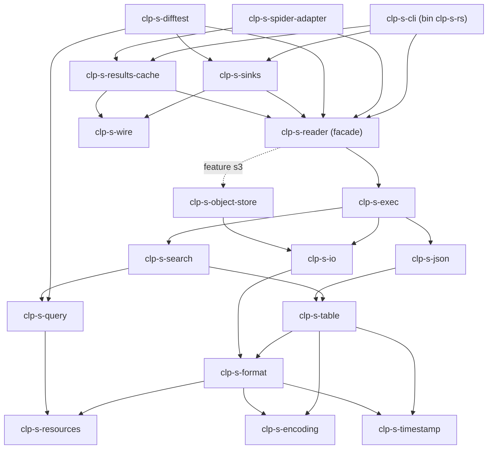

# Rust clp-s reader: design

This document has two parts: the architecture of the prototype for milestones M0-M3 (Part 1), and the search semantics it implements (Part 2). Section numbers without a part refer to Part 1. The public API is summarized in [api-overview.md](api-overview.md); test and benchmark results are in [prototyping-and-benchmark.md](prototyping-and-benchmark.md).

## Part 1. Prototype design (frozen for M0-M3)

**Date:** 2026-10-17. **Status:** frozen for this round.

This is the trimmed architecture for the prototype's delivery scope: single-file archives (SFA)
0.5.x from a file, memory or S3; unordered `extract`; search with KQL, time bounds,
case-insensitive matching and projection into stdout, msgpack file/network and the results cache
with session-wide top-k; unstructured arrays; archives ingested from kv-IR; and an in-process Spider
adapter. It is derived from the design report (§4-§5, §8 and §10.3) and the v1 architecture
document (§4-§5). Where this document and the report disagree, this document wins for this round.

**How to use this document.**

- The stub code under `crates/` *is* the contract. Every type, trait and function another crate
  relies on already exists there with its docstring and a `todo!("not implemented")` body. This
  document explains the contracts, the pipeline that connects them, and who builds what.
- Each milestone implements the stubs of the crates it owns (§12). It may add private items freely
  and may add public items to its own crates. **Changing a public signature that another crate
  uses is a deviation**: make it only if the contract cannot work, keep the change minimal, and
  record it ("deviation from this design §x: ...; reason: ...", see §15).
- Stub types carry a placeholder field `_private: ()` (or `PhantomData` for borrowed types) so the
  skeleton compiles warning-free. Replace it with the real private state. Stub bodies use
  `let _ = (...)` or `drop(...)` to consume parameters; delete that when implementing.
- A handful of trivial format facts are already implemented and tested (version packing, node-type
  numbering and dictionary references, placeholder bytes, saturating time bounds, the wire
  millisecond floor, exit codes, the CLI argument surface). Keep their tests green.

---

### 1. Decisions for this round

These trim or refine the report. Each is binding unless a deviation is recorded (§15).

| # | Decision | Report position | Why |
|---|---|---|---|
| D1 | `Archive::open` reads the header, metadata section **and schema layer** eagerly. | Schema layer loads on first need (§5.1.1). | The scope requires structured-array and other unsupported archives to fail at open, before any result. The schema layer is inside the first 64 KiB on nearly every archive. |
| D2 | Version window is [0.5.0, 0.5.x]. `FormatEpoch` has one variant (`V0_5`), kept `#[non_exhaustive]` as the seam. No `legacy-v0-4` feature. | [0.4.0, 0.5.x] with the feature. | Scope. 0.4.x is DV-43 (rejected). |
| D3 | Any `StructuredArray` node in the schema tree, and any schema with an unordered region, fails at open with `FormatError::UnsupportedFeature { feature: StructuredArrays }` (→ `UnsupportedArchive`). A directory location fails with `StorageError::MultiFileArchive` (→ `UnsupportedArchive`). | Supported (M8) / MFA supported. | Scope. |
| D4 | Decode policies: `SingleShot` for resident sources and for remote sources (one read of the whole compressed frame), `StableStreaming` in 1 MiB chunks for local files. No row windows, no `decode_retaining`, no `NeedsSections` protocol for stream reads. | Three policies plus row windows. | Scope (single-pass decode only). |
| D5 | Only `Executor::CurrentThread`. No worker pool, morsels, prefetch or concurrent fetch. `MemoryBudget` is try-only, unlimited by default; a stream that does not fit fails with `ResourceExhausted` (no degrade-to-windows). `BufferPool` recycles heap buffers; no mmap or huge pages. | Pool, THP, admission with degrade. | Scope. The seams (`Executor` enum, pool type, budget type) stay. |
| D6 | `ErrorKind` lives in `clp-s-resources` (L0), and every layer error has `kind()`. `ReadError::kind()` delegates. | `ErrorKind` in the exec layer. | Lets each layer own its mapping; `ReadError` stays a thin box-wrapper. |
| D7 | `clp-s-exec` defines the whole facade (`Archive`, `Scan`, `SearchSession`, sinks, errors); `clp-s-reader` only re-exports. `ArchiveLocation` is `File`, `Memory` or `Source(Arc<dyn ByteSource>)`; S3 is `Source(Arc::new(S3Source::new(..)?))`. | Facade owns `Archive`; `ArchiveLocation::S3` behind a feature. | No facade-only code to keep in sync; no cfg variant in an engine enum. |
| D8 | `OutputRequirements` has booleans (`is_json_needed`, `is_timestamp_needed`, `is_log_event_idx_needed`) and an optional required order. No `RecordNeed`, typed columns, `MetadataOnly` batches or string encodings. | `RecordNeed` enum, typed columns. | Only JSON is in scope; style guide prefers booleans over one-variant enums. |
| D9 | `RecordProjection` is defined in `clp-s-search` (re-exported by exec and the facade); `ResolvedProjection` (`Full` or sorted leaf `NodeId`s) is in `clp-s-table`. | Same split, `RecordProjection` in exec. | Search resolves the projection and must not depend on exec. |
| D10 | Top-k is an engine operator. Under `ResultOrder::LatestFirst { limit }` the session sorts archives by end timestamp (newest first), keeps one session-wide heap of `LatestFirstKey` with the winners' rendered JSON, delivers **no** batch to the per-archive partitions, and delivers the winners once, sorted by key, as one `BatchRows::Gathered` batch to an extra partition of kind `PartitionKind::TopK`. | Same operator; push sinks keep exact top-k. | Sinks stay trivial (the results-cache sink just inserts what it gets). |
| D11 | `LatestFirstKey::timestamp_ms` is in epoch **milliseconds** (floor of ns, DV-27), so the order equals the api-server's read-time sort over stored documents. | Unit unspecified. | The api-server sorts the stored (ms) value. |
| D12 | `LogicalExpr` derives `Clone`/`Debug`/`PartialEq`; depth is bounded by the parser (`QueryLimits::max_depth`, 1,024) and checked iteratively in `Query::from_expr`. Iterative `Drop`/`Clone` and serde are deferred. `Query::from_expr` borrows the expression. | Hand-written iterative impls, serde. | Every tree in this round comes from the parser or our own code. |
| D13 | One CLI binary, `clp-s-rs` (crate `clp-s-cli`, lib + bin), with the `results-cache` and `s3` features on by default. No signal handling: SIGINT/SIGTERM terminate the process (shells report 130/143); the cancellation token is wired but no signal maps to it. | Lean + remote binaries; signal-hook. | Scope; no new dependency. |
| D14 | The Spider adapter keeps the 7-parameter signature of `clp-tdl-package`'s `search`; shared resources (runtime, reader context, S3 and MongoDB clients) live in a process-wide `AdapterResources` installed with `AdapterResources::init`. | `reader_context(config)` as a package `OnceLock`. | Same idea; avoids an 8-parameter function (clippy `too_many_arguments`). |
| D15 | `clp-s-perf` is dropped; the query-performance report is the `perf` subcommand of `clp-s-difftest`. | Separate dev crate. | Only a simple report is needed this round. |

### 2. Crates

All crates live in `crates/<name>`; `publish = false`. Layers follow design report §4.1.

| Layer | Crate | Owns (this round) | Milestone |
|---|---|---|---|
| L0 | `clp-s-resources` | `CancellationToken`, `MemoryBudget`/`MemoryReservation`, `BufferPool`/`PooledBuffer`/`StreamBuffer`, `ErrorKind`, `ResourceError`, `SharedBytes` | M0b |
| L0 | `clp-s-encoding` | `VariablePlaceholder`, eight-byte integer/float variable encode and decode, `VariableTokenizer` (C++ `encoding_methods`) | M0b |
| L0 | `clp-s-timestamp` | 0.5.x `TimestampPattern` parse/format (`clp_s/timestamp_parser`) | M0b |
| L1 | `clp-s-format` | Header, version window, metadata packets (archive info, file info, timestamp dictionary, range index), schema tree/map, table metadata, `NodeTableIndex`, dictionaries, `ArchiveOpener`, `ArchiveIndex::plan_reads`, `StreamDecoder`, `TableBytes`, structural validation, `ReaderLimits` | M0a |
| L1 | `clp-s-io` | `ByteSource`, `FileSource`, `MemorySource`, `ResolvedSource`, `ArchiveStorage` (open, dictionaries, `read_stream`) | M0a |
| L1 | `clp-s-object-store` | `S3Source` (sequential bounded ranged GETs) | M3b |
| L2 | `clp-s-table` | `ColumnEncoding`, `ArchiveTables`, `TableLayout`/`RecordShape` (semantic validation), `Table`, `ColumnSet`/`ColumnDemand`, `Selection`, `TableScanner` windows, `ColumnBatch`, `ResolvedProjection`, the unstructured-array element scanner | M1a (array scanner: M2b) |
| L2 | `clp-s-json` | `RenderContext`, `JsonTemplate` (incl. projected templates), value writers, escaping, `JsonRecordBuffer`, `JsonOptions` | M1b |
| L3 | `clp-s-query` | KQL parser, `LogicalExpr`, `Query` (NNF, K3 folding, InSet folding), literal typing, `TextPattern`, reference evaluator (`Query::evaluate`, `JsonRecord`) | M0c |
| L3 | `clp-s-search` | `SearchPlanner` (Stage A), `ArchivePlanner` (Stages B-D), column resolver, timestamp/range-index pruning, dictionary prefilter + GrepCore port, `ArchiveSearchPlan`, projection resolution, `CompiledTableFilter` kernels, `TerminationStage` | M2a, M2b (MatchAll seed: M1c) |
| L4 | `clp-s-exec` | `ReaderContext`, `Archive`, `ScanRequest`, `Scan` (serial driver), `RecordBatch`/`OwnedBatch`, `Sink`/`PartialSink`, `SearchSession`, top-k operator, `ScanStats`, `ReadError` | M1c (top-k: M3a) |
| L5 | `clp-s-reader` | Re-exports only; feature `s3` re-exports `clp-s-object-store` as `clp_s_reader::s3` | M1c |
| L6 | `clp-s-wire` | `SearchResultTuple` msgpack encoding, `ResultsCacheField`, `epoch_ns_to_wire_ms` | M3a |
| L6 | `clp-s-sinks` | `JsonLinesSink` (M1c), `CollectSink` (M1c), `MsgpackResultSink` (M3a) | M1c, M3a |
| L6 | `clp-s-results-cache` | `ResultsCacheSink`, `connect_database` | M3a |
| L6 | `clp-s-cli` | `clp-s-rs extract` (M1c), `search` (M2c, outputs M3a, S3 M3b) | M1c-M3b |
| host | `clp-s-spider-adapter` | In-process `search` task, `AdapterResources` | M3c |
| dev | `clp-s-difftest` | C++ runner, canonicalizer (= `scripts/corpus.py`), multiset compare, divergence registry, corpus manifests, fixture/suite/dataset runs, `perf` | M0d (+ wiring in M1c, M2c, M3) |

**Dropped or merged:** `clp-s-cli-remote` (D13), `clp-s-perf` (D15), `clp-s-arrow`, `clp-s-ffi`,
`clp-ffi-bundle`, `clp-s-python` (out of scope). Every suggested crate is kept: `clp-s-wire` is
tiny but is shared by two sinks and is the unit under the C++-compatibility tests of the wire
format; `clp-s-encoding` and `clp-s-timestamp` are small but are the crates a future Rust writer
shares.

#### 2.1 Dependency graph



**Rules** (from design report §4.1.2, enforced by review):

- **DR1 downward only.** `clp-s-table` names no query crate; neither `clp-s-table` nor
  `clp-s-search` names `clp-s-json`; `clp-s-query` depends on nothing archive-related (only
  `clp-s-resources` for `ErrorKind`, and `serde_json` for the reference evaluator).
- **DR2 heavy dependencies at the edges.** tokio and aws-sdk-s3 only in `clp-s-object-store`,
  `clp-s-results-cache`, `clp-s-cli`, `clp-s-spider-adapter` (and difftest/dev-dependencies);
  mongodb only in `clp-s-results-cache`. `cargo tree -p clp-s-exec -e normal` must show none of
  them.
- **No process-global state in libraries** (no env vars, logger, panic hook, threads). Only
  `clp-s-cli`'s `run`, the difftest binary and `AdapterResources` (D14) hold process state.
- Dependencies are declared once in the root `[workspace.dependencies]` with exact patch versions,
  sorted; crates reference them with `workspace = true`. `clp-s-reader` is declared with
  `default-features = false`; a crate that needs S3 enables `features = ["s3"]`.

### 3. Storage contracts (`clp-s-resources`, `clp-s-format`, `clp-s-io`, `clp-s-object-store`)

#### 3.1 Resources

- `CancellationToken`: `new`, `cancel`, `is_cancelled`, `child` (cancelled with its parent, never
  the reverse), `check() -> Result<(), ResourceError::Cancelled>`. Cheap to clone and check (an
  `Arc` of atomics); `Default` is a fresh token.
- `MemoryBudget::new(Option<u64>) -> Arc<Self>`; `try_reserve(size) -> Result<MemoryReservation,
  ResourceError::BudgetExhausted>` never blocks; a reservation releases on drop.
- `BufferPool::new(BufferPoolConfig) -> Arc<Self>`; `acquire(capacity, reservation) ->
  Result<PooledBuffer, ResourceError::AllocationFailed>` (fallible: `try_reserve_exact`, checked
  `usize::try_from`; never zero-filled). `PooledBuffer::as_mut_vec()` exposes spare capacity for
  zstd; `freeze() -> StreamBuffer`; `StreamBuffer::into_shared_bytes()` wraps it in
  `bytes::Bytes::from_owner` so the allocation (and its reservation) returns to the pool when the
  last slice drops. Locks never poison (`parking_lot`).

#### 3.2 Format (sans-IO)

Format facts to port exactly (C++ references in brackets):

- **Header** (`SingleFileArchiveDefs.hpp`): 64 bytes little-endian: magic `fd 2f c5 30`, `u32`
  version, `u64` uncompressed size, `u64` compressed size, 4×`u64` reserved, `u32` metadata section
  size, `u16` compression type (0 = zstd), `u16` padding. `ArchiveHeader::parse(bytes, file_size)`
  validates it and classifies the version.
- **Metadata section** (`ArchiveReaderAdaptor.cpp`): one zstd frame after the header: `u8` packet
  count, then per packet `u8` type, `u32` size, payload. Types: 0 archive info (msgpack map,
  `num_segments` must be 1, else `UnsupportedFeature::NumSegments`), 1 file info (msgpack
  `{files: [{n, o}]}`: section name and offset relative to the end of the metadata section; the
  next offset, or `compressed_size`, ends a section), 2 timestamp dictionary, 3 range index
  (msgpack array of `{s, e, fields}`). Each payload is parsed from an exact slice of its declared
  size: trailing bytes tolerated, zero-length legal (DV-30). Unknown types are kept as
  `UnknownPacket`.
- **Timestamp dictionary** (`TimestampDictionaryReader.cpp`, `TimestampEntry.cpp`): entries (key,
  node ids, encoding + range), then `(u64 id, u64 length, bytes)` patterns. Keys are stored
  raw and never re-tokenized (DV-18). For 0.5.x each entry has exactly one node id. A pattern that
  fails to compile fails only `TimestampIndex::pattern(id)` (DV-32), never the open. Encoding
  values outside the known set are `Corrupt`.
- **Schema layer:** `/schema_tree` (nodes: parent id, key, type), `/schema_ids` (schema map),
  `/table_metadata` (stream directory, then `u64` count of separate column schemas, which must be
  0, then the per-schema `(schema id, stream id, stream offset, num rows)` records; the size of a
  table is the next table's offset or its stream's size, `ArchiveReader.cpp:119-187`). The three
  sections are contiguous; the opener fetches them in one range when the prefix missed them.
- **Validation** (structural tier, design report §4.2.5): counts fit the remaining bytes before any
  allocation; parents are the root or an earlier container node; `(parent, key, type)` unique;
  known node types; no `StructuredArray` (D3); depth ≤ `max_schema_tree_depth`; table offsets tile
  each stream; schema ids exist; `num_rows` fits `u32` (else `UnsupportedFeature::TableRowCount`).
  `TableInfo::first_record_ordinal` is the prefix sum of `num_rows` in directory order.
- **Dictionaries:** a section is a raw `u64` count and one zstd frame of `(u64 length, bytes)`
  records (`DictionaryReader.hpp`). Stored as one values buffer plus offsets. Logtype placeholders
  are indexed at load. `get(id)` is checked (ids from columns are untrusted). `find_exact` folds
  ASCII case when asked and returns every matching id.
- **Streams:** `StreamDecoder::decode_resident` / `begin`+`push_chunk`+`finish` decode exactly
  `read.decoded_prefix_size` bytes; the frame must fill its range exactly
  (`ZSTD_findFrameCompressedSize`). `decode_section` sizes by `ZSTD_decompressBound` under
  `ReaderLimits::max_section_decoded_size`. The static zstd APIs come from the `experimental`
  feature of `zstd-safe` (already enabled in the workspace).
- `ArchiveIndex::plan_reads(&TableSet, DictionaryNeeds) -> ReadPlan`: dictionary ranges plus one
  `StreamRead` per needed stream in ascending order, each with the prefix end of its last needed
  table (design report: prefix ends cut decoded bytes 18-59% on multi-ERT streams).

`ArchiveOpener` protocol: `new(options, file_size)`, then loop `advance()`: on
`NeedsData(ranges)` fetch each range and `push_range` it; on `MetadataReady` the caller may read
`metadata()`; on `IndexReady` call `into_index()`.

#### 3.3 I/O

- `ByteSource` (open set, `dyn` allowed): `capabilities() -> SourceCapabilities { is_resident,
  is_remote }`, `size()`, `read_exact_at(offset, buffer, &ReadContext)` (an interrupted read maps
  to `Cancelled`), `slice(range) -> Option<SharedBytes>` (default `None`).
- `ResolvedSource::{File, Memory, Dyn}` dispatches by enum; `ArchiveStorage` is not generic.
- `ArchiveStorage::open(source, &OpenOptions, &token)` drives the opener (D1). `index()`,
  `dictionaries()` (an `Arc<ArchiveDictionaries>` of three `OnceLock`s that the table and search
  layers read), `load_dictionaries(needs, &token)` (a failed load leaves its cell empty),
  `read_stream(read, &mut decoder, buffer, &options) -> SharedBytes` (policy D4),
  `num_bytes_read()`.
- `S3Source::new(client, runtime_handle, S3Location { bucket, key }, S3SourceConfig)`: rejects a
  current-thread runtime, issues `HeadObject` for the size; each read is one or more bounded
  `Range: bytes=a-b` GETs, blocking on the runtime (never call it from inside an async task). The
  library reads no environment: the CLI and the adapter build the client.

### 4. Data model contracts (`clp-s-table`)

- `ColumnEncoding::of_node_type(NodeType) -> Result<Option<Self>, LayoutError>` is the only map
  from node types to bytes: `Integer`→`Int64`, `DeltaInteger`→`DeltaInt64`, `Float`→`Float64`,
  `FormattedFloat`→`FormattedFloat64`, `DictionaryFloat`→`DictionaryFloat`, `Boolean`→`Boolean`,
  `ClpString`→`ClpString`, `VarString`→`VariableString`, `UnstructuredArray`→`UnstructuredArray`,
  `Timestamp`→`Timestamp`; `Object`, `NullValue`, `Metadata` occupy no bytes;
  `DeprecatedDateString`, `StructuredArray` are `UnsupportedNodeType`. Element layouts follow
  `ColumnReader.hpp` (alignment-1 `LeI64`/`LeU64`/`LeF64`/`LeU16` from `zerocopy`; ClpString is
  `u64` logtype words with the variable offset in bits ≥ 24 plus an `i64` variable region;
  Timestamp is delta-encoded `i64` epoch ns plus `u64` pattern ids).
- `ArchiveTables::new(index, dictionaries)`; `layout(table) -> Result<Arc<TableLayout>,
  LayoutError>` compiles lazily, once per table (semantic tier: nodes exist, strictly increasing
  ids per schema, which catches B4).
- `TableLayout`: `columns()` in buffer order (`ColumnIndex(i)` is element `i`, the only column
  identity), `columns_for_node(node)`, `log_event_idx_column()`, `record_timestamp_column()` (the
  authoritative timestamp node's column in this table), `shape()`.
- `RecordShape::events()`: the default-namespace record as a flat event list (`BeginObject`,
  `EndObject`, `Column`, `Null`, `EmptyObject`) in C++ key order (`SchemaReader` local-tree
  insertion order). Keys come from the schema tree by node id. `@` keys and metadata are not part
  of the shape (C++ omits them from JSON too).
- `Table::load(Arc<ArchiveTables>, TableBytes)`: O(columns) tiling check plus per-row variable
  range checks; then `info()`, `layout()`, `archive()`, `num_rows()`.
- Scanning with owned state: `TableScanner::new(batch_num_rows)`; `start(Arc<Table>,
  Arc<ColumnDemand>) -> TableScanState`; `next_window(&mut state) -> Option<WindowParts>` decodes
  the evaluation columns of at most `batch_num_rows` rows and returns an **empty** selection;
  `finish_window(&state) -> u32` decodes output-only columns if any row is selected and returns the
  count; `batch(&state) -> TableBatch`. The table layer never checks a token; the driver checks
  between windows.
- `Selection`: `u64` words, bit `i % 64` of word `i / 64`, tail bits clear; `select_all`,
  `select`, `is_selected`, `count`, `words`/`words_mut` (+ `mask_tail`), `extend_indices`.
- `ColumnBatch<'batch>` is the kernel and writer vocabulary (one variant per encoding; delta
  columns already prefix-summed per window). `EncodedTextBatch` gives `logtype_id(row)`,
  `variables(row)` (checked), the dictionaries, and `decode(row, &mut Vec<u8>)` (raw text; for
  arrays the JSON array text).
- `TableBatch`: `table()`, `first_row()`, `num_rows()`, `selection()`, `column(i)`,
  `record_id(row)` (`log_event_idx` if recorded, else `first_record_ordinal + first_row + row`),
  `log_event_idx(row)`, `record_timestamp_ns(row)`. Rows are window-relative.
- `ResolvedProjection::{Full, Nodes(sorted ids)}`: `includes(node)`, `output_columns(layout)`.
- `scan_array(text, visit)`: walks a decoded unstructured array (events `BeginArray`, `EndArray`,
  `BeginObject`, `EndObject`, `Key`, `Scalar`), typing numbers like the C++ JSON parser
  (`Integer`, `UnsignedInteger`, `Float`). Built in M2b for array search; JSON output writes
  arrays raw and never calls it.

### 5. JSON contracts (`clp-s-json`)

- `RenderContext::new(Arc<ArchiveTables>)`; `template(table, &ResolvedProjection, &JsonOptions)
  -> Arc<JsonTemplate>` compiled on first use and cached per (table, projection, options).
- `JsonTemplate::bind(TableBatch, &RenderContext) -> BoundJsonTemplate`;
  `write_selected(&mut JsonRecordBuffer) -> u32` appends every selected row in row order;
  `write_rows(&[u32], &mut JsonRecordBuffer)` appends chosen rows (top-k winners).
- `JsonRecordBuffer`: records back to back, each followed by `\n`, plus `i32` offsets;
  `record(i)` excludes the newline, `as_jsonl()` includes them, `byte_size()`.
- Output rules: C++ bytes except the registered fixes. Plain floats print shortest round-trip
  (DV-01) unless `should_emulate_cpp_plain_floats`; non-finite floats print `null` (DV-02);
  FormattedFloat and DictionaryFloat reproduce the stored text exactly; unstructured arrays are
  written raw; timestamps are formatted with their pattern (numeric patterns unquoted); escaping is
  the byte-local C++ escaping (`Utils.cpp`), so the fused ClpString decode-and-escape writer is
  valid. Projected templates follow C++ `Projection` output: only projected leaves, ancestors
  kept, `{}` for a record with none.

### 6. Query and search contracts (`clp-s-query`, `clp-s-search`)

#### 6.1 `clp-s-query`

- `LogicalExpr::parse_kql(text, &QueryOptions)`: hand-written port of `search/kql/Kql.g4`: AND/OR
  equal precedence and left-associative, NOT tighter, list syntax, nested `col: {q}`, `$`/`@`
  namespaces, escapes, and `istringstream`-compatible numbers (`0x10`, `inf`, `nan`, `1e400` are
  text). `ColumnPattern::parse` uses the same column grammar (projections).
- `Query::from_kql` / `from_expr` normalize once: NNF, K3 constant folding (an AND of nothing is
  True), flattening, leaf hash-consing, `*`/`*:*` → `MatchAll`, `NOT *` → `MatchNone`, ORs of
  equalities on one column → `PredicateTest::InSet`; column patterns stay quantified leaves.
  `with_time_bounds` ANDs an `AuthoritativeTimestamp` leaf. `root()`, `leaves()` (`LeafId(i)` is
  element `i`).
- `Query::evaluate(&impl RecordValueSource) -> TruthValue` is the executable spec of design report
  §8.1: existential predicates, K3 connectives, a record matches iff the root is True, `Exists` is
  never Unknown, objects and empty containers satisfy `Exists`, the storage rule (a string with a
  space is stored as ClpString; a Text pattern without a space is False on ClpString values),
  ASCII-only case folding, the literal-typing table. `JsonRecord::new(&serde_json::Value,
  timestamp)` is the source over raw input records (the oracle the difftest uses).
- Pending maintainer questions take the design report §8.2 recommendations: integer literal vs
  Timestamp in epoch ms (DV-15), timestamp vs Float in seconds, objects satisfy `Exists` (DV-19),
  `null` matches the text `"null"`, wildcards descend into arrays (DV-36), empty keys are never
  transparent (no structured arrays; DV-16), AND/OR precedence kept, `AnyLeaf` searches `@` leaves.

#### 6.2 `clp-s-search`

- `SearchPlanner::new(Arc<Query>, &RecordProjection, PlanLimits)` (rejects wildcard or repeated
  projection columns). `prune_on_metadata(&ArchiveMetadata) -> Option<PruneReport>` is Stage A
  (time leaves against the authoritative range, range-index leaves).
  `plan_archive(Arc<ArchiveTables>) -> ArchivePlanner`.
- `ArchivePlanner::advance() -> PlanStep::{NeedsDictionaries(needs), Pruned(report),
  Planned(Arc<ArchiveSearchPlan>)}`: Stage B (resolve each distinct pattern once against the
  MPT into node sets; per-table outcome sets with may/must; timestamp-index refinement for every
  bound column whose node is the authoritative timestamp node), Stage C (VarString id sets through
  `find_exact`/scans; ClpString through the GrepCore heuristic port with the D13 fixes, DV-17),
  Stage D (per-table folding into shared residual templates). The caller loads requested
  dictionaries into the archive's `ArchiveDictionaries` and advances again.
- `ArchiveSearchPlan`: `archive_tables()`, `tables()` (candidates in directory order, each
  `TableSearchPlan { table, num_rows, filter: MatchAll | Residual(ResidualFilter) }`),
  `projection()` (resolved), `filter_dictionary_needs()`.
- `CompiledTableFilter::compile(&plan, &residual, &layout)`; `required_columns() -> &ColumnSet`;
  `evaluate(WindowParts, &mut EvaluationScratch)` selects exactly the True rows. Kernels are
  polarity-aware (a negated single-column leaf selects F; a negated multi-column leaf selects
  `(∪F) & ¬(∪T)`, DV-05), short-circuit through active masks, and evaluate array leaves per row with
  pre-coerced element tests (DV-11, DV-12, DV-13).
- `TerminationStage` keeps the C++ strings; `PruneReason` explains empty plans (e.g.
  `NoTimestampColumn` for DV-20).

### 7. Execution and the public facade (`clp-s-exec`, `clp-s-reader`)

#### 7.1 Facade types

| Type | Contract |
|---|---|
| `ReaderContext` | `builder().memory_budget_size(Option<u64>).config(ExecutionConfig).build() -> Arc<Self>`; holds the executor (`CurrentThread`), config, pool and budget. `ExecutionConfig { batch_num_rows = 4096, max_rendered_batch_size = 256 KiB, stream_chunk_size = 1 MiB, open_options }`. |
| `ArchiveId` | `Arc<str>` newtype; `From<&str>`, `From<String>`, `Display`, ordered. For files, the last path component (C++ parity: fixtures report `<fixture>.clps`). |
| `ArchiveLocation` | `File(PathBuf)` (a directory fails, D3), `Memory(SharedBytes)`, `Source(Arc<dyn ByteSource>)`. |
| `Archive` | `open(Arc<ReaderContext>, ArchiveId, ArchiveLocation)` (D1), `info() -> &ArchiveInfo { archive_id, version, num_log_events, has_log_order, timestamp_range_ms, file_size }`, `tables()`, `scan(Arc<ScanRequest>, CancellationToken) -> Scan`. `Clone + Send + Sync`. |
| `ScanRequest` | `builder().query(Query).time_bounds(TimeBounds).projection(RecordProjection).outputs(OutputRequirements).order(ResultOrder).json_options(JsonOptions).build()`; getters. The time bounds are folded into the query at build. |
| `OutputRequirements` | `none()`, `json()`, `with_timestamps()`, `with_log_event_indices()`, `with_required_order()`, `merge()` (conflicting required orders fail). |
| `ResultOrder` | `Any` (default), `Scan`, `LatestFirst { limit }`. With one thread `Any` and `Scan` both give archive order, then directory order, then row order (DV-28 parity). |
| `Scan` | `advance() -> bool`, `current() -> Option<RecordBatch>`, `next_batch()`, `stats()`, `cancellation_token()`. `Send`. `LatestFirst` on a pull cursor returns one gathered batch at the end. |
| `RecordBatch<'batch>` | Selected-record ordinal index space: `num_records()`, `archive_id(i)`, `record_ids()`, `timestamps_ns()` (if requested), `log_event_indices()` (if requested), `json()` (if requested), `rows()` (`BatchRows::Table(TableBatch)` or `Gathered(&OwnedBatch)`). Never empty. |
| `OwnedBatch` | Owned records (archive id, record id, timestamp, `log_event_idx`, JSON) for the top-k winners. |
| `SearchSession` | `builder(context, request).archive(id, location)….cancellation_token(t).skip_failed_archives(b).build()`; `run(Arc<SinkType>) -> SessionReport { output, archive_summaries }`. |
| `Sink` / `PartialSink` | design report §5.2 shape: `requirements()`, `merge_order()`, `open_partial(&PartitionInfo)`, `merge(&mut output, partial)`; `consume(&RecordBatch) -> SinkControl`, `finish(&PartitionSummary)`. `SinkControl::{Continue, StopArchive, StopSession}` (stops end the session with `Ok`). `PartitionInfo { index, kind: Archive(id) \| TopK, order }`. |
| `ReadError` | ≤ 32 bytes (compile-time assert), boxed layer errors, `InArchive { archive_id, source }`, `kind()`. |
| `LatestFirstKey` | `{ timestamp_ms, archive_id, record_id }`, `Ord`: timestamp descending with `None` last, archive id ascending, record id ascending (D11). |
| `ScanStats` | Mergeable counters (tables planned/scanned, rows scanned, records selected, streams decoded, decoded bytes, bytes read). |

`clp-s-reader` re-exports these plus `Query`, `QueryOptions`, `TimeBounds`, `ColumnPattern`,
`LogicalExpr`, `QueryError`, `CancellationToken`, `ErrorKind`, `JsonOptions`,
`JsonRecordBuffer`, `RecordProjection`, `TerminationStage`, `PruneReason`, `RecordId`,
`TableInfo`, `FormatVersion`, `SharedBytes`, `ByteSource`, `ReadContext`, `SourceCapabilities`,
and with feature `s3` the module `clp_s_reader::s3` (`S3Source`, `S3Location`, `S3SourceConfig`,
`S3Client`, `ObjectStoreError`).

#### 7.2 The serial per-archive pipeline

`Scan` and each archive partition of a session run the same driver:

1. **Open** (`Archive::open`): resolve the location (`File` → `FileSource::open`, a directory →
   `StorageError::MultiFileArchive`), `ArchiveStorage::open`, build `ArchiveTables` and a lazy
   `RenderContext`.
2. **Stage A:** `planner.prune_on_metadata(metadata)`; pruned → no batch, summary records the
   stage and reason.
3. **Stages B-D:** `planner.plan_archive(tables)` and `advance()` until `Pruned` or `Planned`,
   loading requested dictionaries in between.
4. **Demand:** per candidate table, evaluation columns = the compiled filter's
   `required_columns()` (empty for `MatchAll`); output columns = `projection.output_columns(layout)`
   if JSON is needed, plus the record-timestamp column if timestamps are needed (always under
   `LatestFirst`), plus the `log_event_idx` column if indices are needed. Dictionary needs = the
   plan's filter needs ∪ every candidate demand's `dictionary_needs`; load them before decoding.
5. **Read plan:** `index.plan_reads(candidates, needs)`; for each `StreamRead` in order: check the
   token, `budget.try_reserve(decoded_prefix_size)` (failure → `ResourceExhausted`),
   `pool.acquire`, `storage.read_stream` (D4). Release a stream (drop its `SharedBytes`) before
   reading the next.
6. **Tables:** per needed table of the stream, in directory order: check the token,
   `TableBytes::new` + `Table::load`, `scanner.start`.
7. **Windows:** loop `next_window`: check the token; `MatchAll` → `select_all`, else
   `filter.evaluate`; `finish_window`; skip windows with no selected row; otherwise
   `extend_indices`, gather record ids / timestamps / indices for the selected rows, render JSON
   with the bound template if needed (splitting a window into several batches once the buffer
   exceeds `max_rendered_batch_size`), and deliver the `RecordBatch` (pull: `current()`; push:
   `PartialSink::consume`).
8. **Top-k** (`LatestFirst`, D10): instead of delivering, compute each selected row's
   `LatestFirstKey`, render only rows that enter the heap (`write_rows`), keep their owned records;
   after the last archive, deliver the winners sorted by key to the `TopK` partition.
9. **Summary:** termination stage, prune reason, `ScanStats`, and (if failed archives are skipped)
   the error.

Ownership: tables hold `Arc`s of their stream bytes, so a batch never outlives its storage; the
driver keeps one `TableScanner`, one `StreamDecoder`, one `EvaluationScratch` and one
`JsonRecordBuffer`, reused across tables and archives. `tracing` spans `clp_s.open`, `clp_s.plan`,
`clp_s.scan` per archive, never per batch.

#### 7.3 Built-in sinks

| Sink | Requirements | Merge order | Behaviour |
|---|---|---|---|
| `JsonLinesSink<W: Write + Send>` | JSON | `Scan` | Writes `json().as_jsonl()` per batch to the shared writer; `EPIPE` → `SinkError::DownstreamClosed`. Output `u64` record count. Used by `extract` (`OUTPUT_DIR/original`, opened in append mode, C++ parity) and `search --output stdout`. |
| `CollectSink` | JSON + timestamps + indices | `Scan` | Collects `CollectedRecord`s (tests, difftest). |
| `MsgpackResultSink<W>` | JSON + timestamps + indices | `Commutative` | One `SearchResultTuple { timestamp_ms, message, "", archive_id, log_event_idx }` per record, buffered per batch, one writer per session (DV-21, DV-22). Missing timestamp → 0 (DV-34); invalid UTF-8 → U+FFFD (DV-45). |
| `ResultsCacheSink` | JSON + timestamps (as built, §15 X3) | `Commutative` (as built, §15 X3) | `insert_many` (unordered) in `batch_size` chunks of `{_id: {archive_id, log_event_idx}, orig_file_path: "", message, timestamp, dataset}`; duplicate-key-only failures tolerated (retry idempotence). Under `LatestFirst` it simply inserts the gathered winners. |

The `log_event_idx` written on the wire and in `_id` for archives without log order must match
what C++ writes; check it against the msgpack and results-cache oracles (DV-24 applies only if C++
collides).

### 8. Errors

| Layer error | Variants → `ErrorKind` |
|---|---|
| `ResourceError` | `Cancelled` → Cancelled; `BudgetExhausted`, `AllocationFailed` → ResourceExhausted |
| `FormatError` | `Corrupt` → CorruptArchive; `UnsupportedVersion`, `UnsupportedFeature` → UnsupportedArchive; `LimitExceeded` → ResourceExhausted |
| `StorageError` | `Format(e)` → e.kind(); `Io`, `Open` → Io (Interrupted → Cancelled); `MultiFileArchive` → UnsupportedArchive; `Cancelled` → Cancelled |
| `ObjectStoreError` | `CurrentThreadRuntime` → InvalidArgument; `Head`, `MissingContentLength` → Io |
| `LayoutError` | `UnknownTable` → Internal; `UnknownSchema`, `UnknownNode`, `NodeOrder` → CorruptArchive; `UnsupportedNodeType` → UnsupportedArchive |
| `TableError` | `Layout`/`Format` → inner; `Encoding`, `ColumnTiling`, `VariableOutOfRange`, `InvalidArray` → CorruptArchive; `ColumnNotDecoded`, `DictionaryNotLoaded` → Internal |
| `JsonError` | `Table`/`Format` → inner; `Timestamp` → UnsupportedArchive (DV-32); `BufferOverflow` → ResourceExhausted |
| `QueryError` | all → InvalidQuery |
| `PlanError` | `Format`/`Layout` → inner; `InvalidProjection` → InvalidArgument; `LimitExceeded` → ResourceExhausted; `DictionaryNotLoaded` → Internal |
| `EvalError` | `Table`/`Layout` → inner; `PlanMismatch` → Internal |
| `SinkError` | `Read(e)` → e.kind(); everything else → Sink |
| `ReadError` | `InvalidArgument` → InvalidArgument; `Internal` → Internal; boxed variants and `InArchive` → inner |

Variants are added as checks are ported (`CorruptionReason` has one variant per structural
check, so tests can assert the exact reason), and `kind()` stays exhaustive. Error messages start
lowercase and have no trailing period; log messages start uppercase and end with a period. "No
matches" is never an error.

### 9. CLI (`clp-s-rs`)

```
clp-s-rs extract (x) <ARCHIVE_PATH>... -o <OUTPUT_DIR> [--archive-id ID]
                     [--auth none|s3 [--s3-region R] [--s3-endpoint-url URL]]
clp-s-rs search (s) <ARCHIVE_PATH>... -q <KQL> [--archive-id ID]
                     [--time-begin-ms|--tge MS] [--time-end-ms|--tle MS] [-i|--ignore-case]
                     [--projection COL...]
                     [--output stdout|file|network|results-cache]
                     [--path P] [--host H --port N]
                     [--uri MONGODB_URI_WITH_DB --collection C --dataset D --batch-size N]
                     [--max-num-results K]
                     [--auth none|s3 [--s3-region R] [--s3-endpoint-url URL]]
```

- **Inputs:** each `ARCHIVE_PATH` is an SFA file, a directory whose regular files are SFAs (a
  subdirectory is a multi-file archive and fails), or with `--auth s3` an `s3://bucket/key` URL.
  `--archive-id ID` selects `DIR/ID`. The archive id is the last path or key component. All inputs
  of one invocation form one session, in argument order (directory entries sorted by name).
- **extract:** unordered, appends JSON lines to `OUTPUT_DIR/original` (created if missing).
  `--ordered` is rejected ("not supported by this reader", exit 1).
- **search:** `--max-num-results K` sets `ResultOrder::LatestFirst { limit: K }` (any output);
  without it the order is `Scan`. `--count`, `--count-by-time` are rejected (exit 1).
- **Credentials:** with `--auth s3`, `run` builds the client from the default AWS chain
  (`aws-config`), with path-style addressing when an endpoint is given. Nothing below the CLI reads
  the environment.
- **Exit codes** (`exit::exit_code`): 0 success (including no matches, a query that folds to False
  and DV-20), 1 invalid arguments or query (clap usage errors are remapped from 2 to 1), 2 corrupt
  or unsupported archive, 3 I/O, 4 sink, 5 resource exhausted, 70 internal, 130 cancelled.
- Logging: `tracing-subscriber` to stderr, filtered by `RUST_LOG` (default `warn`), installed only
  in `run`.

### 10. Divergences in scope and how the difftest treats them

Every entry has a registry tag in `clp_s_difftest::registry`, at least one positive case in
`tests/queries/suite.toml` (`divergence = [...]` plus `expected_rust_ids`/`expected_rust_count`)
or a dedicated test, and a classifier.

| Entries | In scope? | Difftest treatment |
|---|---|---|
| DV-01 (shortest round-trip floats), DV-02 (non-finite → `null`) | yes | `FloatNormalization`: a mismatching record pair is accepted iff they are equal after reformatting Rust plain floats with C++'s `%f`-based rule (or after `should_emulate_cpp_plain_floats`), and C++'s `nan`/`inf` tokens are mapped to `null`. Fixture `x` comparison is exact otherwise. |
| DV-05..DV-14, DV-17, DV-19, DV-36..DV-39 (search semantics) | yes | `DeclaredByCase` / `ArchiveDependence`: the case must list the DV; the Rust result must equal `expected_rust_ids` (derived from the reference model) **and** the Rust reference evaluator over the input JSON; C++ must differ. A Rust result equal to C++ for a declared case fails ("divergence no longer occurs"). The archive-dependence classifier (design report §8.3) re-runs C++ on single-record archives for undeclared mismatches and only *suggests* an entry. |
| DV-15 (integer literal vs Timestamp in ms) | yes | `DeclaredByCase`. |
| DV-16 (empty keys transparent only under structured arrays) | yes, degenerate | No structured arrays, so empty keys are never transparent; `DeclaredByCase` where C++ treats them as transparent. |
| DV-18 (timestamp index by node id) | yes | Results unchanged; no record mismatch expected. |
| DV-20 (logically false / `--tge` without timestamp: exit 0, all archives searched) | yes | `OutputShape`: exit code and per-archive summaries checked by CLI tests. |
| DV-21, DV-22 (file output opened once; network metadata, one connection) | yes | `OutputShape`: msgpack tuples compared as multisets against `oracles/msgpack/` for single-archive cases; multi-archive cases checked for "no truncation". |
| DV-23 (sink failure exit 4) | yes | `OutputShape` (closed pipe / refused connection test). |
| DV-24 (`_id` collisions) | yes, if C++ collides | `OutputShape` against `oracles/results-cache/`. |
| DV-25 (session-wide top-k, total-order ties) | yes | Single-archive top-k compared with C++ (per-archive = session-wide); multi-archive and tie cases compared with the reference evaluator plus `LatestFirstKey`. |
| DV-27 (ns→ms floor), DV-34 (missing timestamp 0 on the wire, sorted last) | yes | `OutputShape`; only pre-1970 timestamps differ for DV-27. |
| DV-28 (order under a pool) | n/a | One thread: order equals C++; unordered output is compared as multisets anyway. |
| DV-29/DV-43 (version window [0.5.0, 0.5.x]) | yes | `ExpectedRejection` (`UnsupportedArchive`) on header-patched copies. |
| DV-30 (trailing timestamp-dictionary bytes, zero-length packets, empty archives readable), DV-31 (typed errors on corruption), DV-35 (B4 error names the table) | yes | Unit tests with mutated archives in `clp-s-format`/`clp-s-table`; no panic under any single-byte or size-field mutation of a fixture. |
| DV-32 (unparsable timestamp pattern fails only rendering) | yes | Unit test with a patched pattern. |
| DV-41 (unsigned range-index values exact), DV-42 (saturating `--tge`) | yes | Unit tests (DV-42 exists already). |
| DV-45 (U+FFFD on the wire, bytes passed through in JSON lines) | yes | `OutputShape` on the `strings` fixture (lone surrogates). |
| DV-47 (range-index leaves under NOT: K3 over each record's range-index fields, where C++ rewrites them into `log_event_idx` ranges after NarrowTypes) | yes; registered during M2 in `tests/divergences.toml`, not yet in design report §8.3 | `DeclaredByCase`: `meta-not-filename`, `meta-not-filename-and-level`, `meta-not-exists-filename-nolog`. |
| DV-03, DV-04, DV-26, DV-33, DV-40, DV-44, DV-46 | no | Structured arrays, 0.4.x, chunked extraction, FFI, Velox and typed output are out of scope. |
| SX-01 multi-file archive, SX-02 structured arrays, SX-03 version outside [0.5.0, 0.5.x] | scope exclusions | `ExpectedRejection`: `fixtures/archives/reject/*` must fail at open with `UnsupportedArchive` (exit 2) before any output. |

A mismatch that no rule accepts is a bug, reported with the canonical records on both sides.

### 11. Test plan

1. **Unit tests in every crate** for every non-trivial behaviour, including error paths on corrupt
   or unsupported input; `anyhow::Result` test functions where fallible, `expect` with
   descriptive messages, assertions that print the failing value, no `unwrap`. Important tests
   are validated against the defect they guard (break, see it fail, restore).
2. **Fixture equivalence** (`clp-s-difftest` integration test `tests/fixtures.rs`, plus
   `clp-s-difftest fixtures`): for every `[[archive]]` of `tests/fixtures/manifest.toml`, the Rust
   reader opens the archive and decompresses it; the canonical digest (`canonical.rs`, equal to
   `corpus.py`'s) must equal `oracle_canonical_sha256`, and on mismatch the multiset diff is
   printed.
   Reject archives must fail with `UnsupportedArchive` at open. Run both through the library and
   through `clp-s-rs extract`.
3. **Query-suite equivalence** (`clp-s-difftest queries`): every `[[query]]` of
   `tests/queries/suite.toml` against its fixture target (all of the fixture's archives as one
   session) or dataset, for each requested output (stdout, msgpack, results cache via a
   `proto-`-prefixed `mongo:8.0.21` container), compared with `tests/queries/oracles/manifest.toml`
   under §10's rules. The library path and the CLI path must give identical digests.
4. **Datasets** (bench, spider, synthetic; archives and oracles listed in
   `tests/queries/datasets.toml`): `x` canonical digest equality, and every dataset query of the
   suite (the C++ baseline workloads: rare/common equality, ranges, ClpString wildcards, bare
   values, `NOT`, time ranges, `*`, array search, `poly_range` with DV-11's expected 30,781).
5. **Performance report** (`clp-s-difftest perf`, release build, `taskset -c 8-15`, warm cache,
   5 runs, median and min-max): wall time and peak RSS of C++ `clp-s s` vs `clp-s-rs search` (stdout
   to `/dev/null`, and to a file) for every dataset query, plus `x`. Raw results go to
   `$PROTO_DATA_ROOT/perf/<date>.json`, and the command prints the table. No performance gate
   this round.
6. **S3** (M3b): `S3Source` against MinIO in a `proto-minio` container if the image can be pulled,
   else against an in-test HTTP mock that implements ranged GETs; the fixture corpus decompresses
   identically through S3 and from files.
7. **Spider end-to-end** (M3c): `search` with a filesystem config and an S3 config against
   `proto-` MongoDB (and MinIO); results-cache documents equal the C++ results-cache oracle for the
   same query; a retried task inserts no duplicates.

### 12. Milestones and boundaries

Each milestone owns the listed crates (and their tests). Touching another crate's public surface
is a deviation (see "How to use this document"). Work in parallel within a milestone against the
stubs; integrate in order.

#### M0 (foundations; four parallel tracks)

- **M0a — `clp-s-format`, `clp-s-io`.** Everything in §3.2-§3.3 except S3: header, version
  window, metadata packets, file-info section table, timestamp dictionary (with patterns via
  `clp-s-timestamp`), range index, schema tree/map, table metadata, `NodeTableIndex`,
  dictionaries, `ArchiveOpener`, `plan_reads`, `StreamDecoder`, `TableBytes`, structural
  validation, `ReaderLimits`, `FileSource`, `MemorySource`, `ArchiveStorage`. Gate: every fixture
  archive opens (index, dictionaries, every stream decoded and tiled); every reject archive fails
  with the right kind; no panic on truncation and single-byte mutations of every fixture.
- **M0b — `clp-s-resources`, `clp-s-encoding`, `clp-s-timestamp`.** §3.1; the variable encodings
  and tokenizer byte-exact with `clp/ffi/encoding_methods`; timestamp patterns of
  `clp_s/timestamp_parser` (parse every pattern in the fixture and dataset archives, format equal
  to the C++ output in the oracles).
- **M0c — `clp-s-query`.** §6.1: parser, IR, NNF, literal typing, `TextPattern`, reference
  evaluator over JSON. Gate: every `kql` of `suite.toml` parses; the reference evaluator reproduces
  `expected_rust_ids` / the reference model results recorded by `gen-oracles.sh`.
- **M0d — `clp-s-difftest`.** C++ runner, canonicalizer byte-identical to `corpus.py` (checked
  against every oracle's `canonical_sha256`), multiset compare, registry (§10), manifest loaders,
  CLI subcommand skeletons (`fixtures`, `queries`, `datasets`, `perf`) whose Rust side is wired in
  M1-M3.

#### M1 (unordered extract)

- **M1a — `clp-s-table`** (§4, except `scan_array`). Gate: layouts compile for every fixture
  table; scanning every column of every fixture yields the values the oracles imply.
- **M1b — `clp-s-json`** (§5), including projected templates. Gate: rendering every fixture table
  equals the C++ oracle bytes up to DV-01/DV-02.
- **M1c — `clp-s-exec`, `clp-s-reader`, `clp-s-sinks` (`JsonLinesSink`, `CollectSink`),
  `clp-s-cli extract`**, the MatchAll seed of `clp-s-search` (`SearchPlanner` and
  `ArchivePlanner` for `NormalExpr::MatchAll` with full projection: no pruning, every table
  `MatchAll`; M2a replaces it), and the difftest wiring for extract (§11.2, §11.4 `x`). Gate:
  fixture and dataset `x` equivalence.

#### M2 (search)

- **M2a — `clp-s-search` planner:** resolver, Stages A-D, timestamp- and range-index pruning,
  dictionary prefilter including the GrepCore port, projection resolution.
- **M2b — kernels:** `CompiledTableFilter`, all leaf kernels and connectives, `scan_array` in
  `clp-s-table`.
- **M2c — search integration:** filtered scans in `clp-s-exec`, `clp-s-rs search` with stdout
  output, difftest on the query suite (stdout outputs) and the datasets, and the performance report
  (§11.5). Gate: every stdout case passes under §10.

#### M3 (outputs, S3, Spider)

- **M3a — `clp-s-wire`, `MsgpackResultSink`, `clp-s-results-cache`, the top-k operator in
  `clp-s-exec`, CLI `--output file|network|results-cache` and `--max-num-results`.** Gate: msgpack
  and results-cache cases of the suite pass.
- **M3b — `clp-s-object-store` `S3Source`, CLI `--auth s3`.** Gate: §11.6.
- **M3c — `clp-s-spider-adapter`** and end-to-end tests. Gate: §11.7.

### 13. Workspace and tooling

- Root: this directory, a standalone workspace (resolver 3, edition 2024), not a member of the
  repository workspace. The repository's `.cargo/config.toml` applies here too: clippy `all`,
  `pedantic` and `nursery` are denied, so `#[must_use]`, `const fn`, backticked identifiers in
  docs (`ClpString`), short first doc paragraphs, and `# Errors` sections are enforced.
- Gates: `scripts/lint.sh -p <crate>...` (fmt check, clippy `-D warnings`, tests); without `-p`
  it runs on the whole workspace. `CARGO_TARGET_DIR` defaults to the workspace's `target/`.
- `Cargo.lock` lives at the workspace root and was seeded from the repository's lock, so shared
  crates resolve to the same versions. Every crate already lists the workspace dependencies it is
  expected to need; adding a new external crate requires adding it to the root table (exact
  version, sorted). `sha2 0.10.9` (difftest digests, already in the
  repository lock) and `toml 0.9.12` (corpus manifests) were added for the difftest.
- Large artifacts go under `$PROTO_DATA_ROOT` (default: the workspace's `target/proto-data`),
  never into the repository (`tests/README.md`). The corpus (`tests/`, `scripts/build-fixtures.sh`,
  `scripts/gen-oracles.sh`, `scripts/corpus.py`) is generated from the C++ binary; treat it as
  read-only input and regenerate it with the scripts instead of editing generated files.

### 14. Facts to verify against C++ (before relying on them)

- The unit of the timestamp passed to the C++ output handlers (wire and results cache): D11 and
  DV-27 assume milliseconds.
- What C++ writes as `log_event_idx` (tuples and `_id`) for archives built with
  `--disable-log-order`.
- Whether C++ renders `@` keys and metadata in `x` output (design report §3.2 says they are dropped;
  the shape excludes them).
- The exact `%f`-based plain-float format of `SchemaReader.cpp` (DV-01 normalization).
- How the C++ time bounds compare at row level (inclusive bounds; ms vs ns) and at index level
  (`EvaluateTimestampIndex.cpp`), so DV-15/DV-42 cases are derived correctly.
- The archive id of an S3 archive (last URI component, `InputConfig.cpp:get_archive_id_from_path`).

### 15. Deviations recorded after the build

Recorded from the conformance review ([prototyping-and-benchmark.md](prototyping-and-benchmark.md) Part 1, issues 7 and 10). They
describe the code as built; each is tested.

| # | Deviation | Section | Reason |
|---|---|---|---|
| X1 | On an `UnsupportedArchive` error raised before anything reached the sink, the Spider adapter searches the archive with the C++ `clp-s` subprocess (`clp-s-spider-adapter/src/subprocess.rs`, mirrored from `clp-tdl-package`). | D14, scope "Spider adapter" | The package must keep serving the archives this round rejects (multi-file archives, structured arrays, versions outside the window). Falling back only when nothing was written avoids duplicate partial results. Tests: `unsupported_archives_are_searched_by_clp_s`, `falling_back_requires_that_nothing_was_written`, and the end-to-end `unsupported_archives_fall_back_to_clp_s`. |
| X2 | The Spider adapter waits for room and retries a search that failed with a memory-budget `ResourceExhausted`, up to `base_admission_timeout_sec` (`WaitForBase` admission, `admission.rs`). A reservation larger than the whole budget fails at once. | D5 | The budget inside the reader stays try-only, as D5 requires. A Spider worker runs one search per thread, so waiting at the task boundary is better than failing a task that a later attempt can serve. Retries are idempotent because the results cache tolerates duplicate `_id`s. Tests: `base_admission_waits_for_the_budget_to_drain`, `streams_larger_than_the_budget_fail_without_waiting`, the `admission.rs` unit tests. |
| X3 | `ResultsCacheSink` requires JSON and timestamps only, and always reports `MergeOrder::Commutative`. | §7.3 | The `_id`'s `log_event_idx` is the record id, which every batch carries: the `log_event_idx` under log order, else the table-order ordinal (DV-24). It needs no index column. Under `LatestFirst` the winners arrive in the single `TopK` partition (D10), so no merge order is needed for the limit. |

## Part 2. Search semantics (M0-M3)

**Scope:** M0c, `clp-s-query`. **Status:** the specification for this round. It writes out design
report §8.1 with the decisions of §8.2 and the in-scope entries of the divergence register (§8.3),
as Part 1 §6.1 and §10 scope them.

The executable form of this document is `Query::evaluate` over `JsonRecord` (crate `clp-s-query`).
Its tests follow the sections below: `tests/kql.rs` (§1-§2), `tests/semantics.rs` (§3-§7, one test
per rule and per divergence), `tests/normalize.rs` (§8), and `tests/suite.rs`, which runs the whole
query suite through the evaluator over the C++ `clp-s x` output of every fixture and dataset and
compares it with the C++ `clp-s s` oracles (§10).

### 1. KQL

The grammar is `components/core/src/clp_s/search/kql/Kql.g4`, parsed by hand without recursion.

#### 1.1 Tokens

ANTLR's lexer rules apply: the longest match wins, and on a tie the earlier rule wins (implicit
tokens, then `AND`, `OR`, `NOT`, then literals).

| Token | Text |
|---|---|
| punctuation | `(` `)` `{` `}` `:`; `,` and `timestamp(` only where a literal cannot be longer |
| range operator | `<` `<=` `>` `>=` |
| keyword | a whole unquoted literal equal to `and`, `or` or `not` in any letter case |
| quoted literal | `"` ... `"`. A quote preceded by a backslash may continue the string; the longest match is taken (`"a\" b"` is one token, `"a\"` at the end of the query is the string `a\`). An unterminated string is a syntax error. |
| unquoted literal | any byte except `\ ( ) : < > " { }`, space, `\t`, `\r`, `\n`, plus the escapes `\t`, `\r`, `\n`, `\` before one of `\():<>"*?{}.@$!#`, and `\u` with four hexadecimal digits. Any other backslash is an error (`InvalidEscape`). |
| whitespace | space, `\t`, `\r`, `\n` only |

Keywords are never literals: a column or value named `not` must be quoted.

#### 1.2 Grammar

```
query      := unary ((AND | OR) unary)*        AND and OR: equal precedence, left-associative
unary      := NOT unary | primary              NOT binds tighter than AND and OR
primary    := '(' query ')'
            | column ':' '{' query '}'         nested query
            | column ':' '(' [AND | OR | NOT] literal* ')'
            | column ':' (literal | timestamp)
            | column range (literal | timestamp)
            | literal                          bare value
timestamp  := 'timestamp(' quoted [',' quoted] ')'
```

- `a OR b AND c` is `(a OR b) AND c`. Runs of one connective form one n-ary node.
- A list is an OR of equalities on the column; `(AND ...)` is an AND of them; `(NOT ...)` is an
  AND of their negations. `()` is an OR of nothing (False) and `(AND)` an AND of nothing (True).
- A nested query prefixes every column inside it with its column, including the implicit `*` of a
  bare value (`a: {foo}` is `a.*: foo`). A column inside a nested query must not declare a
  namespace (`NamespaceInNestedQuery`); the prefix's namespace applies.
- Quoting a column does not protect its dots: `"a.b"` is the path `a`, `b`.
- Depth (a predicate is 1; NOT, AND and OR add 1; parentheses add nothing) is bounded by
  `QueryLimits::max_depth` (1,024): beyond it the parser fails with `LimitExceeded` before it
  builds the tree.

#### 1.3 Columns

C++ `tokenize_column_descriptor`: a first byte `@`, `$`, `!` or `#` selects the namespace
(auto-generated, range index, reserved, reserved); unescaped dots split tokens; no token may be
empty; a token that is exactly an unescaped `*` is the wildcard `AnyDepth`; consecutive wildcards
collapse. In keys, `\.` is a dot, `?` is literal, `\uXXXX` is the code point, and `\*` is a
literal star. The pure wildcard `*` in the default namespace is `ColumnRef::AnyLeaf`; any column in
the `$` namespace is `ColumnRef::RangeIndexField`.

#### 1.4 Literals

A literal is unescaped (C++ `unescape_kql_value`: `\\ \" \t \r \n \b \f \{ \} \( \) \< \> \@ \$ \!
\#`, and `\uXXXX` for a non-surrogate code point; `\*`, `\?` and the escapes that produce `*`, `?`
or `\` stay literal characters; anything else, including `\.` and `\:` in a value, is an
`InvalidEscape`). Then it is typed in C++ order, identically whether quoted or not:

1. an integer if `istringstream >> std::noskipws >> int64_t` reads all of it: an optional sign
   and decimal digits within the `i64` range (`+5`, `007`, `-0`);
2. else a float if libstdc++'s `istringstream >> double` reads all of it: an optional sign,
   digits with at most one point and at least one digit, an optional exponent with digits, and a
   finite result (`5.`, `.5`, `+.5e-2`, `9223372036854775808`, `1e-400`). `0x10`, `inf`, `nan`,
   `1e400` and `1,5` are text;
3. else `true` or `false` (lower case only), else `null`;
4. else a text pattern: unescaped `*` is any run of bytes, unescaped `?` is exactly one byte.

The literal `*` (after collapsing `**`) under `:` is the test `Exists`. Under a range operator it
is a text pattern, which no value is comparable with.

#### 1.5 Timestamp literals

`timestamp("t")` and `timestamp("t", "pattern")` compare as the type Timestamp in epoch
nanoseconds. Both strings keep their quotes, which match each other, as in C++. This round supports
patterns made of literal bytes and one of `\E`, `\L`, `\C`, `\N` (epoch s, ms, us, ns) or `\P`
(precision estimated from the magnitude), and the one-argument form for an epoch integer string.
Date-time patterns and the C++ default date-time patterns fail with `InvalidTimestamp` (gap; they
need the timestamp-parser port in `clp-s-timestamp`).

### 2. Values reached by a column

For a record `r` and a column reference `C`, `V(r, C)` is the multiset of values `C` reaches.

- **Keys.** A key token descends into the object member of that name.
- **Wildcard.** `*` matches zero or more object levels, so `a.*.b` reaches `a.b`, `a.x.b`,
  `a.x.y.b`; it also matches a key that is the empty string. At the end of a path, `a.*` reaches
  every value strictly below `a` and, when `a` is an object, `a` itself.
- **Arrays are transparent** at every step, for literal paths and wildcards alike (DV-36): a path
  that meets an array continues into each element, at any array depth, and a path that ends on a
  non-empty array reaches its elements (recursively), not the array.
- **Duplicate keys** survive only inside objects in unstructured arrays (C++ drops a record with a
  duplicate key at ingestion, but keeps the raw array text). A key token reaches only the first
  member of that name, as C++ `QueryRunner::evaluate_array_filter_object` does: `a.b: 1` matches
  `{"a": [{"b": 1, "b": 2}]}` and `a.b: 2` does not. A wildcard reaches every member (`a.*: 2`
  matches). The reference evaluators (`clp_s_query::JsonRecord` over `serde_json`, and
  `scripts/reference_eval.py`) keep the last member instead, so they are known to disagree on such
  records; no fixture has one, and `filter::array` unit tests pin the archive behaviour.
- **Empty keys** are ordinary keys; they are never skipped (DV-16): `a.b` does not reach
  `{"a": {"": {"b": 1}}}`, `a.*.b` does (DV-38).
- **Bare values** (`AnyLeaf`) reach every scalar leaf at any depth, through objects and arrays, in
  every namespace (Q2).
- **Objects and empty containers** are reached as values that only `Exists` accepts: a non-empty
  object as `Object`, and `{}`, `[]` (also inside arrays) as `EmptyContainer`.
- **The timestamp column.** A value reached at the archive's timestamp key, outside any array, that
  is a number or a string is the authoritative timestamp (type Timestamp, epoch ns as stored).
  The timestamp index is bound to that column's node, so the same key in another namespace
  (`@timestamp` when the key is `timestamp`) is an ordinary column that the index never prunes
  (DV-18). No fixture has such a column (`log-converter` writes no auto-generated keys), so this
  half of DV-18 is covered only by a planner test, not at the record level.
- **Range-index fields** (`$` namespace) are the fields of the record's `log_event_idx` range, such
  as `$_filename`.
- **Stored values.** Values are typed as the C++ writer stores them: integers beyond `i64::MAX`
  wrap to `i64` (also inside arrays), `-0` is `0`, and plain floats keep their stored value (with
  `--no-retain-float-format` C++ prints them with `%f`, which is lossy).

### 3. Predicates and connectives

- `Exists` is True if `V(r, C)` is non-empty and False otherwise; it is never Unknown (DV-07,
  DV-19).
- A comparison is Unknown if no reached value is comparable with the literal under the operator
  (§4); otherwise it is True if some comparable value satisfies it, and False if none does.
- An in-set test (an OR of equalities on one column, see §8) is Unknown if no reached value is
  comparable with any member, True if some value equals some member, and False otherwise.
- AND, OR and NOT follow Kleene's strong three-valued logic. A record matches iff the root is True.
- A column pattern is a quantifier, not a disjunction: `NOT a.*.b: 1` is "some comparable value is
  reached and none equals 1" (DV-08). Expanding the pattern into an OR of paths would be wrong
  under K3.

### 4. Coercion table

"Comparable" is decided per reached value. `x` is the reached value, `v` the literal.

| Literal | `:` is comparable with | Ranges are comparable with |
|---|---|---|
| Integer `v` (text `t`) | Integer, Float, Timestamp, Text (`x` equals `t` exactly: `a:5` matches `"5"`, not `"5.0"` or `"+5"`) | Integer, Float, Timestamp |
| Float `v` (text `t`) | Integer, Float, Timestamp, Text (`x` equals `t`) | Integer, Float, Timestamp |
| Boolean | Boolean, Text `"true"` / `"false"` | nothing (Unknown) |
| `null` | every scalar: True iff `x` is null or the text `"null"` (DV-10, DV-12) | nothing |
| Text pattern | Text (whole-value byte glob) | nothing |
| Timestamp `v` (ns) | Timestamp (ns), Integer (ns, the 0.5.x unit), Float (seconds) | the same |

- **Exact numerics (DV-14).** Every Integer/Float/Timestamp comparison is exact over the rationals:
  `9007199254740993` does not equal `9007199254740992.0`, and `a > 1e30` is False for 2000.
- **Numeric literals against a Timestamp are in epoch milliseconds (DV-15):** `ts > 1700000004123`
  compares the stored nanoseconds with `1700000004123 * 10^6`.
- **Text comparisons** of numeric, boolean and null literals use the predicate's case folding.
- Objects and empty containers are comparable with nothing.

### 5. Storage rule

C++ stores a string as `ClpString` iff it contains a space, else as `VarString`. The rule only
prunes: a text pattern without a space or wildcard is False (not Unknown) on a `ClpString` value,
which is what the whole-value comparison gives anyway, so `NOT msg: hello` matches
`"hello world"`. The evaluator needs no special case; the archive planner uses it to skip columns.

### 6. Case and wildcards

- Case-insensitive matching (`-i`) is a property of each predicate and folds ASCII letters only.
- Wildcards count bytes: `?` matches one byte of a multi-byte character.
- `*` and `*:*` (and every pure-wildcard spelling) match every record, including `{}`; `NOT *`
  matches nothing (DV-09).

### 7. Time bounds

`--tge`/`--tle` (epoch ms, converted to ns with saturation, DV-42) add one inclusive comparison
leaf per set bound on the authoritative timestamp, ANDed with the query. A record without an
authoritative timestamp makes them Unknown, so it never matches a bounded search. Bounds with
`begin > end` fold the query to `MatchNone`. A query on an archive without a timestamp column
returns no record and is not an error (DV-20).

### 8. Normalization

`Query::from_kql` / `Query::from_expr` produce negation normal form over a table of distinct
leaves, once per request:

- negations are pushed to the leaves (De Morgan); nested ANDs and ORs are flattened;
- constants fold under K3: an AND of nothing is True, an OR of nothing is False;
- a comparison whose literal no value can be compared with under its operator (`a > foo`,
  `a < null`) is Unknown for every record and folds to False, in both polarities; this is exact for
  matching, since in negation normal form an Unknown operand never makes an AND or OR True. Such a
  query folds to `MatchNone` (DV-20: no error);
- `Exists` on `AnyLeaf` (`*`, `*:*`) is `MatchAll`, its negation `MatchNone`;
- equalities on one column with the same case sensitivity and the same comparable search types
  fold into one in-set leaf: in an OR, the positive ones; in an AND, the negated ones (De Morgan).
  Equal search types keep the fold exact under K3; `a: (1 foo)` stays two leaves;
- equal leaves share one `LeafId`, and a repeated leaf under one connective appears once;
- limits: depth ≤ `max_depth` (checked iteratively) and distinct leaves ≤ `max_leaves`
  (`LimitExceeded`).

`Query::evaluate` returns the K3 value of the normalized query, so a constant-Unknown subexpression
evaluates to False; per-record Unknowns are kept.

### 9. Divergences from C++ in scope

Each entry has a positive test in `tests/semantics.rs` or suite cases (`tests/queries/suite.toml`,
checked by `tests/suite.rs` and `clp-s-difftest queries`), usually both.

| ID | C++ | Rust | Test |
|---|---|---|---|
| DV-05 | `NOT v` / `NOT *: v` complements over the archive's string encodings: `NOT ERROR` on bench returns 1,000,000 | K3 over comparable leaves: 750,396 | `negated_bare_values_are_domain_restricted_dv_05`, `bench-not-bare` |
| DV-06 | the bug-254 rewrite adds `EXISTS` of the other string encoding to only one not-equal filter per AND parent, so `NOT a: foo AND NOT a: bar` loses `ClpString` values | K3; no rewrite (the storage rule prunes instead, §5) | `clp-negation-and`, `clp-negation-not-or` (suite only) |
| DV-07 | `NOT p: *` on a path absent from the archive matches nothing | matches every record without the path | `nexists_matches_every_record_lacking_the_path_dv_07` |
| DV-08 | NOT and NEXISTS over a partial wildcard mean ∃¬ | ¬∃ | `column_patterns_are_quantifiers_not_disjunctions_dv_08` |
| DV-09 | `*:null` returns everything when any record has a null; `NOT *:null`, `NOT *:*` return everything | K3; `NOT *` is `MatchNone` | `star_matches_every_record_and_not_star_none_dv_09` |
| DV-10 | `{a:"null"}` matches both `a:null` and `NOT a:null` | only `a:null` | `null_literals_follow_the_coercion_table_dv_10_dv_12` |
| DV-11 | array range operators evaluate as `!=` | typed element comparisons (`poly_range`: 30,781) | `array_elements_are_typed_and_ranges_apply_dv_11_dv_12`, `synthetic-poly-range` |
| DV-12 | a literal path into an array binds regardless of type (`a: null` matches every array) | elements are typed | same tests |
| DV-13 | per-row N/A inside arrays is False before NOT | K3 per row | `not_forms_are_unknown_on_empty_value_sets_dv_13` |
| DV-14 | `double_as_int` undefined behaviour | exact rational comparison | `float_literals_compare_exactly_dv_14` |
| DV-15 | integer literal vs Timestamp: ns at row level, ms in the index | ms everywhere | `numeric_literals_compare_with_timestamps_in_milliseconds_dv_15` |
| DV-16 | empty keys are transparent | never transparent (no structured arrays this round) | `empty_keys_are_never_transparent_dv_16_dv_38` |
| DV-19 | objects never satisfy `Exists` | objects and empty containers do | `objects_and_empty_containers_satisfy_exists_dv_19` |
| DV-20 | a logically false query exits 1 | folds to `MatchNone`, no error | `logically_false_queries_fold_without_an_error_dv_20` |
| DV-36 | partial wildcards reach array values only through another record's literal copy | wildcards descend into arrays | `literal_paths_and_wildcards_descend_into_arrays_dv_36` |
| DV-37 | one array suffix per descriptor | every binding with its own suffix | `wildcards_bind_every_matching_path_dv_37_dv_39` |
| DV-38 | a wildcard match below a `""` key is lost unless another record has the path without it | archive-independent | `empty_keys_are_never_transparent_dv_16_dv_38`, `empty-key-wildcard-*` |
| DV-39 | one descriptor binding two columns of a schema searches only the smaller node id | ∃ over every bound value | `wildcards_bind_every_matching_path_dv_37_dv_39`, `empty-key-order-*` |
| DV-42 | `tge * 10^6` overflows | saturates | `time_bounds_saturate_dv_42` |

Archive independence: a record's match status depends only on that record and the query. The
reference evaluator sees one record at a time, so it holds by construction; the archive search must
reproduce it (difftest classifier, design report §8.3).

**Not register entries, but deliberate:** an AND of nothing is True (C++ treats an empty AND as
false, DD §7 #6); multiple epoch specifiers in one timestamp pattern are rejected (C++ keeps the
last).

### 10. Evidence

- `tests/suite.rs`: all 308 suite queries parse. 262 fixture queries are evaluated over the C++ `x`
  output of their fixtures and select exactly the C++ `s` records (or, for the 48 tagged ones, the
  stated Rust ids, counts or exit), and all 32 dataset queries (bench, spider, synthetic) select the
  C++ count or the registered count (`--ignored`, release). 14 fixture queries are not evaluated:
  5 projections (planner layer), 3 results-cache top-k and 1 msgpack DV-21 query (execution layer),
  and 5 queries on `timestamps-string` fixtures whose non-ISO timestamps the test does not decode.
- The reference model `scripts/reference_eval.py` is an independent implementation of the same
  rules; it agrees with this evaluator on every checked query because both agree with the oracles.
  Where the two could differ: the model compares `null` with `"null"` case-sensitively under `-i`,
  while this evaluator folds case like every other text comparison (no suite query exercises it).

### 11. Decisions taken from design report §8.2

Numeric literal vs Timestamp in epoch ms; Timestamp literal vs Float in seconds; objects and empty
containers satisfy `Exists`; `null` matches the text `"null"`; wildcards descend into arrays; empty
keys are never transparent (no structured arrays in scope); AND/OR keep equal precedence and left
associativity; `AnyLeaf` searches `@` leaves.
