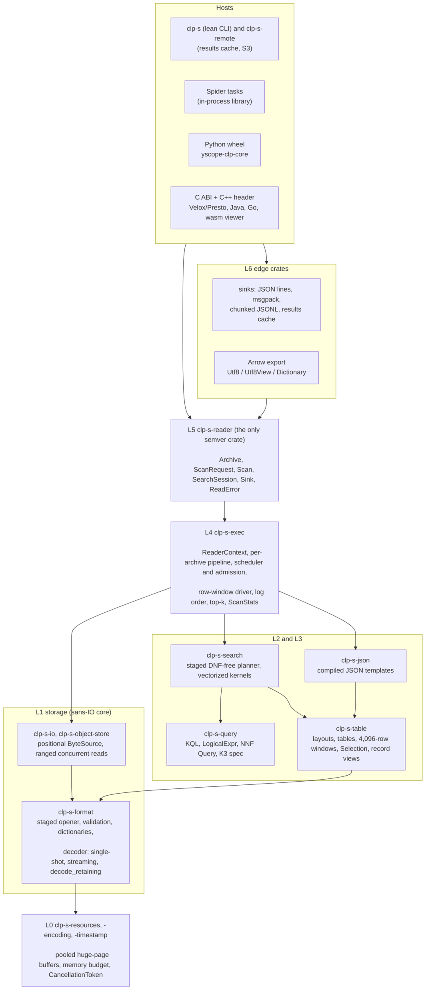
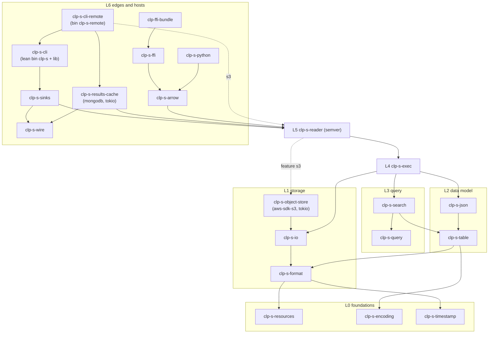
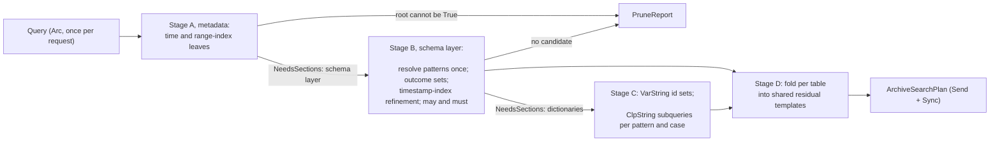
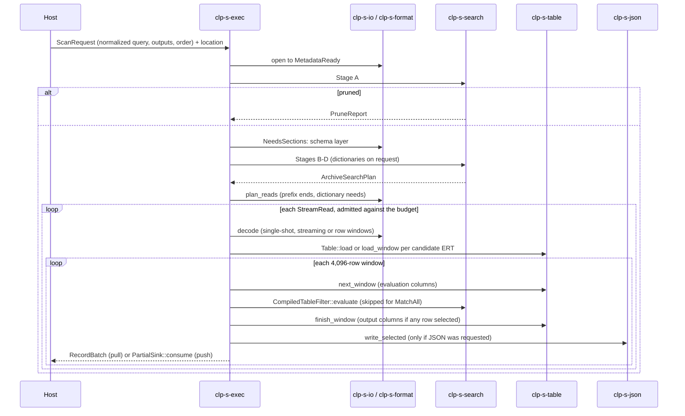
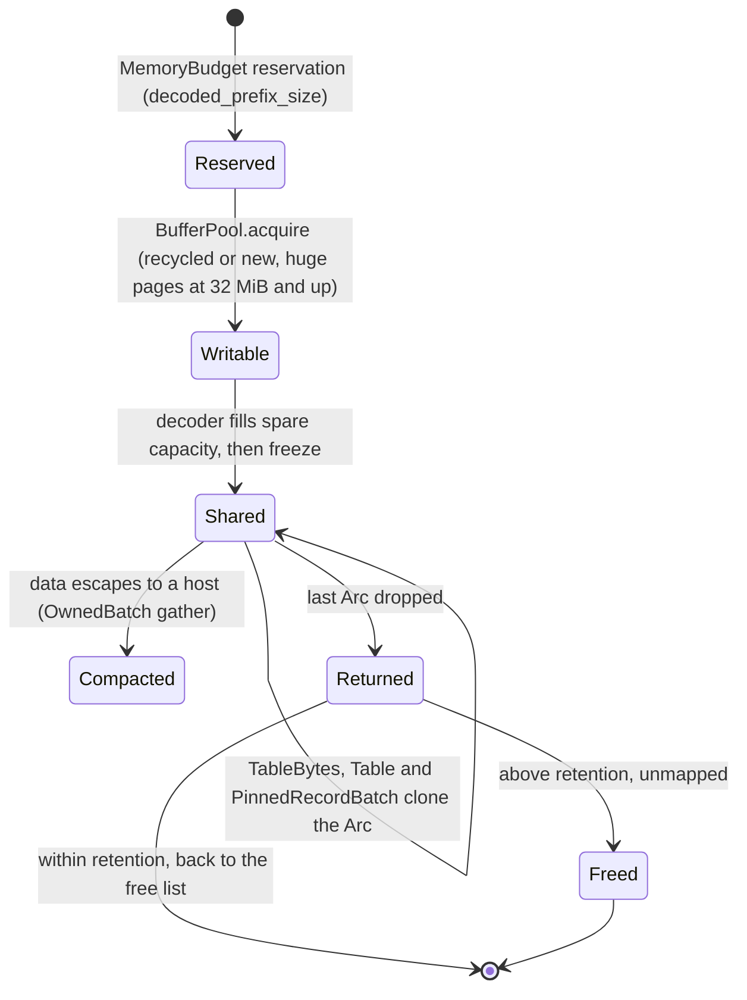
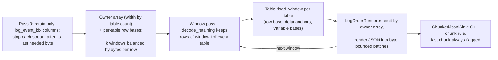
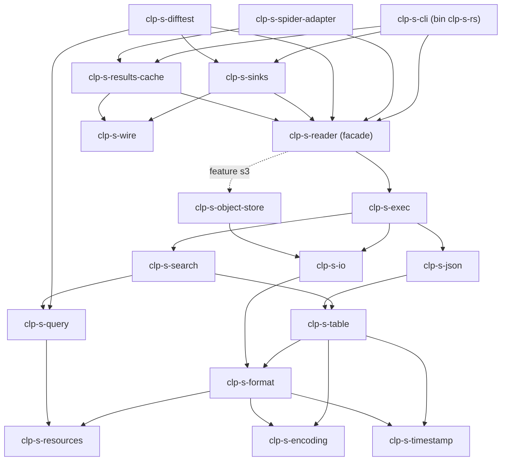

# Rust clp-s reader: design

This document has three parts: the architecture of the Rust clp-s reader (Part 1), the prototype
design frozen for milestones M0-M3 (Part 2), and the search semantics the prototype implements
(Part 3). Section numbers without a part refer to the part they appear in. The public API of the
prototype is summarized in [api-overview.md](api-overview.md); test and benchmark results are in
[prototyping-and-benchmark.md](prototyping-and-benchmark.md).

## Part 1. Architecture

**Date:** 2026-10-17. **Status:** proposed for maintainer review; milestones M0-M3 are prototyped
(Part 2, [prototyping-and-benchmark.md](prototyping-and-benchmark.md)).

This part proposes the internal architecture and the programmatic API for the Rust rewrite of the
clp-s **archive reader**: reading, decompressing and searching clp-s archives, and delivering the
resulting log events to the CLI, to Rust hosts such as the Spider tasks, and through FFI to Python,
Presto/Velox, Java and the log viewer.

The design rests on a survey of the C++ reader and its consumers plus microbenchmarks, whose key
numbers are quoted inline; Appendix A summarizes what each study settled. The raw lab notes are not
part of the repository.

**Conventions.**

- C++ paths are relative to `components/core/src/clp_s/` unless they start with `clp/` or name
  another component. Line numbers are as of October 2026 and may drift.
- *Projection* marks a figure that adds up component costs measured in separate labs. It is not an
  end-to-end measurement; the perf harness replaces each one with a measurement from milestone M1
  on.
- Every measurement comes from one shared WSL2 host (32 cores, kernel 6.6) on which one lab saw
  sporadic zstd output corruption. The published ≥ 10% evidence must be regenerated on bare metal
  (Q20).
- Rust sketches are abbreviated: docstrings are shortened to one line except on traits other crates
  implement, and bodies are `todo!("not implemented")`. Otherwise they follow the repository's Rust
  style: no `unwrap`, `XxxType` generic names with inline bounds, enum dispatch unless the set is
  open.
- "ERT" (encoded record table) is used in prose and `Table*` in code. The glossary is Appendix B.
- "DD §x" cites a section of a code-referenced deep dive into the C++ reader's defects, which is not
  part of the repository; §7.2 lists the defects it reports.
- **Identifiers.**
  - `DV-` entries are the divergence register (§8.3). ADR numbers are the decisions of the decision
    log (§9.1).
  - B1-B6 are the marshalling defects (§3.2, §7.3), K1-K8 the archive-dependence classes of C++
    (§3.2, §8.3), D1-D16 the query-layer defects (§7.3), and OD1-OD12 the output-path defects (§3.2,
    §7.3).
  - OP1-OP15 and S1-S2 are the pain points (§7). Q1-Q25 are maintainer questions (§10.1), DR1-DR7
    the crate dependency rules (§4.1.2) and RK1-RK13 the risks (§10.2). P1-P16 are the performance
    principles (§6.1).
  - X2-X6 are experiments still to run, named in the risks and gates of §10.

---

### 1. Executive summary

**Delivery scope.** The first delivery is narrower than this architecture: single-file archives, no
IR features, and an implementation cut after M3. §2.5 lists what the cut removes, moves and defers,
and how the rest migrates.

#### 1.1 The architecture in one picture



#### 1.2 Ten points

1. **Seven layers, 21 crates, one public facade.** Dependencies point downward only and CI enforces
   it. `clp-s-reader` is the only crate under semver. The core crates, storage through execution,
   contain no tokio, arrow-rs, pyo3 or mongodb and build for wasm; the one exception is the optional
   `clp-s-object-store` S3 adapter, which links tokio and aws-sdk-s3. The CLI ships as a **lean
   `clp-s` binary** for local archives that `exec`s a heavy **`clp-s-remote`** front end only for
   the results cache and S3. Linking those dependencies adds 1.1-3.0 MiB of resident floor, and no
   build flag or page-dropping trick brings it within 0.5 MiB of the lean binary (CLI-floor lab).
2. **Storage is sans-IO and positional.** A `ByteSource` trait with positional, cancellable reads
   and declared capabilities replaces the C++ forward-only checkout model. The opener stops at a
   metadata checkpoint, so archive-level pruning costs one request. Reads follow a plan of byte
   ranges and prefix ends, and a selective remote query fetches 0.5-12% of an archive instead of
   98-99.7% (I/O and zstd lab). Everything read from the file is validated: structurally at parse
   time, semantically per schema and lazily. Pre-0.5.0 handling sits behind one cargo feature and is
   normalized at the table boundary.
3. **Memory is engineered, not hoped for.** Decode buffers come from a host-scoped pool that
   outlives archives. They are never zero-filled, and buffers of 32 MiB and up are mapped with
   transparent huge pages (−22 ms per fresh process on bench). Streams above 64 MiB are decoded in
   **row windows**: k streaming passes, each of which retains one row window of every column,
   derived only from bytes already seen. That halves peak memory on the two rows whose margins are
   thinnest without windows, spider `x --ordered` (1.4%) and bench `x` (a few MiB), as the
   row-window lab measured. The memory budget gives every cursor a base guarantee, so admission
   cannot deadlock.
4. **The data model is closed and batch-first.** There is one mapping from node type to bytes and
   one value model. Tables load in O(columns) without copying. Scans walk 4,096-row windows of
   typed, alignment-1 column slices with a `u64` selection bitmap. The scan position is an owned
   value, so the pull cursor, the C ABI and thousands of ordered-mode tables all compile without
   self-references. Physical encodings stay internal; the facade exposes a logical `TypedColumn`.
5. **JSON is a compiled template in its own crate.** One template per (table layout, projection,
   options), made of pre-escaped fragments and stateless, fused value writers: 108 ns/record against
   351 ns/record in C++ on bench (marshalling lab). Rendered output per delivered batch is bounded
   by bytes.
6. **Queries have a written semantics and no DNF.**
   - **Semantics.** Kleene three-valued logic over existential predicates is written down as a
     specification (Part 3), with a 47-entry divergence register and the invariant that **a record's
     match status depends only on that record and the query**. C++ violates that invariant in 31% of
     runs on an adversarial corpus (archive-dependence scan).
   - **Planning.** Queries are normalized once to negation normal form. A staged, I/O-free planner
     propagates per-table outcome sets; it is 8-270x faster than DNF on shapes that blow up the DNF
     (planner lab). It prunes on the timestamp index for every time predicate in the query.
   - **Evaluation.** Shared residual templates compile into vectorized, polarity-aware kernels:
     0.2-2.7 ns/row against 8.5-22.9 for the C++ row loop (column-access lab).
7. **Execution is synchronous and pull-driven.**
   - **Threads.** One thread by default, the mode compared against C++. An opt-in worker pool takes
     stream tasks from one largest-first queue across archives and admits them at dequeue time.
   - **Operators.** Log order uses an O(N) owner array instead of a heap. Top-k is an engine
     operator that renders at most k records per morsel.
   - **Control and telemetry.** One `CancellationToken` type serves every layer. Statistics are
     returned, never written to global state.
8. **The public API is a pull cursor plus a push session.**
   - **Pull.** `Scan::advance`/`current` lend one window per call, with `next_batch` as sugar.
   - **Push.** `SearchSession::run(Arc<Sink>)` drives tantivy-shaped sinks that declare their merge
     order.
   - **Batches.** Every batch uses one index space, the selected-record ordinal. Data that leaves
     the engine is coalesced into owned, Arrow-layout batches, in a string encoding the request
     chooses.
   - **Errors.** One `ReadError` of at most 32 bytes maps one-to-one onto C status codes and Python
     exceptions, and onto CLI exit codes, where some kinds share a code.
9. **Every integration reuses one pipeline.** The CLI, Spider, Python and the C ABI all call the
   same planner and driver, which removes the three diverging C++ copies of the search pipeline that
   the consumer survey found.
   - **C ABI.** A cbindgen-generated C header with a hand-written C++ RAII layer on top. Data
     crosses it in batches, through Arrow C Data export (`Utf8View` for Velox).
   - **Python.** The wheel is a pyo3 abi3 iterator of batches with `__arrow_c_stream__`. Typed Arrow
     costs 53 ns/record with the default gathered `utf8` strings and 37-42 ns/record with
     `strings="dictionary"`, against 1,920 ns/record for today's subprocess route (Python FFI lab).
   - **Spider.** Searches run in-process, under a shared memory budget.
10. **The ≥ 10% target is reachable with margin, and it is gated from the first milestone.**
    - *Projections:* bench `x` at about 0.58x of C++ wall time and 0.48x of its peak memory; spider
      `x --ordered` at about 0.49x of its memory; selective bench queries at about 0.6x of its wall
      time, but about 0.85x of its memory, because filtered scans are not windowed (§6.3).
    - **Differential harness:** three oracles, a machine-checked divergence registry and an
      archive-dependence classifier.
    - **Perf gate:** ≤ 0.9x on wall time and on line-itemized peak memory.
    - Both harnesses ship before the engine.

#### 1.3 The main decisions

| Area | Decision | Headline evidence | Where |
|---|---|---|---|
| I/O | Positional `ByteSource` with capabilities and a cancellation context; read policy follows capabilities | Forward-only costs 8-180x in bytes for remote selective queries (I/O and zstd lab) | §4.2, ADR-03 |
| Decode | Single-shot when resident; stable-output streaming from files; **row windows** above 64 MiB for full-record scans and ordered mode | Streaming peaks 12 MiB below single-shot (storage proposal); row windows halve the peak for 1.41-1.48x decode work (row-window lab) | §4.2, §4.5, ADR-05, ADR-47 |
| Buffers | Host-scoped pool, never zero-filled, huge pages at ≥ 32 MiB, retention by concurrent demand | A fresh buffer costs +38-47% decode time (I/O and zstd lab); THP saves 22 ms per process (CLI-floor lab) | §4.5, ADR-06 |
| Budget | One base reservation per live cursor, optional reservations try-only, waits only in the dispatcher or when opted in | A blocking reserve self-deadlocks when one thread interleaves two cursors | §4.5, ADR-41 |
| Data model | Closed `ColumnEncoding`/`ValueRef` inside; logical `TypedColumn` outside | Vectorized is 6-85x faster than the C++ row shape (column-access lab); physical variants in semver would break Velox and pandas consumers | §4.3, ADR-11, ADR-42 |
| Marshalling | Compiled templates in `clp-s-json`, rendered on the evaluating worker | 3.3x faster than C++ marshalling (marshalling lab) | §4.3, ADR-15 |
| Semantics | K3 over existential predicates, archive-independence invariant, written register | DNF ≡ NNF+K3 on 9,443 queries (planner lab); 7 archive-dependent C++ mechanisms (archive-dependence scan) | §8, ADR-17, ADR-44 |
| Planner | Staged, I/O-free, DNF-free, shared templates, one `NeedsSections` protocol | C++ needs 7.8 s at k=12; the Rust planner about 0.3 ms (planner lab) | §4.4, ADR-19 |
| Execution | `CurrentThread` default; opt-in largest-first worker pool | 3.21x at 4 threads; rayon's default splitting 1.8x slower (I/O and zstd lab) | §4.5, ADR-23 |
| API | `advance`/`current` cursor; push session with `'static` sinks; selected-ordinal index space; coalesced owned batches | A borrowing cursor does not compile; window-shaped host batches hurt Velox and Python | §5.1, ADR-22, ADR-43 |
| CLI | Lean reader binary plus a heavy remote front end | No single-binary mitigation came within 0.5 MiB of lean (CLI-floor lab) | §5.3, ADR-35 |
| FFI | cbindgen C header + C++ RAII layer; Arrow C Data with request-chosen string encodings; pyo3 abi3 wheel | Velox rejects `u32` dictionary keys and re-imports a dictionary per batch | §5.4, §5.5, ADR-29, ADR-30 |

### 2. Requirements recap

#### 2.1 Mission

The rewrite must deliver three things.

1. **An internal architecture** that fixes the maintainer-reported pain points (§7.1) and the
   defects in the code-referenced deep dive (cited as "DD §x", §7.2).
2. **Programmatic APIs** on top of the reader black box:
   - a formal, versioned Rust library that Rust projects such as the Spider tasks depend on
     directly;
   - FFI integration, starting with the Python wheel `python-wheels/yscope-clp-core` (which today
     only bundles the binary), then C/C++ hosts through a C ABI with generated headers
     (Presto/Velox, Java);
   - interchangeable output handlers: stdout, file, network, the results cache, and later count and
     aggregation.
3. **Performance.** The architecture must not cap vectorization, late materialization, zero-copy,
   buffer reuse, parallelism, SIMD or ranged I/O. The rewrite must beat C++ by at least 10% in
   throughput and in memory for decompression and search, at equal parallelism.

#### 2.2 Scope rules that bind the design

- **The boundary.** The reader is "archive + optional query → log events", and the archive format is
  unchanged.
  - **Semantic equivalence.** Results must be semantically equivalent to C++. Serialization, result
    order (when log order is not requested) and output handlers may change.
  - **Bugs.** Known bugs are fixed, and each fix that changes output is documented as an intentional
    divergence: the C++ behaviour, the new behaviour and the reason.
- **Functionality.** The rewrite covers a subset of today's functionality and adds nothing new
  except the interfaces.
  - Aggregations, the indexer and the log converter are out of scope.
  - They must remain buildable on top of the API later, and efficiently: from typed values, not from
    re-parsed JSON.
- **Legacy archives.** Whether pre-0.5.0 archives stay supported is undecided, so legacy handling
  must be isolated well enough that either decision is cheap.
- **No stable Rust ABI.** Hosts reach the reader through an in-process C ABI or through serialized
  exchange. C++ hosts get generated headers. log-surgeon's Rust rewrite already generates its C++
  header with cbindgen; this design generates a C header instead and wraps it in C++, for the reason
  given in §5.4.
- **Format evolution.** The format will keep evolving, so adding a new version or a new structure
  must be cheap and isolated. Examples: a replacement timestamp index, field-level dictionaries,
  per-field indexes, per-shape counts.

#### 2.3 Performance targets

The C++ baseline profiled the C++ binary on three datasets. Every target below is 0.9x of the C++
median, at one thread with a warm cache. The archives were multi-file archives; the first cut
re-baselines the targets on single-file archives (§2.5).

- **bench:** 1M flat records.
- **spider:** 1.06M real Rust `tracing` records.
- **synthetic:** 500k polymorphic records in 7,189 ERTs.

| Workload | C++ wall / peak RSS | Target wall / RSS |
|---|---|---|
| bench `x` | 563 ms / 119.2 MiB | ≤ 507 ms / ≤ 107.3 MiB |
| spider `x` | 749 / 86.8 | ≤ 674 / ≤ 78.1 |
| synthetic `x` | 830 / 58.2 | ≤ 747 / ≤ 52.4 |
| bench `x --ordered` | 554 / 119.2 | ≤ 499 / ≤ 107.3 |
| spider `x --ordered` | 799 / 148.2 | ≤ 719 / ≤ 133.4 |
| synthetic `x --ordered` | 1,925 / 223.0 | ≤ 1,732 / ≤ 200.7 |
| bench `*`, JSON to file / count | 576 / 100, 119.5 MiB | ≤ 518 / ≤ 90, ≤ 107.6 |
| bench `level: ERROR` (250k hits), JSON | 214 / 121.5 | ≤ 193 / ≤ 109.4 |
| bench `message: "*req-46e85770*"` (71 hits) | 111 / 121.5 | ≤ 100 / ≤ 109.4 |
| bench / spider / synthetic bare value | 170 / 180 / 310; 119.5 / 87.2 / 64.0 MiB | ≤ 153 / 162 / 279; ≤ 107.6 / 78.5 / 57.6 |
| synthetic `attrs.k: "tier"` (array search) | 406 / 62.0 | ≤ 365 / ≤ 55.8 |

Every other search row works the same way.

- **`poly_range`:** compared in count mode, because C++ returns wrong rows there (DV-11).
- **Rows whose serialization changes:** compared at equal output volume.

#### 2.4 Rules that bind every crate

1. **No panics on input, and no `unwrap` anywhere.** A panic on archive bytes, query text or host
   input is a bug. Every FFI entry point and every worker task still runs under `catch_unwind`, and
   the paths that bypass unwinding are closed separately (§4.5.7).
2. **No process-global state in libraries:** no environment variables, global allocator, panic hook,
   logger or unrequested threads. Only the CLI `main` functions read the environment.
3. **Heavy dependencies only at the edges.** tokio, arrow-rs, pyo3, mongodb and aws-sdk-s3 never
   enter L0-L4, except the optional object-store adapter.
4. **Thread-safety bounds are asserted at compile time** with `const` assertions (§4.1.4).
5. **`NodeType` numbering is frozen and append-only.** Presto hard-codes values 0-14.
6. **Enum dispatch for closed sets.** `dyn` is allowed only where the set is open: host byte
   sources, user sinks at batch granularity, and user error payloads.
7. **Dependencies are pinned to exact patch versions and sorted alphabetically**, as in the
   workspace `Cargo.toml`.

#### 2.5 Delivery scope of the first cut

The maintainers narrowed the first delivery: single-file archives only, no IR features, and an
implementation cut after M3. Everything else in this part stays designed, with a migration path from
the cut. Part 2 is the prototype of the cut.

**Facts behind the cut.**

- Spider-based deployments write only SFA and never use structured arrays.
- The C++ baseline targets of §2.3 were measured on MFA archives and must be re-baselined on SFA.
- The legacy Celery path writes MFA on local file systems and SFA only for S3
  (`job_orchestration/executor/compress/compression_task.py:415` in
  `components/job-orchestration/`), so MFA in existing deployments stays on the C++ reader.
- "No IR features" does not mean rejecting archives ingested from kv-IR. Spider's unstructured-log
  path runs log-converter and compresses its kv-IR output, so those archives must be readable. They
  carry no `@` auto-generated keys, so Q2, Q4 and DV-46 keep C++ behaviour.

**Removed from the cut.**

- kv-IR search and Velox IR splits, so DV-44 and RK11 do not apply.
- MFA. `ArchiveLocation::Directory` and the per-file range split collapse to one source per archive,
  and MFA stays a seam.

**Moved into M0-M3.**

- Minimal S3 reading: one GET per coalesced range, in sequence. Concurrent fetches and prefetch stay
  at M7.
- Early `UnsupportedArchive` rejection, at open time, of MFA, structured arrays, 0.4.x and unknown
  versions.
- A Spider fallback to the existing C++ subprocess path on `UnsupportedArchive` (§5.6).

**Designed but deferred.**

- Typed columns, Arrow export, and owned and pinned batches.
- The worker pool, morsels and the reorder window; only `Executor::CurrentThread` ships.
- Ordered mode, the owner array and chunked extraction.
- Row-window decode, deferred out of M1; the prototype decodes in a single pass.
- Structured arrays, 0.4.x and the log-order paging view.

`#[non_exhaustive]` enums and the asserted thread-safety bounds (§4.1.4) keep these later additions
non-breaking. `clp-s-reader` can stay unpublished (0.x) until the Python or C ABI milestone.

**CLI.** The prototype ships one CLI binary, `clp-s-rs`, instead of the lean and remote split of
§5.3 (Part 2 D13).

**Interim routing.** Each workload keeps its current reader until the milestone listed:

| Workload | During the cut | Switches to Rust at |
|---|---|---|
| Spider search on SFA, local or S3 | Rust in-process, with C++ fallback on `UnsupportedArchive` | M3 |
| Celery search path (MFA on local FS) | C++ binary | Path retirement, or an MFA layout later |
| Stream extraction (`x --ordered` + MongoDB) | C++ binary | M4 |
| Aggregation jobs | C++ binary | Aggregation sinks |
| Velox connector / Python wheel | C++ | M6 / M5 |
| kv-IR stream search | C++ binary | Out of scope |

**Gates.** M1-M3 gate on SFA, with the S3 rows compared against C++ `--auth s3`. Ordered-mode
performance becomes M4's gate.

**Effort.** The whole plan (§10.3) was estimated at about 60-90 engineer-weeks. The cut changes the
M0-M3 estimates as follows:

| Milestone | Original estimate (engineer-weeks) | Cut estimate (engineer-weeks) | Reason |
|---|---|---|---|
| M0 | 5-7 | 4.5-6.5 | SFA only |
| M1 | 8-11 | 6-8.5 | Row windows deferred |
| M2 | 12-16 | 11-15 | No typed or Arrow requests |
| M3 | 5-7 | 6-8 | Gains minimal S3 and the Spider fallback |

The rows sum to 27.5-38 engineer-weeks. With the same 15-20% allowance for CI, review, integration
and bare-metal benchmarking that the whole-plan figure includes, M0-M3 take about 32-45
engineer-weeks, roughly 3.5-5 months with three engineers.

### 3. Findings that shaped the design

#### 3.1 Where the C++ reader spends time and memory

Source: the C++ baseline.

**Decompression and full-output searches.**

- Marshalling is 68-81% of user CPU, at about 351-360 ns/record on bench, and zstd is only 4-9%.
- Inside marshalling, the cost goes to per-record key re-escaping, `std::string` churn, a temporary
  copy per ClpString and a per-record copy into the handler.

**Selective and count queries.**

- They are zstd-bound: zstd and the copies it causes take 70-88% of user CPU.
- In a fresh process, faults on the newly allocated, zero-filled 97.5 MiB buffer add 33-45 ms of
  kernel time to a query of about 100 ms.
- Every bench query that reads the ERT costs at least about 96 ms and 121 MiB.

**Peak memory.**

- Peak RSS ≈ a 19-20 MiB process floor + the largest decoded stream + the materialized variable
  dictionary.
- Ordered decompression keeps every ERT resident. Spider peaks at 148.2 MiB; synthetic peaks at 223
  MiB and is 2.3x slower than unordered, with the priority-queue merge taking 23% of user CPU.

**Many-ERT archives** (synthetic has 7,189 ERTs, 2,907 of them with 10 records or fewer):

- per-ERT planning and setup take 7-14% of CPU;
- materializing 849k variable-dictionary strings takes 24% of a `*` count's CPU.

**Row interpreter.** Where `ColumnScan` cannot run (bare values, arrays, ClpString wildcards), the
row interpreter costs 29-50% of user CPU.

**A new bug.** Numeric range filters on unstructured arrays evaluate as `!=`
(`search/QueryRunner.cpp:39`): `payload > 50000` returns 93,444 records instead of 30,781.

#### 3.2 Key facts from the survey

**Format and I/O** (the format survey, the I/O and zstd lab, and the storage proposal's
measurements):

- **Random access is possible.** Every packed stream is an independent zstd frame. C++ enforces
  forward order for every reader (`PackedStreamReader.cpp:117`, `ArchiveReaderAdaptor.cpp:342`), but
  the order is costly only over the network, where the reader streams one HTTP GET and must read
  through whatever it skips. The schema layer sits next to the metadata and is small: 2.9 KB on
  bench, about 100 KB on synthetic.
- **No frame stores a content size** (97 frames checked). Streams are therefore sized from the table
  metadata, and sections from `ZSTD_decompressBound`.
- **Buffer reuse dominates.** A fresh output buffer adds 38-47% above 32 MiB, while zstd context
  reuse makes no difference. Single-shot decode is 1.05-1.13x faster than the C++ buffered path, and
  stable-output streaming matches single-shot within 1% while peaking 12 MiB lower on bench (101.0
  vs 113.0 MiB).
- **Remote reads.** Ranged reads fetch 0.5-12% of an archive for selective keys, against 98-99.7%
  for the C++ forward-only reader. 8-16 concurrent ranged GETs cut a simulated object-store scan
  from 2,666 to 269-343 ms.
- **Dictionaries.** As one arena with offsets, the 849k-entry variable dictionary builds in 11.1 ms
  with 12.9 MiB live. Per-entry strings take 31.5 ms and 22.6 MiB, with a 63.5 MiB peak.
- **Crashes and open failures.** Four crash modes were reproduced on corrupt or edge-case archives:
  a double close aborts, uncaught exceptions on the search path abort, an out-of-range parent
  segfaults, and a zero-length packet makes the archive unopenable. A trailing field in the
  timestamp-dictionary packet also makes the archive unopenable.

**Columns and marshalling** (the marshalling survey, the marshalling lab and the column-access lab):

- **Templates.** Every row of an ERT has the same shape, so a record compiles to one template. It
  renders in 108 ns/record on bench, and all six marshalling strategies the lab tried were
  byte-identical to a serde_json oracle.
- **Fused writers.** Fused ClpString decode and escape takes 31.7 ns against 80.3 ns. Plain floats
  print shortest round-trip in 27.9 ns, while C++ `%f` takes 126.5 ns and is lossy.
- **Fidelity bugs.**
  - `@` auto-generated keys are dropped from output.
  - An empty key inside a structured array yields invalid JSON (B3).
  - Duplicate keys make an ERT unreadable and abort the archive (B4).
  - The deep dive's "columns dropped inside structured arrays" is refuted.
- **Vectorized evaluation.** It takes 0.20-2.70 ns/row, and the best row-at-a-time design still
  takes 2.9-8.2.
  - `dyn` per node per batch is within 2.5% of enum dispatch.
  - A dense id bitset beats a hash set 12x.
  - Per-window delta decoding costs 0.17-0.26 ns/row against 0.98 for the C++ cursor.
  - Unaligned 8-byte loads are free.
  - AVX2 makes integer compares 4x faster.

**Query and search** (the query survey, the planner lab, the query proposal's probes and the
archive-dependence scan):

- **K3 is the real semantics.** C++ already implements Kleene three-valued logic wherever it is
  correct.
- **Defects.** 13 result-changing defects beyond the deep dive were reproduced. Examples: `NOT
  ERROR` returns all 1,000,000 bench records; the bug-254 dedupe drops matches under AND; NEXISTS on
  an absent path matches nothing.
- **The DNF is exponential.** The C++ binary needs 7.8 s at k=12 and times out at k=16. The DNF-free
  planner agrees with a correct DNF on all 9,443 random queries, and is 8-270x faster on blow-up
  shapes.
- **Archive dependence.** In 282 of 900 (query, mode) runs (31%), C++ gives a different answer on
  the full archive than on single-record archives. Seven mechanisms are responsible (K1-K7). On top
  of that, 21 `--structurize-arrays` queries abort only on the multi-record archive (K8).

**Output and consumers** (the output survey, the consumer survey, the delivery-API lab and the
Python FFI lab):

- **Per-archive handlers.** Handlers are built once per archive, which causes defects OD1-OD12:
  per-archive file truncation, missing network metadata, `_id` collisions without log order, and
  per-archive top-k.
- **Costs.** A count takes 99 ms, JSON output 456 ms, a results-cache top-10 516 ms, and
  min/max/unique about 20x a count.
- **Three pipeline copies.** The "archive + KQL" pipeline exists in three diverging copies:
  `clp-s.cpp`, the Velox cursor and the beta SFA reader.
- **Delivery shape.** Pulling a lending batch costs the same as pushing (3.43 vs 3.29 ns/record).
  Per-record channels cost 435 ns, and owned records +52-57 ns.
- **Python.** Typed Arrow costs 53 ns/record with gathered `utf8` strings and 37-42 ns/record with
  dictionary-encoded strings. Releasing the GIL per batch scales about 4x on 4 threads; a deep
  producer queue avoids the GIL convoy.
- **Linking.** Two Rust staticlibs in one host collide with 2,173 duplicate symbols.

**Rust prior art** (the prior-art survey). The design borrows these patterns:

- arrow-rs's parquet push decoder (sans-IO `NeedsData`, with sync and async drivers on top);
- tantivy's query → weight → scorer tiers and its collectors;
- Vortex's prune → filter → project phases;
- a cbindgen C ABI;
- pyo3 abi3 with the PyCapsule protocol.

**Follow-up labs.**

- **Row-window decode works** (row-window lab). 82 of 82 verification runs and 144 of 144 measured
  runs reproduced the slices of a full decode byte for byte. At k=2 the peak falls from 101.0 to
  54.5 MiB on bench, and from 131.8 to 70.5 MiB on spider in ordered mode.
- **Floors and huge pages** (CLI-floor lab). No single-binary mitigation gets within 0.5 MiB of the
  lean floor. Huge pages save 22 ms per process for +0.5 MiB.
- **Archive dependence** (the archive-dependence scan) is summarized above.

#### 3.3 Corrections to the deep dive

- **§7 #8 (columns dropped inside structured arrays):** not a defect. No writer emits those columns
  there (marshalling survey), so the rewrite rejects them as corruption.
- **The bug-254 rewrite** also fires for integer and boolean literals. It is not limited to NEQ on
  string columns (planner lab).
- **`NOT <bare word>`** is not a "plain complement". It returns *every* record, including the equal
  ones, whenever the archive has a column of the other string encoding (K2).
- **The `ColumnScan` bitmap path** evaluates every conjunct on every row. That makes it slower than
  the row loop's short-circuit (126 vs 117 ms, query survey).
- **The wasm viewer's copy into linear memory** cannot be avoided by any C ABI.
- **Velox keeps `BaseClpCursor`** for IR splits.

### 4. Internal architecture

#### 4.1 Layers and crates



##### 4.1.1 Responsibilities

| Layer | Crate | Owns | Audience |
|---|---|---|---|
| L0 | `clp-s-resources` | `BufferPool` and its pool-owned buffer type (heap or mapped, huge pages), `MemoryBudget`, `MemoryReservation`, `CancellationToken` | token re-exported; the rest internal |
| L0 | `clp-s-encoding` | Byte-exact CLP variable encoding, placeholder bytes, potential-variable tokenizer | internal; shared with the future writer |
| L0 | `clp-s-timestamp` | Timestamp patterns and compiled formatters; the `%`-style legacy flavour behind `legacy-v0-4` | internal |
| L1 | `clp-s-format` | Header, version gating, metadata, schema tree and map, table directory, timestamp and range indexes, dictionaries, the staged opener, read planning, `StreamDecoder` with `decode_retaining`, validation, `ReaderLimits` | selected types re-exported |
| L1 | `clp-s-io` | `ByteSource`, `ResolvedSource`, `ArchiveFileSystem`, `ArchiveFiles`, `ArchiveStorage`, fetch backends | `ByteSource` re-exported |
| L1 | `clp-s-object-store` | `S3Source` over a host-provided `aws_sdk_s3::Client` | facade feature `s3` |
| L2 | `clp-s-table` | Value model, `ColumnEncoding`, layouts and record shapes, tables with row-window bases, the row-window segment planner, scanning, record views, the unstructured-array element scanner, `ColumnArray`, log order, `ResolvedProjection`/`ResolvedColumnRequest` | logical views re-exported |
| L2 | `clp-s-json` | `RenderContext`, `JsonTemplate`, value writers, escaping, `JsonRecordBuffer` | `JsonOptions`, `JsonRecordBuffer` re-exported |
| L3 | `clp-s-query` | KQL, `LogicalExpr`, `Query` (NNF), the coercion table, `TextPattern`, the reference evaluator; the specification is Part 3 | `Query` family re-exported |
| L3 | `clp-s-search` | Column resolver, pruning indexes, dictionary prefilter, GrepCore port, staged planner, `ArchiveSearchPlan`, kernels | internal |
| L4 | `clp-s-exec` | `ReaderContext`, executors, the per-archive pipeline, drivers, admission, morsels, the row-window driver, ordered mode, top-k, the sink protocol, batches, `ScanStats`, `ReadError` | most public types originate here |
| L5 | `clp-s-reader` | The facade; features `s3`, `tokio`, `mmap`, `legacy-v0-4`, `unstable-internals` | **public, semver** |
| L6 | `clp-s-wire`, `clp-s-sinks`, `clp-s-results-cache`, `clp-s-arrow` | Wire types, built-in sinks, the MongoDB sink, Arrow export | public |
| L6 | `clp-s-ffi`, `clp-ffi-bundle` | C ABI, generated C header, C++ RAII header; one staticlib per host (also re-exporting log-mechanic) | C ABI |
| L6 | `clp-s-python` | pyo3 module `yscope_clp_core._native` | Python |
| L6 | `clp-s-cli`, `clp-s-cli-remote` | `clp-s` (lean: local archives to stdout, file, network); `clp-s-remote` (results cache, S3) | CLI |

`clp-s-difftest` and `clp-s-perf` are dev-only (`publish = false`).

##### 4.1.2 Dependency rules

- **DR1. Downward only.** CI enforces it with `cargo deny` bans on the reverse edges. `clp-s-table`
  names no query crate, and neither `clp-s-table` nor `clp-s-search` names `clp-s-json`.
  - The resolved, semantics-free forms of projections and typed requests (`ResolvedProjection`,
    `ResolvedColumnRequest`) live in `clp-s-table`.
  - `clp-s-search` produces them; the table and JSON crates consume them. That avoids a crate cycle
    between the query and table layers.
- **DR2. Heavy dependencies sit at the edges.**
  - tokio: only in `clp-s-object-store`, `clp-s-results-cache`, `clp-s-cli-remote` and the facade's
    off-by-default `tokio` feature.
  - arrow-rs: only in `clp-s-arrow`. pyo3: only in `clp-s-python`. mongodb: only in
    `clp-s-results-cache`.
- **DR3. `clp-s-query` depends on nothing archive-related.** Python can validate a query, Presto can
  serialize a `LogicalExpr`, and a future kv-IR search can share the IR, without linking archive
  code.
- **DR4. wasm.** The core crates and the facade without default features build and *run their tests
  under node* for `wasm32-unknown-emscripten` (optionally `wasm32-wasip1`). Timing sits behind a
  clock abstraction, and single-threaded targets never wait on a `Condvar`.
- **DR5. One feature flag for legacy archives.** `legacy-v0-4` lives in `clp-s-format`,
  `clp-s-timestamp`, `clp-s-table` and `clp-s-search`. Nothing above the table layer sees legacy
  encodings (§4.2.6).
- **DR6. Semver covers only the facade** and what it re-exports, checked with `cargo-semver-checks`.
  Every re-exported enum is `#[non_exhaustive]`, and CI checks that too.
- **DR7. User extension points are open sets.** Host byte sources, user sinks and user predicates
  use `dyn` at batch or request granularity. Everything else is enum-dispatched.

##### 4.1.3 Public, unstable and internal surface

| Surface | Contents | Promise |
|---|---|---|
| **Public, semver** | `clp-s-reader` and its re-exports (§5.1); `clp-s-wire`, `clp-s-sinks`, `clp-s-results-cache`, `clp-s-arrow` | Semver; `#[non_exhaustive]`; builders for every configuration type; no third-party 0.x types (static S3 credentials use a crate-owned secret newtype, not `secrecy::SecretString`) |
| **C ABI** | `clp_s.h` (generated, committed, diff-checked in CI) and `clp_s.hpp` | `CLP_S_ABI_VERSION`; every option struct starts with `struct_size` |
| **Python** | `yscope_clp_core` | Versioned with the wheel |
| **Unstable** | Facade feature `unstable-internals`: `ArchiveIndex`, `TableLayout`, `RecordShape`, physical `ColumnBatch`/`ValueRef`, `ArchiveSearchPlan`, serde EXPLAIN output | None |
| **Internal** | Everything else | Free to change |

##### 4.1.4 Ownership and thread safety

Each row is pinned by a `const` assertion in the crate that defines the type.

| Types | Bound | Why |
|---|---|---|
| `ReaderContext`, `Archive`, `ArchiveIndex`, `ArchiveTables`, `TableLayout`, `Table`, dictionaries, `RenderContext`, `JsonTemplate`, `Query`, `ArchiveSearchPlan`, `SearchPlan`, `CompiledTableFilter` | `Send + Sync` | Shared through `Arc`. Lazy parts sit behind an init-once cell with fallible initialization; concurrent first uses serialize, so N threads issue one GET. Nothing mutates shared state. |
| `Scan`, `SessionCursor` | `Send + 'static` | Python wraps them in a mutex (§5.5), and C handles need `'static`. `Sync` is not required. |
| `PinnedRecordBatch`, `OwnedBatch`, the pool buffer types, `TableBytes` | `Send + 'static` (buffers also `Sync`) | They cross worker, producer and host threads. |
| `StreamDecoder`, `TableScanner`, `TableScanState`, `EvaluationScratch`, `BindScratch` | `Send` | Per-worker state reused across tables and archives. |
| `RecordBatch<'batch>`, `TypedColumn<'batch>`, `RecordView<'batch>` | borrowed | Valid until the next `advance` or for the duration of one `consume` call. |

#### 4.2 Storage and format layer

##### 4.2.1 Responsibilities

The storage layer turns bytes into validated structures and decoded streams. It decides *which
bytes* a scan needs and *how* to decode them; execution decides *where buffers come from, when work
is admitted and how long it lives*. Its core, `clp-s-format`, is sans-IO and never blocks.
`clp-s-io` drives it over synchronous sources, and `clp-s-object-store` adds S3.

##### 4.2.2 Sources and locations

```rust
/// Positional, thread-safe, cancellable read access to one file of an archive.
pub trait ByteSource: Send + Sync {
    /// Returns what this source can do cheaply; the read policy is derived from it.
    fn capabilities(&self) -> SourceCapabilities;

    /// Returns the size of the file in bytes.
    ///
    /// # Errors
    ///
    /// Returns an error if:
    ///
    /// * [`std::io::Error`] if the size cannot be determined.
    fn size(&self) -> Result<u64, std::io::Error>;

    /// Fills `buffer` completely with the bytes starting at `offset`.
    ///
    /// # Parameters
    ///
    /// * `offset` - Absolute offset within the file.
    /// * `buffer` - The buffer to fill.
    /// * `context` - The calling scan's cancellation token (and room for a deadline).
    ///
    /// # Errors
    ///
    /// Returns an error if:
    ///
    /// * [`std::io::Error`] if the read fails or is short; [`std::io::ErrorKind::Interrupted`]
    ///   means the read was cancelled through `context` and maps to [`ErrorKind::Cancelled`].
    fn read_exact_at(
        &self,
        offset: u64,
        buffer: &mut [u8],
        context: &ReadContext<'_>,
    ) -> Result<(), std::io::Error>;

    /// Fills uninitialized memory; the default zero-fills `buffer` and delegates.
    ///
    /// # Parameters
    ///
    /// * `offset` - Absolute offset within the file.
    /// * `buffer` - The uninitialized buffer to fill.
    /// * `context` - The calling scan's cancellation token.
    ///
    /// # Errors
    ///
    /// Returns an error if:
    ///
    /// * Forwards [`ByteSource::read_exact_at`]'s return values on failure.
    fn read_exact_at_uninit(
        &self,
        offset: u64,
        buffer: &mut [MaybeUninit<u8>],
        context: &ReadContext<'_>,
    ) -> Result<(), std::io::Error> {
        todo!("not implemented: zero-fill, then delegate to read_exact_at")
    }

    /// Returns a zero-copy view of `range` if the bytes are memory-resident.
    ///
    /// # Parameters
    ///
    /// * `range` - Offsets within this file.
    fn slice(&self, range: FileRange) -> Option<SharedBytes> {
        let _ = range;
        None
    }

    /// Hints the ranges a scan reads next, in read order; remote sources fetch them concurrently.
    ///
    /// # Parameters
    ///
    /// * `ranges` - Coalesced ranges within this file, in the order they will be read.
    fn prefetch(&self, ranges: &[FileRange]) {
        let _ = ranges;
    }
}

/// What a source can do cheaply.
#[non_exhaustive]
#[derive(Clone, Copy, Debug)]
pub struct SourceCapabilities {
    pub is_resident: bool,
    pub preferred_request_size: u64,
    pub supports_concurrent_reads: bool,
}

/// Where an archive lives, as a user names it; resolved into sources at open time.
#[non_exhaustive]
pub enum ArchiveLocation {
    File(PathBuf),
    Directory(PathBuf),
    Memory(SharedBytes),
    #[cfg(feature = "s3")]
    S3 { location: S3Location, client: S3ClientSource },
    Host(Arc<dyn ByteSource>),
    HostFileSystem(Arc<dyn ArchiveFileSystem>),
}

/// The concrete source of one file; built-ins by enum, everything else through `Dyn`.
pub enum ResolvedSource {
    File(FileSource),
    Memory(MemorySource),
    #[cfg(feature = "mmap")]
    MemoryMappedFile(MemoryMappedFileSource),
    Dyn(Arc<dyn ByteSource>),
}
```

Notes on the source model:

- **Locator and source are separate.** `ArchiveLocation` resolves at open time into
  `ArchiveFiles<ResolvedSource>`. A single-file archive (SFA) and a multi-file archive (MFA) are two
  layouts of one virtual address space.
  - **Ranges.** A `FileRange` is a per-file offset range; a `ByteRange` is a range in the virtual
    address space.
  - **Multi-file archives on hosts and S3.** `trait ArchiveFileSystem: Send + Sync` opens files by
    relative path, so a host or S3 can serve an MFA.
  - **No generics in the engine.** `clp-s-exec` is not generic over sources. One virtual call per
    read of 64 KiB or more is noise.
- **Sources.**
  - **File:** `pread`.
  - **Memory:** wraps `SharedBytes`. A host buffer is wrapped without a copy, but only if the host
    guarantees it stays immutable until released.
  - **mmap:** opt-in. It reads fastest warm (7.5 vs 11.0 ms), is 2x slower cold, and raises SIGBUS
    on truncation.
  - **S3:** bounded, coalesced ranged GETs over a host-built `aws_sdk_s3::Client` or `SdkConfig`, so
    refreshing credentials and custom endpoints work. The library reads no environment.
- **No `close()`.** Dropping the handle releases everything, so the C++ double-close abort cannot
  happen.

##### 4.2.3 The staged open and the `NeedsSections` protocol

Opening and planning use one sans-IO protocol. Each step returns either a checkpoint or
`NeedsSections(Vec<SectionRequest>)`. The driver fetches the requested ranges, through prefetch for
remote sources, and pushes them back. Today's checkpoints are instances of this one outcome, so a
future section-backed index adds a request, not a driver change.

| Step | Bytes | Can prune on |
|---|---|---|
| Open to `MetadataReady` | Header and metadata section, usually inside the first 64 KiB, which also covers the schema layer on most archives | nothing yet |
| Stage A (metadata) | none | time bounds and range-index leaves; a query that folds to False |
| `IndexReady` | `/schema_tree`, `/schema_ids`, `/table_metadata`, which are contiguous | nothing yet |
| Stages B-D (planner, §4.4) | dictionaries, only if a candidate binds a string leaf | timestamp-index refinement, schema candidacy, the dictionary prefilter |
| Read plan | none | prefix ends: decoding stops after the last needed ERT of each stream, which cut decoded bytes by 18-59% on multi-ERT streams (I/O and zstd lab) |

`ArchiveIndex` (metadata plus the validated schema layer) is decoded once and is immutable, which
fixes DD §7 #13. `TableInfo::first_record_ordinal` is the prefix sum of `num_rows` in table order;
it is the basis of `RecordId` for archives without log order.

##### 4.2.4 Read and decode policy

The policy has two orthogonal parts, derived per stream from the source's capabilities and from the
scan.

- **How compressed bytes arrive.** Resident sources are sliced. Local files are read in 1 MiB
  positional chunks. High-latency or host sources get one read per coalesced compressed range,
  reserved against `max_inflight_fetch_size`.
- **How decoded bytes are retained:**

```rust
/// How one packed stream is decoded and what stays resident.
pub enum DecodePolicy {
    /// A memory-resident frame decoded in one call into the pooled buffer.
    SingleShot,
    /// A chunked frame streamed into a stable output buffer that holds the decoded prefix.
    StableStreaming,
    /// `num_passes` streaming passes; each keeps one row window of every planned table.
    RowWindows { num_passes: NumWindowPasses },
}

/// A row-window pass count; never below 2, because k = 1 is worse than single-pass streaming.
#[derive(Clone, Copy, Debug, PartialEq, Eq)]
pub struct NumWindowPasses(u32);

impl NumWindowPasses {
    /// Factory function. Returns `None` if `num_passes` is below 2.
    #[must_use]
    pub fn new(num_passes: u32) -> Option<Self> {
        (num_passes >= 2).then_some(Self(num_passes))
    }

    #[must_use]
    pub fn get(self) -> u32 {
        self.0
    }
}
```

| Scan and stream | Policy |
|---|---|
| Resident frame, stream at or below the window threshold, or a filtered scan | `SingleShot` |
| Local file, stream at or below the threshold, or a filtered scan | `StableStreaming` (1 MiB chunks): 101.0 MiB VmHWM on bench, against 113.0 MiB single-shot, for the same time |
| Full-record scan (every table `MatchAll`, whole records requested) with a stream above `window_threshold_size` (default 64 MiB); or ordered mode with Σ resident above `ordered_residency_limit` (default 64 MiB) | `RowWindows`, with k = max(2, ⌈size / limit⌉). Remote frames stay resident in compressed form across the passes. |
| Any scan whose base reservation the budget cannot admit | `RowWindows`, with k chosen to fit, before over-commit is considered (§4.5.4) |

- **Filtered searches are never windowed by default.** They are zstd-bound, and a k=2 window decode
  costs 1.41-1.48x the decode work, which would eat the margin on rows such as bench
  `rare_clp_substr` (target 100 ms).
- **Sizes.** Packed streams are sized exactly from the table metadata. Sections are sized by
  `ZSTD_decompressBound`, under `ReaderLimits`.
- **zstd APIs.** The buffered `DStream` path of C++ is never used. The static-only zstd APIs
  (`ZSTD_d_stableOutBuffer`, `ZSTD_decompressBound`) require the `experimental` feature of the
  pinned `zstd` crate. The fallbacks are 5-11% slower.

**`decode_retaining`.** This is the row-window primitive the row-window lab validated. The decoder
streams a frame through a reused 1 MiB scratch and tiles the stream with segments, each derived only
when the cursor reaches its first byte. There are four kinds of segment:

- **Skip:** decode and discard.
- **Keep:** copy into the pass arena.
- **Sum:** a running sum of delta words, which gives the anchor of rows `[0, a)`.
- **Peek:** capture a logtype word or a variable count.

The format layer does not know column layouts, so the table layer supplies the planner through a
cross-crate trait. That keeps formats and columns decoupled.

```rust
/// Decides, in stream order, what to do with the next run of decoded bytes.
pub trait SegmentPlanner {
    /// Returns the segment that starts at `position`; `peeked` holds the bytes of earlier peeks.
    ///
    /// # Parameters
    ///
    /// * `position` - Offset of the next undecided byte in the decoded stream.
    /// * `peeked` - Bytes captured by earlier `Peek` segments, in order.
    ///
    /// # Errors
    ///
    /// Returns an error if:
    ///
    /// * [`FormatError::Corrupt`] if the peeked bytes contradict the table directory.
    fn next_segment(&mut self, position: u64, peeked: &[u8]) -> Result<Segment, FormatError>;
}

impl StreamDecoder {
    /// Streams `read` once through the scratch window, retaining what `planner` keeps in `arena`.
    pub fn decode_retaining<PlannerType: SegmentPlanner>(
        &mut self,
        read: &StreamRead,
        planner: &mut PlannerType,
        arena: &mut PassArena,
        options: &StreamReadOptions,
    ) -> Result<RetainedStream, FormatError> {
        todo!("not implemented")
    }
}
```

The same primitive admits a column-selective planner, which keeps only the demanded columns in a
single pass. It is not a default (§6.5).

##### 4.2.5 Validation in two tiers

| Tier | When | Checks |
|---|---|---|
| **Structural** | At parse time, for every structure | Magic and compression type; the version window; the header against the file size; each metadata packet parsed from an exact slice of its declared size (trailing bytes tolerated, zero length legal); `num_segments == 1` (C++ parity, `ArchiveReaderAdaptor.cpp:117-119`); counts that fit the remaining bytes before anything is allocated; schema-tree parents that are −1 or an earlier container node (C++ segfaults); a unique `(parent, key, type)` triple (C++ silently merges duplicates and shifts every later node id, `SchemaTree.cpp:43-49`); known node types; tag lengths in range; table offsets that tile each stream; schema ids that exist; packed-stream frames that fill their ranges exactly; depth within `max_schema_tree_depth` |
| **Semantic** | Lazily, in `TableLayout::compile`, for candidate tables only | Strictly increasing ordered node ids (this catches B4); only the types the writer emits inside unordered regions; delimiter lengths in bounds; per-row variable slices in range |

Semantic checks are lazy so that a writer-produced B4 archive stays queryable for `other: x`, as in
C++, which a probe of the C++ binary confirmed. The broken ERT fails only when a scan touches it.

`ReaderLimits` caps `max_packed_stream_size`, `max_total_decoded_size`, `max_section_decoded_size`
and `max_schema_tree_depth`.

- **Defaults** are finite. Depth and count limits sit above anything the writer can produce. Size
  limits default to the memory budget when one is set, and otherwise to a large finite value.
- **Violations** are `LimitExceeded`, which maps to `ResourceExhausted` (exit 5), never to
  `Corrupt`.

Logtype and array dictionary ids are checked on access. Dictionaries with more than 2^24 entries are
not rejected: C++ reads such archives, and only the ids at or above 2^24 are corrupt.

##### 4.2.6 Dictionaries, indexes, versions and legacy isolation

**Dictionaries.**

- **Layout.** Each dictionary is one values buffer plus offsets: `i32` offsets below 2 GiB, `i64`
  above. It is built by streaming its frame through a 128 KiB window, and it reserves memory
  incrementally as the arena grows.
- **Immutability.** Logtype placeholders are indexed at load, so dictionaries are immutable and
  `Sync`.
- **Exact lookup.** `find_exact(probes, is_case_sensitive)` resolves probes in one batched pass. It
  returns an id set per probe, because ASCII folding can match "ERROR", "Error" and "error" (C++
  parity, `DictionaryReader.hpp:168-199`); a single id remains the fast path for case-sensitive
  probes. A persistent hash index (84 ms, 25 MiB) is a later opt-in for long-lived handles.
- **Validation.** UTF-8 validity is computed once per entry, lazily, alongside the JSON escape flags
  (§4.3.6).

**Indexes.**

- **Timestamp index.** Entries carry node ids and a `TimestampRange::{EpochMillis, Legacy(..)}` with
  an explicit unit. Stored keys are raw bytes and are never re-tokenized with the KQL grammar, which
  removes DD §4.2(a) and §7 #2-#3. For 0.5.x archives only `authoritative()` is exposed, so the
  research-only multi-entry case disappears from the API.
- **Range index.** Fields stay raw msgpack until accessed. Unsigned values are compared exactly
  (DV-41).

**Versions.** The accepted window is [0.4.0, 0.5.x]. `ClassifiedVersion` maps each archive to a
`FormatEpoch` (`LegacyV0_4` or `V0_5`) and is the only output of version checks.

- **Derived facts.** `FormatFeatures` (table layer) and `SemanticsProfile` (query layer) are each
  derived from it in exactly one function.
- **Newer patches.** Newer 0.5 patches are accepted, and any unknown construct in them fails
  precisely as `UnsupportedFeature`.
- **Format proposal (Q16).** Reserve a must-understand range of packet types and section names (for
  example ≥ 128), so an unknown structure that changes meaning can never be ignored silently.

**Legacy isolation.**

- All 0.4.x handling sits behind `legacy-v0-4`, which stays off until a 0.4.x writer has produced
  fixtures.
- The legacy module **normalizes at the table boundary**. A DeprecatedDateString window decodes into
  the modern `Timestamp { epoch_ns, pattern_ids }` with a checked ×10^6 per window, and one
  `TimestampPatternTable` holds both pattern flavours. Legacy encodings are therefore crate-private,
  and the JSON writer, the kernels, Arrow export and the facade only ever see `Timestamp`.
- `SemanticsProfile` remains the only *semantic* legacy knob, used for the 0.4.x literal-unit rule.
- Dropping 0.4.x means turning the feature off and deleting four modules. With the feature off, even
  0.4.x archives without legacy constructs are rejected, which is registered as DV-43.

##### 4.2.7 Pain points, preserved optimizations and plug-in points

**Pain points fixed.**

- Forward-only I/O and `BufferedReader` (scope S2).
- The timestamp-dictionary complexity, OP3 (a)-(d).
- No version checks and unenforced packet sizes (DD §7 #4, #5).
- The format survey's four crash reproductions and the unopenable trailing-field case, plus three
  found by reading the code: a duplicate MPT triple, a missing schema silently created empty, an
  unknown timestamp encoding.

**C++ optimizations preserved, and improved.**

- Stream buffers are reused, now across archives.
- ERTs of one stream share one buffer through `Arc`.
- Columns are zero-copy.
- Dictionaries load lazily, and strictly lazier than in C++.
- Pruning happens before decode, and earlier: before the schema layer.

**Where faster implementations plug in.**

- **Column-selective planners** go behind `SegmentPlanner`.
- **Format hooks** go behind `StreamDecoder` and `TableInfo`, with nothing above them changing
  shape: content sizes, per-column or seekable frames, per-ERT `log_event_idx` and timestamp
  statistics (§4.6).
- **A persistent lookup index** goes behind `find_exact`.

#### 4.3 Data model, tables, record views and marshalling

##### 4.3.1 Responsibilities

`clp-s-table` maps stored bytes to typed values and scans tables in windows. It contains no
predicate logic, no JSON, no Arrow dependency and no I/O. `clp-s-json` is one consumer of it, which
is how the `SchemaReader` coupling (`SchemaReader.hpp:368-392`) is undone: layout, load, iteration,
filtering (in `clp-s-search`), rendering (in `clp-s-json`) and delivery are separate typed steps, so
the types enforce the call order.

##### 4.3.2 Storage and value models (internal)

- **`ColumnEncoding::of_node_type(node_type, features)`** is the only mapping from `NodeType` to
  bytes. Today two C++ switches must agree on it (`ArchiveReader.cpp:246-359`,
  `SchemaReader.cpp:470-738`).
- **`ValueRef<'table>`** is a closed enum: `Null`, `Boolean`, `Integer`, `Float(FloatRef)` with the
  plain, formatted and dictionary forms, `String(StringRef)` with the variable-id and encoded forms,
  `Timestamp`, `UnstructuredArray`, `EmptyObject` and `EmptyArray`. It replaces `extract_value ->
  variant<int64, double, string, uint8>` (OP2).
- **Element types are alignment-1** (crate-owned `LeI64` and friends), because ERT columns are
  packed back to back.
- **`RecordId`** is `log_event_idx` when the archive records log order, and `first_record_ordinal +
  row` otherwise. That fixes the results-cache `_id` collisions (OD4).
- **These physical types are internal.** The facade exposes the logical `TypedColumn` (§5.1). The
  physical forms are visible only through `unstable-internals`.

##### 4.3.3 Layouts, shapes and tables

- **`TableLayout`.** Compiled lazily, once per schema per archive, and only for candidate tables. It
  holds:
  - the columns in buffer order, each with its node id, encoding, namespace and structured-array
    flag;
  - a `RecordShape`;
  - the `log_event_idx` column and the record-timestamp column, each resolved once.
- **`ColumnIndex` is the only column identity**, because unordered regions repeat node ids. The
  planner binds leaves to `ColumnIndex` directly.
- **"Array element" comes from the parent's type** (`ShapeKey::ArrayElement`), never from an empty
  key. That fixes B3.
- **Key order follows C++'s local-tree insertion order**, which keeps byte diffs small.
- **`Table`** holds an `Arc<ArchiveTables>`, its layout, its `TableBytes` (a pooled stream plus a
  range) and validated column offsets. It is loaded in O(columns), with one small allocation and no
  copy, and every per-row variable slice is checked.
  - **Row-window base.** For row windows, a `Table` also carries the window's base: the first row,
    one anchor per delta column (the sum of rows `[0, a)`, for DeltaInteger columns and timestamp
    epochs), and one variable base per ClpString column, which rebases the offsets read from logtype
    words. A whole table is the case `row_base = 0`, so nothing above `Table` changes.

```rust
/// Which rows of an ERT a loaded table holds, and the state needed to decode them in isolation.
pub struct TableRows {
    row_base: u32,
    num_rows: u32,
    delta_anchors: Box<[i64]>,
    variable_bases: Box<[u64]>,
}

impl Table {
    /// Factory function. Checks, in O(columns), that the layout's columns exactly tile `bytes`.
    pub fn load(archive: Arc<ArchiveTables>, bytes: TableBytes) -> Result<Self, TableError> {
        todo!("not implemented")
    }

    /// Factory function. Loads one row window retained by a `RowWindows` pass.
    pub fn load_window(
        archive: Arc<ArchiveTables>,
        window: RetainedTableWindow,
    ) -> Result<Self, TableError> {
        todo!("not implemented")
    }
}
```

##### 4.3.4 Scanning with owned state

The scan position is an owned value, so a cursor can resume in the middle of a table across
`advance` calls, a C handle can keep its current batch, and thousands of ordered-mode tables need no
self-references. A compiled sketch of this split passes its tests.

```rust
/// Owned position of one scan inside one table; holds no borrows.
pub struct TableScanState {
    table: Arc<Table>,
    demand: Arc<ColumnDemand>,
    next_row: u32,
    end_row: u32,
    window: Range<u32>,
    delta_anchors: DeltaAnchors,
}

/// Reusable per-worker scan buffers: decoded delta windows, selections and gathers.
pub struct TableScanner {
    batch_num_rows: NonZeroU32,
    decoded: DecodedColumns,
    selection: Selection,
}

impl TableScanner {
    /// Starts a scan over window-aligned `rows` of `table`.
    pub fn start(
        &self,
        table: Arc<Table>,
        demand: Arc<ColumnDemand>,
        rows: Range<u32>,
    ) -> TableScanState {
        todo!("not implemented")
    }

    /// Decodes the evaluation columns of the next window; at most `batch_num_rows` rows of work.
    pub fn next_window<'window>(
        &'window mut self,
        state: &'window mut TableScanState,
    ) -> Result<Option<WindowParts<'window>>, TableError> {
        todo!("not implemented")
    }

    /// Decodes output-only columns if a row is selected; returns the number of selected rows.
    pub fn finish_window(&mut self, state: &TableScanState) -> Result<u32, TableError> {
        todo!("not implemented")
    }

    /// Returns the finished window as a borrowed batch.
    pub fn batch<'batch>(&'batch self, state: &'batch TableScanState) -> TableBatch<'batch> {
        todo!("not implemented")
    }
}
```

A borrowing `TableCursor<'scan>` stays available as a convenience for task-local loops that never
hand a batch out.

**Windows.** A window is 4,096 rows: the column-access lab found 1K-16K rows flat, and 64-row
batches 23-63% slower. Each `next_window` does at most one window of work, so the driver checks
cancellation between calls; the table layer never checks a token itself.

**Delta columns** are prefix-summed per window from anchors (one `i64` per window), so a morsel can
start in the middle of a table. An export that coalesces selected rows across windows (§5.1.3, §5.4)
re-decodes each window's delta values from its anchor at export time, instead of keeping decoded
windows alive.

**`Selection`** is a `u64` bitmap:

- it offers `count`, `iter`, and `extend_indices` for the Velox-style index vectors;
- tail bits are masked;
- `words_mut` is `pub(crate)`.

**Demand.**

- **Two phases.** `ColumnDemand { evaluation, output, dictionary_needs }` decodes evaluation columns
  first. Output columns are decoded only for windows that have a selected row.
- **Untouched columns.** Columns outside the demand are never sliced.
- **Dictionaries.** The dictionary needs are stored when the demand is built. A `*` count therefore
  loads no dictionary; C++ materializes the variable dictionary for it, which is 24% of synthetic
  CPU.

##### 4.3.5 Record views and the element scanner

- **The generic accessor.** `RecordView::walk(visitor)` walks a record in its batch's own shape,
  emitting structural events and typed `ValueRef` leaves to a statically dispatched `RecordVisitor`.
  This is the "one generic accessor" the maintainers asked for. Its users are Python dicts, a serde
  adapter for msgpack, ERT dumps and future per-record aggregations.
- **Arrays.** The unstructured-array element scanner lives in `clp-s-table`, so the kernels and the
  record views share it. Python `records()` then yields lists, not JSON text.
- **Log-order batches** use a log-order view over `(table, row)` pairs.

##### 4.3.6 JSON marshalling (`clp-s-json`)

- **One template per (layout, projection, options).** It is a flat sequence of (pre-escaped static
  fragment, value slot) steps plus a tail.
  - **Compile time.** Braces, commas, keys, nulls, empty containers and structured-array punctuation
    are all resolved when the template is compiled, which retires `JsonSerializer`'s look-behind
    comma fix-ups and the per-record key escaping (9.3% of C++ `x` time).
  - **Laziness.** A template is compiled on the first selected row, and never for count or
    typed-only consumers.
  - **Footprint.** Keys are pre-escaped once per node id in an archive-scoped arena, so a template
    costs about 16 bytes per column.
- **Value writers** form a closed, stateless enum. The fused ClpString writer is valid because C++
  escaping is byte-local (`Utils.cpp:243-295`), so escaping each part equals escaping the whole.

| Writer | Rust (marshalling lab) | C++ shape |
|---|---|---|
| Integer (`itoa`) | 9.5 ns | 15.3 ns |
| Plain float (shortest round-trip, lossless) | 27.9 ns | 126.5 ns, lossy |
| FormattedFloat | 46.4 ns | 149.3 ns |
| ISO / epoch-ms timestamp (compiled tokens) | 28.9 / 9.4 ns | 35.7 / 27.3 ns |
| ClpString, fused decode and escape (72 B) | 31.7 ns | 80.3 ns |
| Escaping 72 B (SSE2) | 13.7 ns | 39.5 ns |

- **The context is bound once.** `JsonTemplate::bind(batch, context, scratch)` binds the
  `RenderContext` along with the batch, so another archive's context cannot be passed by mistake.
  - `BoundJsonTemplate::write_selected` appends every selected record into a reused
    `JsonRecordBuffer`: bytes plus `i32` record offsets, the Arrow `Utf8` layout that Velox imports
    without copying.
  - `write_rows(&[u32])` renders chosen rows only, for top-k winners and on-demand JSON.
- **Rendered output is bounded by bytes.** `ExecutionConfig::max_rendered_batch_size` defaults to
  256 KiB: a window that renders more is delivered as several batches over consecutive selected-row
  ranges.
- **Lazy archive-scoped caches.**
  - Escape flags and UTF-8 validity for dictionary entries are computed lazily, per chunk of
    entries.
  - Compiled logtypes sit in lazily allocated chunks of slots.
  - Nothing is O(dictionary) before a query touches it.
- **Defaults.** C++ output plus the documented fixes (DV-01 to DV-04).
  - Unstructured arrays are written raw.
  - `@` keys are omitted from JSON until maintainers decide otherwise (Q4).
  - `should_emulate_cpp_plain_floats` exists for the differential harness and the chunk gate.

##### 4.3.7 Columnar export and log order

**Columnar export.** `ColumnArray` holds owned, recyclable Arrow-layout buffers with no arrow-rs
dependency. Its variants are:

- `Int64`, `Float64`, `Boolean` and `TimestampNs`;
- `Utf8`, gathered;
- `Utf8View`, with views into the shared variable-dictionary arena for VarString and an owned buffer
  for decoded ClpString;
- `Dictionary`, a per-batch compacted dictionary with `i32` keys, remapped through a
  generation-stamped table in O(selected rows);
- `ListUtf8`;
- `Null`.

The request chooses the encoding, never the storage (§5.1). A `DictionaryUtf8 { keys: Vec<u32>,
dictionary: Arc<VariableDictionary> }` over the archive-wide dictionary is rejected: Velox cannot
import `u32` keys (`Bridge.cpp:1766-1770`), and it would re-import the whole archive dictionary on
every batch (`:1773-1775`).

**Log order without a heap.** `log_event_idx` is dense per archive: `ArchiveWriter.cpp:137` resets
it and `:267` increments it once per record. One scatter pass therefore fills an owner array, and
emission follows `owner[i]` to that table's next row.

- **Cost.** 1.2-2.0 ns/record, against 2.9-29 ns/record for a typed heap (the data-model proposal's
  micro-benchmark).
- **Width.** `LogOrderIndex` chooses the width from the table count: no array for one table (rows
  are already in log order), `u8` up to 256 tables, `u16` up to 65,536, `u32` above.
- **Density.** The scatter checks that every index is owned exactly once. A failed check falls back
  to a typed heap merge with a warning, so the order is never wrong.
- **Rendering.** A `LogOrderRenderer` keeps one `TableScanState` and one bound template per resident
  table, bound once per table rather than per window. For parallel windows, the per-table cursor
  snapshots are computed in one pass over the owner array.
- **Typed columns.** Log-order batches carry JSON, record ids, timestamps and record views. Typed
  `column()` returns `Unsupported` in the first release; a typed gather through the owner array is
  deferred.

##### 4.3.8 Pain points, preserved optimizations and plug-in points

**Fixed:**

- OP1 (`SchemaReader`) and OP2 (`extract_value`);
- the hidden invariants of the C++ call sequence;
- projection that builds every column;
- the timestamp special cases;
- lossy floats;
- duplicated type switches;
- aggregations that re-parse JSON;
- the stateful delta cursor;
- the heap merge;
- B3 and B4;
- unchecked `sub_span`.

**Preserved:** one reused scanner per worker, zero-copy columns, a lazy serializer, metadata-only
paths, encoded-domain predicates, and a per-window decoded-array cache.

**Plug-in points:**

- a new encoding is one enum variant per consumer;
- SIMD escaping and writers sit behind single variants;
- `Utf8View` exports need no new variant;
- a typed log-order gather can be added behind `LogOrderRenderer`.

#### 4.4 Query layer: IR, semantics, planner, evaluator

##### 4.4.1 Responsibilities

The query layer is split in two:

- `clp-s-query` is archive-independent: KQL, the IR, normalization, the coercion table, glob
  patterns, the reference evaluator and the spec;
- `clp-s-search` is archive-bound: resolution, pruning, dictionary work, plans and kernels.

Kernels live here and not in the column layer, because they encode semantics. The full semantics are
in §8.

##### 4.4.2 IR and normalization

```rust
/// A query as written: one negation form, three-valued constants, typed literals.
// Not derived: `Clone`, `Debug`, `PartialEq` and `Drop` are hand-written over explicit stacks, and
// serde (feature `serde`) is depth-checked; see "Depth" below.
#[non_exhaustive]
pub enum LogicalExpr {
    Constant(TruthValue),
    And(Vec<LogicalExpr>),
    Or(Vec<LogicalExpr>),
    Not(Box<LogicalExpr>),
    Predicate(Predicate),
}

/// A test on the values a column reference reaches; there is no `NotEqual`.
#[non_exhaustive]
#[derive(Clone, Debug, PartialEq)]
pub enum PredicateTest {
    Exists,
    Compare { operator: CompareOperator, value: QueryValue, is_case_sensitive: bool },
    InSet { values: Box<[QueryValue]>, is_case_sensitive: bool },
}

/// NNF over a hash-consed leaf table; negation exists only as leaf polarity.
#[derive(Clone, Debug, PartialEq, Eq, Hash)]
pub enum NormalExpr {
    MatchAll,
    MatchNone,
    And(Box<[NormalExpr]>),
    Or(Box<[NormalExpr]>),
    Leaf { leaf: LeafId, is_negated: bool },
}
```

- **One negation form.** `LogicalExpr::Not` is the only negation (OP7; today 40 non-test call sites
  check `is_inverted()` or call `invert()`). Case sensitivity is a property of each predicate (OP8).
  The constants `True`/`False`/`Unknown` and `MatchAll`/`MatchNone` answer OP9.
- **Three explicit type layers.** `QueryValue` → `SearchType` → `NodeType`, with the coercion tables
  written as code (OP10).
- **The parser.** KQL is parsed by a hand-written parser that reproduces the C++ grammar: equal
  AND/OR precedence with left associativity, the list syntax, nested `col: {q}`, and
  `istringstream`-compatible numeric typing, so `0x10`, `inf`, `nan` and `1e400` are text.
- **Depth.** A stack overflow cannot be caught, and a `LogicalExpr` can come from the parser, from
  host code or from a deserializer, so no code may recurse once per level of an unchecked tree.
  - **The parser** stops at the `QueryLimits` depth (default 1,024).
  - **Every pass is iterative, trait impls included.** A derived impl would recurse once per level
    whoever built the tree, so none is derived. `Drop` moves each node's children onto a heap stack
    before the node is freed; `Clone`, `Debug` and `PartialEq` walk the tree with explicit stacks.
    Because the type implements `Drop`, hosts cannot move fields out of it by pattern: they match it
    by reference, and build it through its variants or the constructors `LogicalExpr::and`, `or`,
    `not` and `predicate`.
  - **Serde is recursive by construction**, so it is bounded instead. `Serialize` checks the depth
    iteratively first and fails beyond the limit. `Deserialize` runs through a depth-counting
    `DeserializeSeed` that rejects deeper input before building it, which covers a serialized
    `LogicalExpr` pushed down by Presto (Q12).
  - **Host-built trees** are checked where they enter the engine: `Query::from_expr` measures depth
    iteratively before normalizing and returns `InvalidQuery` beyond the limit.
  - **`NormalExpr`** is not re-exported, so only normalization builds it. Normalization is iterative
    and never deepens the tree, so its derived impls stay within the limit.
- **Normalization runs once per request:**
  - NNF;
  - K3 constant folding, under which an AND folds to True (DD §7 #6);
  - flattening and hash-consing;
  - `*` and `*:*` become `MatchAll`, and `NOT *` and `NOT *:*` become `MatchNone` (C++ parity for
    `*`);
  - an OR of equalities on one column folds into one `InSet` leaf. This is exact under existential
    K3, because both forms are Unknown exactly when no comparable value exists;
  - column patterns stay quantified leaves and are never expanded into ORs, the root of C++'s ∃¬
    behaviour (D4).
- **Time bounds** fold into the query as an `AuthoritativeTimestamp` leaf through
  `Query::with_time_bounds`. Its millisecond constructor saturates (DV-42).

##### 4.4.3 The staged planner



- **Outcome sets.** Each distinct `ColumnPattern` is resolved once against the MPT; wildcards yield
  node sets, never AST copies. Each (leaf, column) then gets an outcome set ⊆ {T, F, U} per table,
  stored as bitsets over the table ordinals.
  - **Combining.** An existential join combines a leaf's columns, polarity selects the
    per-occurrence (may, must) bitsets, and AND and OR become intersection and union.
  - **Results.** `may(root)` is the candidate set; `must(root)` is the `MatchAll` set, which needs
    no evaluation and, for counts, no decode.
  - **Soundness** rests on over-approximation plus monotone acceptance: 0 mismatches against a
    correct DNF on 9,443 random queries (planner lab). That equivalence was shown *inside Rust*;
    fidelity to the binary rests on probes and on the seeded random differential that is a Q3
    prerequisite.
- **Timestamp-index refinement (Stage B).** C++ evaluates the timestamp index for every filter whose
  column could be timestamp-typed (`search/EvaluateTimestampIndex.cpp:63-137`), not only for
  `--tge`/`--tle`. Pruning on the time bounds alone would lose that pruning for predicates written
  in KQL, including Presto's pushed-down `timestamp("…")` literals.
  - **Rule.** After each `Path` leaf is resolved, every bound column whose node is the authoritative
    timestamp node gets its outcome set refined from the index range: {F} when the predicate is
    disjoint from the range, {T} when the range lies inside it.
  - **Units.** The bounds are conservative floor/ceil milliseconds, in the same unit as row-level
    evaluation, so the D11 decision binds both places.
  - The {T} case lets a whole table become `MatchAll`, which C++ cannot do.
    `TerminationStage::TimeRangeMatchingAfterColumnResolution` is kept.
- **Dictionary prefilter (Stage C).** VarString leaves become id sets; ClpString leaves become a
  port of GrepCore's heuristic path with its two known bugs fixed (D13). An empty set, or `Never`,
  makes the column F and candidacy is recomputed, so a non-matching bench query ends here in about 8
  ms instead of 110 ms (query survey).
  - **Adaptive id sets:** a single id becomes a vectorized equality, a few ids a small sorted set,
    and only dense sets become bitsets. A 1,000-term IN list on synthetic would otherwise cost about
    104 MiB of plan memory.
  - **Plan memory** is bounded by `PlanLimits` and reserved through the budget.
- **Templates (Stage D).** Residual folds are memoized by leaf-state signature. The planner lab
  measured 1-9 templates for thousands of tables on simple, wildcard and range queries.
  - `ArchiveSearchPlan` is immutable and `Send + Sync`. It holds the query, the shared leaves, the
    templates, a `TableSearchPlan` per candidate (its `TableFilterPlan` is `MatchAll`, or `Residual
    { template, bindings }` with `ColumnIndex` bindings), the resolved projection and typed
    requests, and the dictionary needs.
  - This replaces the pointer-keyed maps of `SchemaMatch` and the descriptors narrowed in place
    (OP13).

##### 4.4.4 The evaluator

- **One NNF tree per table.** `CompiledTableFilter::compile(plan, table, layout)` derives the table
  plan from `plan` plus a `TableOrdinal`, so the two cannot disagree. The tree's nodes are kernels.
- **Short circuits.** `evaluate(window, scratch)` passes `active` masks down the tree: an AND gives
  each child the running selection, an OR gives each child the rows not yet selected.
- **Cost order.** Children run in order of cost class: constants; booleans and numbers; dictionary
  ids; row ranges; encoded text without decoding; encoded text with decoding; arrays.
- **Kernels.**
  - **Dispatch.** Kernels are enum-dispatched `ColumnProbe` variants. A `Custom(Box<dyn
    BatchPredicate + Send + Sync>)` arm is the extension point; one virtual call per node per batch
    was unmeasurable (column-access lab).
  - **Polarity.** Leaf kernels are polarity-aware: a negated single-column leaf selects F, and a
    negated multi-column leaf selects `(∪F) & ¬(∪T)`. `NOT ERROR` on bench therefore returns 750,396
    records, not 1,000,000 (DV-05).
  - **Arrays.** Array probes compute T and F masks separately (per-row U is possible) and walk only
    surviving rows with pre-coerced element tests. C++ re-parses the literal through three
    `istringstream`s per row.
  - **ISA.** Kernels use runtime AVX2 dispatch or target at least x86-64-v3. Baseline x86-64 is 4x
    slower on integer compares.
- **The reference evaluator.** `Query::evaluate(&RecordValueSource)` is the scalar implementation of
  the same spec: the oracle for the differential harness, and the basis for range-index facts and a
  future kv-IR search.

##### 4.4.5 Projection and typed requests

One `ColumnResolver` has three modes: Filter, Projection and TypedRequest. Projection implements
exactly the C++ rules (`search/Projection.cpp:10-97`, confirmed by a probe of the C++ binary):

1. no wildcards;
2. intermediate tokens must be Object nodes, so a projection never enters an array;
3. the final node has a literal type, so containers and structured arrays are never projected;
4. every matched record is emitted, as `{}` when it has none of the projected columns;
5. keys appear in node-id order.

Typed `ColumnRequest`s are a new interface with their own documented rules (§5.1).

##### 4.4.6 Pain points, preserved optimizations and plug-in points

**Fixed:** OP7-OP14, DD §5.6 items 4, 5, 7, 8 and 12, and D1-D16.

**Preserved:**

- pruning before decompression, now staged and earlier;
- dictionary results cached per (pattern, case);
- encoded-domain ClpString matching;
- VarString id membership;
- the lazy array dictionary;
- ColumnScan's bitmaps, generalized to every leaf.

**Plug-in points:**

- a new index structure is a `PruningIndex` variant that returns per-table outcome sets, plus one
  `NeedsSections` request;
- SIMD kernels go behind `ColumnProbe`;
- kv-IR search can reuse `Query` and the reference evaluator.

#### 4.5 Execution, threading, memory and I/O

##### 4.5.1 Context, configuration and executors

```rust
/// Host-scoped resources shared by every scan given this context.
pub struct ReaderContext {
    executor: Executor,
    buffer_pool: Arc<BufferPool>,
    memory_budget: Arc<MemoryBudget>,
    config: ExecutionConfig,
}

/// Tunables with measured defaults; built through `ReaderContext::builder()`.
#[non_exhaustive]
#[derive(Clone, Debug)]
pub struct ExecutionConfig {
    pub batch_num_rows: NonZeroU32,
    pub morsel_num_rows: NonZeroU32,
    pub max_rendered_batch_size: u64,
    pub window_threshold_size: u64,
    pub ordered_residency_limit: u64,
    pub max_inflight_fetch_size: u64,
    pub max_concurrent_fetches: NonZeroU32,
    pub producer_queue_size: u64,
    pub reorder_window_size: u64,
    pub stream_chunk_size: u64,
    pub admission_policy: AdmissionPolicy,
}

/// Where scan work runs; new variants (for example a host-owned pool, §4.5.9) are additive.
#[non_exhaustive]
pub enum Executor {
    /// Everything runs on the thread that pulls or runs the session; nothing is spawned.
    CurrentThread,
    /// Fetch, decode, evaluation and rendering run on a shared pool with one largest-first queue.
    WorkerPool(Arc<WorkerPool>),
}
```

Defaults:

| Setting | Default |
|---|---|
| Window (batch) | 4,096 rows |
| Morsel | 64K rows |
| Rendered batch | 256 KiB |
| Window threshold and ordered residency limit | 64 MiB each |
| In-flight fetches | 8-16 requests |
| Producer queue | 8 MiB |
| Decode chunk | 1 MiB |

**`CurrentThread` is the default, and the mode compared against C++.** The scope compares at equal
parallelism, and hosts must not be oversubscribed: Velox driver threads, Python threads and
concurrent Spider tasks. CPU-bound work never runs on an async runtime.

##### 4.5.2 The per-archive pipeline



**Delivery rules.**

- A borrowed batch is one window of one table, except log-order batches and the final gathered top-k
  batch.
- A batch with zero selected rows is never delivered, but cancellation is still checked once per
  window.
- No binding assembles pruning passes of its own. That removes the three diverging pipeline copies
  the consumer survey found: `clp-s.cpp`, the Velox cursor and the beta SFA reader.

##### 4.5.3 Work units and scheduling

**Work units.**

- **Stream task.** One packed stream, the indivisible fetch and decode unit.
- **Morsel.** At most 64K rows of one ERT, or several consecutive small ERTs of one stream. It is
  the unit of evaluation and parallelism.
- **Window.** 4,096 rows, the unit of kernels and delivery.

**Queues.** With a worker pool, one queue serves every archive of every scan.

- **Order.** The queue is largest-first by default: 3.21x at 4 threads on many-sfa, capped at 3.80x
  by the largest stream, while rayon's default splitting is 1.8x slower (I/O and zstd lab).
- **Archive order instead.** Top-k and scan-order merges switch the queue to archive order.

**Merge order.** `Sink::merge_order()` returns `MergeOrder::Commutative` or `MergeOrder::Scan`. It
is an enum rather than a `bool`, against the style guide's preference for booleans over two-variant
enums, because it is the return type of a public trait that other crates implement: a third order,
such as a keyed merge for top-k, can then be added as a `#[non_exhaustive]` variant without breaking
those crates.

- **Commutative sinks** merge in completion order: counts, aggregations, the results cache without a
  limit, and JSON under `ResultOrder::Any`.
- **`Scan` merges** force sequence-order dispatch.
- **Liveness invariants:**
  - the reorder window is bounded in **bytes**;
  - the next expected partition is always admitted and runnable;
  - workers never block on delivery: they park finished output and take other work;
  - the window bounds dispatch, not completion.
- **Streaming partials.** Scan-order partials hand finished windows to the session as they complete,
  instead of buffering a 16-29 MiB morsel.

##### 4.5.4 Memory: pool, buffers and admission

**The pool.**

- **Buffer type.** `BufferPool` hands out its own buffer type, which implements zstd-safe's
  `WriteBuf`. Pages can therefore come from the heap or from `mmap` without an API change; the
  CLI-floor lab's `MmapBuffer` prototype worked unchanged with stable-output decode.
- **Huge pages.** Buffers of 32 MiB and up are mapped as `round_up(n, 2 MiB)`, aligned to 2 MiB,
  with `MADV_HUGEPAGE`. When THP is `never`, the pool falls back to plain `mmap`; it never adds
  `MADV_POPULATE_WRITE`.
- **Measured effect.** −22 ms wall per fresh process on bench (faults drop from about 25,500 to
  about 600), for +0.29 to +0.57 MiB of VmHWM. That is the 2 MiB tail page, and the gate allows one
  tail page per buffer.
- **No zero-fill.** Buffers are never zero-filled.
- **Fallible.** `acquire` takes only a reservation and returns `Result`, through `try_reserve_exact`
  (or `mmap`) and a checked `usize::try_from`. Allocation failure maps to `ResourceExhausted` even
  with an unlimited budget, because allocation failure aborts rather than unwinds.
- **Retention.** By default the pool retains up to a decaying high-water mark of *concurrently
  leased* bytes, bounded by the budget, so concurrent `CurrentThread` Spider tasks keep warm
  buffers. The retention policy is set on the `ReaderContext` builder.



**Admission.** A blocking rule, "block until the size fits", self-deadlocks when one thread
interleaves two cursors. The rules are:

1. **Base guarantee.** Every live cursor (a `Scan`, a `SessionCursor` or a session partition driver)
   may always hold one *base* reservation for the stream it is scanning.
   - **Degrade first.** When the base does not fit, the driver first degrades the stream to
     `RowWindows` with k chosen to fit. Degrading costs decode time; over-committing costs memory
     the budget was set to protect.
   - **Then over-commit.** Only if the smallest window still does not fit does the cursor
     over-commit. That is recorded in `ScanStats` and bounded by live cursors × largest window.
2. **Optional reservations are try-only:** prefetch, parallel lookahead and speculative fetches are
   skipped when they do not fit.
3. **Ordered residency never waits.** It is reserved up front, then admitted, degraded to
   `RowWindows`, or failed with `ResourceExhausted`.
4. **Blocking waits exist in exactly two places:**
   - the worker-pool dispatcher, where a worker that cannot admit a task takes another runnable
     task, and every session's head-of-line task is admissible as that session's base;
   - `AdmissionPolicy::WaitForBase { timeout_sec }`, opt-in for hosts that run one cursor per
     thread, such as Spider. It is cancellable and times out with `ResourceExhausted`.
5. **Release before acquire.** Serial drivers release the current stream before reserving the next.
6. **`CurrentThread` never waits**, so wasm never touches a `Condvar`.
7. **Everything large is budgeted:**
   - every allocation above 1 MiB, including the zstd scratch and window state of streaming
     decoders, as a fixed per-decoder reservation;
   - dictionaries, incrementally;
   - S3 range-cache entries, evicted once their stream is decoded and bounded by
     `max_inflight_fetch_size`;
   - the producer queue and the reorder window, by bytes;
   - plan memory.
8. **Tested at M0.** A loom or deterministic model of these rules is an M0 test.

Locks in `clp-s-resources` never poison: `parking_lot::Mutex` or one documented `lock_unpoisoned`
helper. No sink or host code runs while a resources lock is held.

##### 4.5.5 Row windows and ordered mode



**Why row windows.** Without a format change, ordered mode must otherwise keep every decoded stream
resident: 127.3 MiB on spider. Row windows lower that floor without one.

- **Ranges from bytes already seen.** Every range is derived from bytes that have already streamed
  past:
  - fixed-width columns from `num_rows`;
  - ClpString variable ranges from the logtype words of rows `a` and `b` plus the variable count,
    all of which precede the variables (the offset sits in bits ≥ 24 of each logtype word,
    `ColumnWriter.hpp:187-193`);
  - delta anchors from a running sum.
- **Correctness.** In the row-window lab, 82 of 82 verification runs over 36 configurations, and 144
  of 144 measured runs, matched single-decode slices byte for byte, with 0 look-ahead violations.
- **Cost.**
  - Steady-state window passes cost 1.01-1.08x a decode-and-discard pass, about 0.42-0.55 ms per MiB
    of decoded stream.
  - Because a window pass faults only its own window, it costs 0.65-0.78x a single full streaming
    decode into a fresh buffer.
  - Total work at k=2 is 1.41-1.48x a single pass, and 2.28-2.55x at k=4.
- **Pass 0** retains only the `log_event_idx` columns and stops each stream after its last needed
  byte. On spider it decoded 8.78 of 133.5 MB in 4.3 ms; the plan step adds 3.1 ms and 1 MiB.
  - In every archive measured, `log_event_idx` is column 0: the writer inserts the node into every
    schema as an ordered column (`JsonParser.cpp:772-777,851`).
  - The design does not rely on that position. Streams with many ERTs decode through their last
    ERT's `log_event_idx` column, which is unmeasured (§6.6).
- **Never k = 1.** Window decode cannot use a stable output buffer, so it pays a 2.3 MiB zstd window
  state. At k=1 that makes it worse than single-pass streaming: 103.2 against 101.0 MiB, and up to
  15% slower.
- **Arena.** The pass arena is pool-owned and reused across passes. Per-part allocation re-faults
  every pass, which cost +9-17% per pass.

**Ordered-mode details.**

- **Windows.** Windows are cut in `log_event_idx` space and balanced by per-table bytes per row; the
  lab's byte-balanced windows came out equal within 0.01 MiB.
- **Release.** Streams are released at `table_end`.
- **Chunks.** Chunks follow exactly the C++ rule: close after the record that brings the chunk to
  the target size (`JsonConstructor.cpp:165-170`), applied to Rust's byte lengths. The final chunk
  is always flagged, and chunk metadata is inserted per chunk. That fixes DV-26: C++ deletes an
  empty tail file and flags no chunk (`:173-182`).
- **Requests.** Ordered requests require a `MatchAll` query in the first release. Filtered and paged
  log order belong to `LogOrderView`, pending Q9 (§5.1.6).

##### 4.5.6 Top-k

`ResultOrder::LatestFirst { limit }` runs an engine operator with a session-wide heap of keys only
(k × 24 B) and an atomic threshold. The key is `LatestFirstKey { timestamp: Option<i64>, archive_id,
record_id }`: timestamp descending with `None` last, then archive id ascending, then record id
ascending, exactly the api-server's read-time sort (`components/api-server/src/client.rs:682-691`).
The key is exported, and sinks use the same type.

**Pruning levels:**

- archives whose end timestamp is below the threshold, with no I/O;
- tables without the authoritative timestamp column, once the heap is full;
- rows, cut per morsel, or per window under `CurrentThread`.

**Archive order.** Archive-level pruning only skips archives that arrive after the heap is full, so
its effect depends on the order of the session's archives. The library documents this: sessions
prune best when archives are sorted by end timestamp, newest first, which is the order the CLI and
the package scheduler already use (§5.3).

**Ascending timestamps.** When timestamps ascend (detected from the first and last window, or from
`TableStatistics` when present), windows and morsels are scanned in descending row order. The heap
then fills with the newest rows first, and later windows render almost nothing.

**Rendering.** Winners are rendered with `write_rows`, which re-decodes delta windows for the
winners only.

**Delivery.**

- **Push sinks** keep the exact top-k.
- **Pull consumers** receive one final gathered batch sorted by the key. The engine buffers at most
  k compacted survivors.

##### 4.5.7 Cancellation and containment

**Cancellation check points:**

- before a task is dequeued;
- between 1 MiB decode chunks, which bounds latency to about 4 ms on bench;
- inside `read_exact_at`, through `ReadContext`;
- before `Table::load`;
- before every window, whether or not it matches;
- before every sink call;
- while waiting on the budget or on a remote range.

**Stop versus cancel.** `SinkControl::StopArchive` and `StopSession` cancel child tokens, and the
run ends with `Ok`. Caller cancellation ends with `Err(Cancelled)`; every check point tests the
caller token separately, because an early prototype of the API once confused the two.

**Containment.**

- Dropping a driver cancels and joins its work.
- Every worker task and FFI entry point runs under `catch_unwind`.
- `panic = "unwind"` is pinned for the bundle and the wheel, and `clp-s-ffi` and `clp-s-python`
  refuse to compile under `panic = "abort"`.
- Recursion over untrusted structures is replaced by explicit-stack algorithms (MPT, record shapes,
  templates, expressions), and allocation is fallible, so the main abort paths no longer exist.

##### 4.5.8 I/O backends and telemetry

**Fetch backends:**

- `Inline`: local `pread` on the decoding worker;
- `BlockingThreads`: concurrent `read_exact_at` calls for `Sync` host sources, so a `CurrentThread`
  scan still keeps 8-16 reads in flight;
- `Async`: the object-store adapter on a host-provided multi-thread tokio runtime. Current-thread
  runtimes are rejected at construction, by `S3Source::new` and `ResultsCacheSink::new` alike.

The facade's optional tokio `Stream` adapter is a tokio mpsc channel of owned batches that the
producer fills with `blocking_send`.

The prefetcher submits planned ranges in dispatch order, coalesced across gaps below 1 MiB, within
`max_inflight_fetch_size`.

**Telemetry.**

- `ScanStats` is returned and mergeable, with optional per-table counters and counters for
  type-mismatch nulls per typed request.
- `TerminationStage` keeps the C++ telemetry strings and adds `LogicallyFalse` and `StoppedBySink`.
- `tracing` spans `clp_s.open`, `clp_s.plan` and `clp_s.scan` are emitted per archive and per stream
  task, never per batch, and the library installs no subscriber.

##### 4.5.9 Pain points, preserved optimizations and plug-in points

**Fixed:**

- per-archive output handlers and per-archive top-k (OD1, OD8): sinks and the top-k heap are
  session-scoped;
- the three diverging copies of the search pipeline: every front end calls one planner and one
  driver;
- unbounded process memory: each Spider search spawns a process of about 120 MiB with no global
  bound, and ordered mode keeps every ERT resident (148.2 MiB on spider). The budget, row windows
  and the shared pool bound both;
- the heap merge over thousands of virtual readers (23% of synthetic ordered CPU): the owner array;
- global telemetry and missing cancellation: returned `ScanStats`, one token checked at window
  granularity, and signals mapped to that token in the CLI;
- aborts on downstream failure (OD3): `SinkError`, exit 4.

**C++ optimizations preserved, and improved:**

- one reused decode buffer per worker (the grow-only buffer of `PackedStreamReader.cpp:148-153`),
  now pooled across archives, never zero-filled and huge-page backed;
- zero-copy ERT slices of a shared stream buffer, now shared across threads through `Arc`;
- each packed stream is decoded once and serves every ERT in it (C++ `read_stream` returns its
  cached buffer for consecutive ERTs of one stream, `ArchiveReader.cpp:454-467`);
- single-threaded execution by default, which is also the mode compared against C++.

New on top of C++: a `MatchAll` table becomes a `MetadataOnly` batch for consumers that accept it,
so a `*` count reads no stream at all.

**Where faster implementations plug in:**

- a host-owned thread pool or allocator (Velox's executor and `MemoryPool`, Q13) as a new `Executor`
  variant or `BufferPool` hook;
- new fetch backends next to `Inline`, `BlockingThreads` and `Async`;
- intra-ERT morsel parallelism for single-ERT archives such as bench (§6.5);
- `TableStatistics`, which would let ordered mode decode a stream only when the merge reaches it
  (§4.6).

#### 4.6 Seams for format evolution

| Format change | Where it plugs in | What changes above |
|---|---|---|
| New format version | A `FormatEpoch` variant plus decoder modules, gated by `ClassifiedVersion` | Nothing, if the in-memory model is unchanged |
| New metadata packet or section (field-level dictionary, per-field index) | A packet or `SectionId` variant; an optional slot on `ArchiveIndex`; a `NeedsSections` request | Only its consumer, typically a new `PruningIndex` variant |
| Replacement timestamp index | A new decoder that yields `TimestampIndex`, or a new `PruningIndex` | Nothing |
| New column encoding | A `ColumnEncoding` variant and the matching internal view, writer and probe variants, mapped onto an existing logical `TypedColumn` variant | Internal exhaustive matches only; the facade is unchanged |
| Per-table statistics (timestamp min/max, `log_event_idx` range, shape counts) | An optional `TableStatistics` on `TableInfo` | The planner (table-level time pruning), top-k, and ordered mode (decode a stream only when the merge reaches it) |
| Content sizes, per-column or seekable frames | A `StreamLayout` variant behind `StreamDecoder` | Column-selective fetch, intra-ERT parallel decode, cheaper window passes |
| A must-understand packet range | A classification rule in `clp-s-format` | Nothing |

### 5. API design

This section is the target API. The subset that M0-M3 implement, and where it deviates, is
documented in [api-overview.md](api-overview.md).

#### 5.1 The Rust library (`clp-s-reader`)

##### 5.1.1 Opening archives and planning

```rust
/// An opened archive: validated, immutable metadata shared across scans and threads.
#[derive(Clone)]
pub struct Archive {
    handle: Arc<ArchiveHandle>,
    context: Arc<ReaderContext>,
}

impl Archive {
    /// Factory function. Reads the header and metadata only; the schema layer loads on first need.
    pub fn open(
        context: Arc<ReaderContext>,
        archive_id: ArchiveId,
        location: ArchiveLocation,
    ) -> Result<Self, ReadError> {
        todo!("not implemented")
    }

    #[must_use]
    pub fn info(&self) -> &ArchiveInfo {
        todo!("not implemented")
    }

    /// Returns the stable schema surface: leaf paths, node types, logical types and node ids.
    pub fn schema(&self) -> Result<SchemaView<'_>, ReadError> {
        todo!("not implemented")
    }

    /// Lists every ERT with its schema id and row count, without decompressing anything.
    pub fn tables(&self) -> Result<&[TableInfo], ReadError> {
        todo!("not implemented")
    }

    /// Returns the shape of one table: its leaf paths and logical types.
    pub fn table_shape(&self, table: TableOrdinal) -> Result<TableShapeView<'_>, ReadError> {
        todo!("not implemented")
    }

    /// Returns the event count from the table metadata (exact even without a range index).
    pub fn num_log_events(&self) -> Result<u64, ReadError> {
        todo!("not implemented")
    }

    /// Lists the source files of the range index: name, `log_event_idx` range and event count.
    pub fn source_files(&self) -> Result<&[SourceFileInfo], ReadError> {
        todo!("not implemented")
    }

    /// Runs every pruning stage for `request`; decompresses nothing. `Display` prints an EXPLAIN.
    pub fn plan(&self, request: Arc<ScanRequest>) -> Result<Arc<SearchPlan>, ReadError> {
        todo!("not implemented")
    }

    /// Plans `request` and opens a cursor over every scan unit.
    pub fn scan(
        &self,
        request: Arc<ScanRequest>,
        cancellation_token: CancellationToken,
    ) -> Result<Scan, ReadError> {
        todo!("not implemented")
    }
}
```

- **`SearchPlan`** holds the plan outcome, `Empty { stage, reason }` or `Candidates`.
  - **Scan units.** `units()` lists the candidate packed streams with their sizes.
    `scan(&ScanUnitSelection)` scans a subset: `All`, `Streams(..)` or `Tables(..)`. Velox splits
    and external parallelism use it, and the C ABI mirrors it (§5.4).
- **Ownership.** `open`, `plan` and `scan` take their `Arc`s by value, because the archive, the plan
  and the cursor keep them; a caller that reuses one passes `Arc::clone(&request)`.
- **The stable metadata surface** consists of `Archive::schema`, `table_shape`, `tables` and
  `TableInfo` on every batch. Discovery, per-shape counts, the indexer and Presto's column metadata
  use it; they no longer need `unstable-internals`.

##### 5.1.2 Requests, outputs and typed columns

```rust
/// What to scan and deliver; immutable and shared by every archive of a session.
pub struct ScanRequest {
    query: Arc<Query>,
    time_bounds: TimeBounds,
    projection: RecordProjection,
    outputs: OutputRequirements,
    order: ResultOrder,
    string_encoding: StringEncoding,
    is_corrupt_table_skipped: bool,
}

/// What a consumer needs materialized; a session merges its sink's requirements into the request.
#[non_exhaustive]
#[derive(Clone, Debug, Default)]
pub struct OutputRequirements {
    pub record: Option<RecordNeed>,
    pub typed_columns: Vec<ColumnRequest>,
    pub is_timestamp_needed: bool,
    pub is_log_event_idx_needed: bool,
    pub is_source_file_needed: bool,
    pub accepts_match_all_tables: bool,
    pub required_order: Option<ResultOrder>,
    pub required_limit: Option<NonZeroU32>,
}

/// How whole records are delivered; the request, not the sink, owns the projection.
#[non_exhaustive]
#[derive(Clone, Copy, Debug, PartialEq, Eq)]
pub enum RecordNeed {
    /// Rendered by the engine on the evaluating worker.
    Json,
    /// Rendered only for the records the consumer asks for (`write_json_records`).
    JsonOnDemand,
    /// Walkable through record views; nothing is rendered.
    View,
    /// One owned batch of every leaf column per table, in the table's native schema.
    NativeColumns,
}

/// Which leaves of each matched record are rendered or walked, under the C++ rules of §4.4.5.
#[non_exhaustive]
#[derive(Clone, Debug, Default, PartialEq, Eq)]
pub enum RecordProjection {
    #[default]
    Full,
    Columns(Vec<ColumnPattern>),
}

/// A typed leaf requested by literal path, with the output type fixed by the request.
#[non_exhaustive]
#[derive(Clone, Debug, PartialEq, Eq)]
pub struct ColumnRequest {
    pub path: ColumnPattern,
    pub output: OutputType,
    pub numeric_timestamp_unit: Option<TimestampUnit>,
}

/// Ordering and pruning applied before delivery.
#[non_exhaustive]
#[derive(Clone, Copy, Debug, Default, PartialEq, Eq)]
pub enum ResultOrder {
    #[default]
    Any,
    Scan,
    Log,
    LatestFirst { limit: NonZeroU32 },
}
```

Every configuration type has `Default` plus `with_*` setters or a builder.
`OutputRequirements::{json, view, columns}` are provided constructors.

- **Request-to-storage acceptance table.** It is written as code:
  - `Float64` accepts Integer storage by widening;
  - `TimestampNs` accepts Integer, Float, FormattedFloat, DictionaryFloat, legacy and Timestamp
    storage. For numeric storage it needs an explicit unit, or `TimestampUnit::InferFromMagnitude`,
    which reproduces Velox's rule (`ClpTimestampsUtils.h:46-62`);
  - `JsonText` accepts anything;
  - `Any` is exported as `JsonText` at the Arrow edges, so the Arrow type stays fixed.
- **Type mismatches** become nulls, counted per request in `ScanStats`.
- **String encoding** is chosen per scan, never by storage:
  - `StringEncoding::Utf8` (gathered) is the default;
  - `Utf8View` is what the Velox adapter requests;
  - `Dictionary` (per-batch compacted, `i32` keys) is opt-in.
- **The Arrow schema** is therefore fixed per scan by the requests. That fixes a problem for
  consumers: the writer stores a string as ClpString if and only if it contains a space, so one
  requested column would otherwise alternate between encodings.

##### 5.1.3 The cursor and its batches

```rust
/// Pull cursor over one plan; owns its archive, so threads and bindings can hold it.
pub struct Scan {
    driver: ScanDriver,
}

impl Scan {
    /// Moves to the next batch with at least one selected row; returns whether one exists.
    pub fn advance(&mut self) -> Result<bool, ReadError> {
        todo!("not implemented")
    }

    /// Returns the batch `advance` stopped at, until the next `advance`.
    #[must_use]
    pub fn current(&self) -> Option<RecordBatch<'_>> {
        todo!("not implemented")
    }

    /// Returns the next batch; `advance` followed by `current`.
    pub fn next_batch(&mut self) -> Result<Option<RecordBatch<'_>>, ReadError> {
        Ok(if self.advance()? { self.current() } else { None })
    }

    /// Fills `output` with the next coalesced batch, rendering JSON straight into its buffers.
    pub fn next_owned_batch(&mut self, output: &mut OwnedBatch) -> Result<bool, ReadError> {
        todo!("not implemented")
    }

    /// Returns the handle of a typed column the request declared, or `None` if it did not.
    #[must_use]
    pub fn column_handle(&self, request: &ColumnRequest) -> Option<ColumnHandle> {
        todo!("not implemented")
    }

    #[must_use]
    pub fn stats(&self) -> ScanStats {
        todo!("not implemented")
    }

    #[must_use]
    pub fn cancellation_token(&self) -> &CancellationToken {
        todo!("not implemented")
    }
}

/// The selected records of one delivery, indexed by selected-record ordinal.
pub struct RecordBatch<'batch> {
    archive: &'batch ArchiveInfo,
    rows: BatchRows<'batch>,
    json: Option<&'batch JsonRecordBuffer>,
}

/// The storage behind a batch.
#[non_exhaustive]
pub enum BatchRows<'batch> {
    /// Selected rows of one window of one table (window-space access for vectorized consumers).
    Table(TableBatch<'batch>),
    /// Consecutive selected log events drawn from several tables.
    LogOrder(LogOrderBatch<'batch>),
    /// A table proven `MatchAll`, counted rather than decompressed (only if accepted).
    MetadataOnly { table: &'batch TableInfo },
    /// Compacted records gathered across tables (the final top-k batch in pull form).
    Gathered(&'batch OwnedBatch),
}
```

**One index space.** Every accessor on `RecordBatch` uses the selected-record ordinal:

- `num_records()`;
- `record_ids()`, `timestamps()` (values plus validity) and `latest_first_key(i)`;
- `source_files()`, each record's range-index source file as an index into
  `Archive::source_files()`, when the request sets `is_source_file_needed`;
- `json().record(i)` and `write_json_records(records, &mut buffer)` for `JsonOnDemand`;
- `records()`, a plain `Iterator` of `RecordView`s;
- `table_info()`;
- `column(handle) -> Result<Option<TypedColumn<'batch>>, ReadError>`, a selected-only logical view.

Window-space access stays available as the vectorized opt-in through `rows()`.

`TypedColumn` has the variants `Int64`, `Float64`, `Boolean`, `Text`, `DictionaryText { ids,
dictionary }`, `TimestampNs`, `JsonText` and `Null`, with `iter_selected()` and decoders. It is
`#[non_exhaustive]`, but new storage encodings map onto existing variants, so downstream code never
silently skips data.

**Batch forms.**

| Form | Owns | Crosses threads | Used for |
|---|---|---|---|
| `RecordBatch<'batch>` | nothing; borrows the cursor or a pinned batch | no | every consumer: `current`, `next_batch`, `PartialSink::consume` |
| `PinnedRecordBatch` | `Arc<Table>`, the selection, decoded delta windows; holds its budget reservation | yes, `Send + 'static` | threaded consumers, k-way merges, Python `records()` under prefetch, the engine's fan-in queue; retention documented |
| `OwnedBatch` | compacted Arrow-layout buffers of the selected rows, coalesced across windows and tables up to a target (4,096 records or 2 MiB by default) | yes | every escape to a host: Python, Arrow C Data, the tokio `Stream` adapter, the background producer |

Coalescing happens only at the escape points. The borrowed batch stays one window, because a
borrowed batch spanning windows would have to keep several decoded delta windows alive, for 0.3-0.6
ns/record of gain (delivery-API lab).

##### 5.1.4 Errors, cancellation and observability

**Errors.**

- **Per-layer enums.** Each layer has its own `thiserror` enum: `FormatError`, `StorageError`,
  `LayoutError`, `TableError`, `QueryError`, `PlanError`, `EvalError`, `SinkError`.
- **One public error.** They meet in `ReadError`: `#[non_exhaustive]`, with boxed payloads and an
  `InArchive` context, and at most 32 bytes, asserted at compile time. `ReadError::kind()` returns
  the `ErrorKind` that maps to C status codes, Python exceptions and exit codes (§5.4).
- **Never-states.** "No matches" is never an error, and an error is never "no rows".

**Cancellation.**

- Every scan carries a `CancellationToken` that can be cancelled from any thread.
- Child tokens implement sink stops.
- Dropping a `Scan` cancels and joins its work.

**Observability.** `ScanStats` and the `SessionReport`/`ArchiveSummary` are returned values. Spans
are `tracing` spans. Nothing is global.

##### 5.1.5 Usage examples

Decompress an archive to stdout:

```rust
let context = Arc::new(ReaderContext::builder().build()?);
let archive = Archive::open(context, ArchiveId::from("a1"), ArchiveLocation::Directory(path))?;
let request = Arc::new(
    ScanRequest::builder()
        .outputs(OutputRequirements::json())
        .build()?,
);
let mut scan = archive.scan(request, CancellationToken::default())?;
let mut stdout = std::io::stdout().lock();
while let Some(batch) = scan.next_batch()? {
    if let Some(json) = batch.json() {
        stdout.write_all(json.as_bytes())?;
    }
}
```

Search with a time range and typed columns, from a second thread that may cancel:

```rust
let query = Query::from_kql("level: ERROR AND latency_ms > 500", &QueryOptions::default())?;
let latency = ColumnRequest::builder(ColumnPattern::parse("latency_ms")?)
    .output(OutputType::Float64)
    .build();
let request = Arc::new(
    ScanRequest::builder()
        .query(query)
        .time_bounds(TimeBounds::from_epoch_millis(Some(1_700_000_000_000), None))
        .outputs(OutputRequirements::columns(vec![latency.clone()]).with_timestamps())
        .build()?,
);
let mut scan = archive.scan(Arc::clone(&request), CancellationToken::default())?;
let watchdog_token = scan.cancellation_token().clone();
std::thread::spawn(move || cancel_after_deadline(&watchdog_token));
let handle = scan.column_handle(&latency).expect("the request declared this column");
while scan.advance()? {
    let Some(batch) = scan.current() else {
        break;
    };
    if let Some(TypedColumn::Float64(values)) = batch.column(handle)? {
        for (latency_ms, timestamp_ns) in values.iter_selected().zip(batch.timestamps().iter()) {
            report(latency_ms, timestamp_ns);
        }
    }
}
```

Explain what a query would read, without decompressing anything:

```rust
let plan = archive.plan(request)?;
println!("{plan}");
```

The output lists the termination stage, the candidate tables, which tables are `MatchAll`, the row
counts and the scan units. It is backed by existing metadata only (`inspect --explain`, Q9).

##### 5.1.6 The log-order view (pending Q9)

The beta SFA API that clp-ffi-js PR #155 targets offers file selection, `decode_range` over a
decode-once cache, and search-then-page. That is in-flight functionality, so whether the first
release serves it is scope question Q9. If it does, it is served properly:

- **The view.** `Archive::log_order_view(..) -> LogOrderView` is archive-scoped and budgeted. It
  caches the owner array and each table's first and last `log_event_idx`, and offers `read(range)`
  and `seek`.
- **Paging cost.** When Σ streams fit `ordered_residency_limit`, the streams stay resident and a
  page is O(page). Otherwise the view holds one row window: pages inside it are O(page), and
  crossing into another window costs one window pass, measured at 53-56 ms on spider.
- **Search, then page.** It collects the matching `log_event_idx` values per table and sorts them,
  with nothing resident; pages are then read through the view.
- **Caching.** No other decoded state is cached across scans in the first release. A general
  decoded-stream LRU is deferred.

#### 5.2 The sink model

**Sessions** span many archives. A session has one sink lifecycle and returns one summary per
archive. Its pull form, `SessionCursor`, has the same `advance`/`current` contract as `Scan`.

```rust
/// One request over many archives, with one sink lifecycle and per-archive outcomes.
pub struct SearchSession {
    context: Arc<ReaderContext>,
    archives: Vec<SessionArchive>,
    request: Arc<ScanRequest>,
    cancellation_token: CancellationToken,
    is_failed_archive_skipped: bool,
}

impl SearchSession {
    pub fn builder(context: Arc<ReaderContext>, request: Arc<ScanRequest>) -> SearchSessionBuilder {
        todo!("not implemented")
    }

    /// Pushes every partition into `sink`, on workers when the context has a pool.
    pub fn run<SinkType: Sink>(
        self,
        sink: Arc<SinkType>,
    ) -> Result<SessionReport<SinkType::Output>, ReadError> {
        todo!("not implemented")
    }

    /// Returns the pull form across archives (Python `search(paths)`, C ABI multi-archive
    /// iteration).
    pub fn into_cursor(self) -> SessionCursor {
        todo!("not implemented")
    }
}

/// The merged sink output and one summary per archive, in archive order.
#[derive(Debug)]
pub struct SessionReport<SinkOutputType> {
    pub output: SinkOutputType,
    pub archive_summaries: Vec<ArchiveSummary>,
}

/// What happened to one archive of a session; `Debug` so hosts can log it.
#[non_exhaustive]
#[derive(Debug)]
pub struct ArchiveSummary {
    pub archive_id: ArchiveId,
    pub termination_stage: TerminationStage,
    pub stats: ScanStats,
    pub error: Option<ReadError>,
}
```

```rust
/// A destination for the records of one session (tantivy `Collector` shape).
pub trait Sink: Send + Sync + 'static {
    type Partial: PartialSink;
    type Output: Default + Send + 'static;

    /// Declares what the engine must materialize, and any order or limit the sink requires.
    fn requirements(&self) -> OutputRequirements;

    /// Declares whether partition outputs may merge in completion order.
    fn merge_order(&self) -> MergeOrder;

    /// Opens the partial sink for one partition.
    ///
    /// # Parameters
    ///
    /// * `partition` - Identity, resolved order and limit, and typed-column handles.
    ///
    /// # Errors
    ///
    /// Returns an error if:
    ///
    /// * [`SinkError`] if the partial cannot be opened.
    fn open_partial(&self, partition: &PartitionInfo) -> Result<Self::Partial, SinkError>;

    /// Folds one finished partition into `output`.
    ///
    /// # Parameters
    ///
    /// * `output` - The accumulated session output.
    /// * `partial` - The next partition's output, in the order `merge_order` promises.
    ///
    /// # Errors
    ///
    /// Returns an error if:
    ///
    /// * [`SinkError`] if merging or a side effect fails.
    fn merge(
        &self,
        output: &mut Self::Output,
        partial: <Self::Partial as PartialSink>::Output,
    ) -> Result<SinkControl, SinkError>;
}

/// The per-partition consumer of batches; runs on the worker that produced them.
pub trait PartialSink: Send + 'static {
    type Output: Send + 'static;

    /// Consumes one batch, valid only during the call.
    ///
    /// # Parameters
    ///
    /// * `batch` - A batch with everything the sink's requirements asked for.
    ///
    /// # Errors
    ///
    /// Returns an error if:
    ///
    /// * [`SinkError`] if writing fails; [`SinkError::Read`] keeps a read error's kind.
    fn consume(&mut self, batch: &RecordBatch<'_>) -> Result<SinkControl, SinkError>;

    /// Finishes the partition; also called for archives pruned before any table was read.
    ///
    /// # Parameters
    ///
    /// * `summary` - What happened to the partition.
    ///
    /// # Errors
    ///
    /// Returns an error if:
    ///
    /// * [`SinkError`] if flushing fails.
    fn finish(self, summary: &PartitionSummary) -> Result<Self::Output, SinkError>;
}
```

**Lifetimes.** `SearchSession::run<SinkType: Sink>(self, sink: Arc<SinkType>)` runs on the shared
pool, so sinks are `'static`. A borrowed-sink `run_scoped` on `std::thread::scope` can come later.

**Type erasure.** The engine runs an object-safe erased partial, and the generic `run` is a thin
wrapper over it, so the engine is compiled once rather than once per sink. Per-batch `dyn` costs at
most 2.5% (column-access lab). There is no `BuiltinSink` enum: the CLI calls `run` once per `match`
arm over its output kinds.

**Partitions.** A partition is a contiguous slice of the session's scan order: one archive under
`CurrentThread`, one morsel under a worker pool.

**Requirements.**

- The session merges `requirements()` into the request before planning.
- It fails at build time when the sink's `required_order` or `required_limit` conflicts with the
  request; for example, `ChunkedJsonlSink` requires `Log`.
- `PartitionInfo` carries the resolved order and limit, and `column_handle(&ColumnRequest)`, so
  typed sinks find their columns.

**C++ output handlers and their replacements.**

| C++ handler (`OutputHandlerImpl.hpp`) | Rust sink | Merge order | Defect fixed |
|---|---|---|---|
| `StandardOutputHandler` | `JsonLinesSink<Stdout>` | `Scan` with threads, else either | — |
| `FileOutputHandler` | `MsgpackResultSink<File>`, opened once per session, writing `clp_s_wire::SearchResultTuple` `(timestamp, message, "", archive_id, log_event_idx)` with real metadata, byte-compatible with C++ (`OutputHandlerImpl.cpp:33-44`), because the package reads these files back: `fs_search_task.py:211-219` passes `file --path <job_dir>/<archive_id>`, and the api-server's `fetch_results_from_file` decodes them as msgpack tuples (`components/api-server/src/client.rs:509-532`) | `Commutative` | OD1: truncated once per archive |
| `NetworkOutputHandler` | `MsgpackResultSink<TcpStream>`, writing the same tuples per batch | `Commutative` | OD2: missing metadata; OD3: exit 134 on peer close; one `send()` per record |
| `ResultsCacheOutputHandler` | `ResultsCacheSink` (crate `clp-s-results-cache`, linked only by `clp-s-remote`), sharing a host `mongodb::Client`; with `LatestFirst`, exact top-k on `LatestFirstKey` | `Scan` with a limit, `Commutative` without | OD4: `_id` collisions; OD8: per-archive top-k |
| `JsonConstructor` (ordered chunks) | `ChunkedJsonlSink` (+ metadata through the results cache) | `Scan`, requires `Log` | OD6: last chunk unflagged; OD12: orphaned chunks |
| `JsonConstructor` (unordered `x`) | `JsonLinesSink` appending to `OUTPUT_DIR/original` (C++ parity: `JsonConstructor.cpp:50-54` opens it in append mode, `FileWriter.cpp:120-121`) | `Scan` | — |
| `CountReducerOutputHandler`, `CountByTimeReducerOutputHandler`, `AggregationOutputHandler<AggT>` | Future typed sinks (§5.7); test-only in the first release | `Commutative` | OD5, OD7, OD10, OD11 |
| `VectorOutputHandler` (tests) | `CollectSink` | either | — |

JSON lines into a file stay available as `--output stdout` redirected to a file. A first-class
JSON-lines file output would be a new output kind, not a change to `file`.

#### 5.3 The CLI

**Two binaries** (ADR-35, CLI-floor lab). The prototype ships one binary, `clp-s-rs`, instead (§2.5,
Part 2 D13).

- `clp-s` is the lean reader. It serves local archives (single-file and multi-file) to stdout, a
  file or the network.
- `clp-s-remote` links mongodb, aws-sdk-s3 and tokio. It handles `--output results-cache` and
  `s3://` inputs, and the lean binary `exec`s it with the same argv.
- Both are thin clap front ends over `SearchSession`.
- During rollout the C++ binary keeps compression, aggregations and kv-IR. Final binary names are
  part of the orchestration milestone (M9).

| C++ today (`CommandLineArguments.cpp`) | Rust CLI | API |
|---|---|---|
| `s DIR KQL` | `search <ARCHIVE_OR_DIR>... --query <KQL>` (alias `s`) | `SearchSession`, `Query::from_kql` |
| `--tge`/`--tle` (ms) | `--time-begin-ms`/`--time-end-ms`, saturating | `TimeBounds::from_epoch_millis` |
| `-i` | `--ignore-case` | `QueryOptions::with_case_sensitivity(false)` |
| `--projection` | `--projection <PATH>...`, applied to every output | `ScanRequest::projection` |
| `stdout` / `file` / `network` | `--output stdout\|file\|network` | stdout: `JsonLinesSink<Stdout>`; file and network: `MsgpackResultSink` (msgpack result tuples, as in C++) |
| `results-cache ... --max-num-results K` | `--output results-cache --max-num-results K` (in `clp-s-remote`); archives sorted by end time | `ResultsCacheSink` + `LatestFirst` |
| `--auth s3` (`AWS_*` read deep in the library) | `--auth s3`: `main` builds the client from the default chain explicitly | `ArchiveLocation::S3` |
| `x DIR OUT [--ordered ...]` | `extract` (alias `x`), same chunk flags; unordered output appends to `OUT/original` | `JsonLinesSink`, or `ChunkedJsonlSink` + `Log` |
| (none) | `--threads N` (default 1; `Scan` order when N > 1), `--memory-budget SIZE` (default unlimited) | `Executor::WorkerPool`, `MemoryBudget` |
| `--count`, `--count-by-time`, `--min/--max/--unique`, `reducer`, `*.clp` | rejected: "not supported by this reader" | out of scope (Q10, Q11) |
| (none) | `inspect <ARCHIVE> [--tables\|--schema\|--files\|--explain KQL]` | `Archive::tables`, `schema`, `SearchPlan` (Q9) |

**Exit codes.**

| Code | Meaning |
|---|---|
| 0 | Success, including no matches |
| 1 | Invalid arguments or query |
| 2 | Corrupt or unsupported archive |
| 3 | I/O error |
| 4 | Sink or downstream failure |
| 5 | Resource limit or memory budget exhausted |
| 70 | Contained internal error |
| 130 / 143 | SIGINT / SIGTERM, which map to the session token; C++ has no signal handling and dies mid-`insert_many` |

#### 5.4 The C ABI and the C/C++ headers

Designed, deferred to M6 (§2.5).

**Conventions.**

- **Headers.** The cbindgen C header (`language = "C"`, `cpp_compat = true`) is the source of truth,
  because cgo and Java's `jextract` need plain C. It is committed and diff-checked in CI. The
  hand-written header-only `clp_s.hpp` adds:
  - `unique_ptr` deleters and `string_view`/`span` accessors;
  - an exception type and an `std::error_category`;
  - a `noexcept` adapter for `ClpSByteSource`, which catches every exception and returns an I/O
    status. A C++ exception crossing `extern "C"` would otherwise be undefined behaviour.
- **A departure from the log-surgeon precedent.** log-surgeon's cbindgen config generates a C++
  header directly (`language = "C++"`, namespace `clp::log_mechanic`, log-surgeon's
  `rust/cbindgen.toml`), with a hand-written `log_mechanic.hpp` on top. This reader generates C
  instead, because cgo and `jextract` cannot read a C++ header. The bundle therefore ships both
  styles: `clp_s.h` plus `clp_s.hpp`, and log-mechanic's generated C++ header plus its wrapper. They
  coexist in one translation unit, because the exported symbols carry different prefixes (`clp_s_`
  and `clp_log_mechanic_`) and log-mechanic's types sit in their own namespace. Moving log-mechanic
  to the C-plus-RAII scheme is needed only if a C, Go or Java host wants it, and belongs with the
  bundle-ownership question (Q15).
- **Handles and errors.** Handles are opaque. Every fallible call returns a status and writes an
  owned `ClpSError*`; there is no thread-local "last error". The C++ wrapper owns the error
  out-parameter, because C++ argument evaluation order is unspecified.
- **Safety at the boundary.**
  - `catch_unwind` guards every entry point.
  - Nullable arguments use `Option<&T>`, so a null pointer becomes `INVALID_ARGUMENT`.
  - Callbacks are declared `unsafe extern "C" fn`. `release` may run on any thread, and memory
    passed to `open_memory` must stay immutable until it is released.
- **Cancellation** goes through a separate token handle, which avoids `&`/`&mut` aliasing while
  another thread is inside `next`.
- **Batches.** `clp_s_scan_next` takes the batch size per call and accumulates selected rows of one
  table, pinned by its `Arc`. `ClpSJsonBatch` carries the JSON bytes with `i32` offsets, the record
  ids, and the timestamps with a validity bitmap. With `with_source_file`, a separate accessor
  returns each selected row's source file as an index into `clp_s_archive_source_files`.
- **Planning mirrors Rust.** `clp_s_archive_plan` runs every pruning stage and returns a `ClpSPlan`,
  the counterpart of `Archive::plan`. `clp_s_plan_units` lists its scan units, and `clp_s_plan_scan`
  opens a cursor over all of them or a subset, as `SearchPlan::scan(&ScanUnitSelection)` does, so
  one plan serves every split of an archive. `clp_s_scan_create` is shorthand for planning and then
  scanning every unit.
- **Typed columns.** `ClpSScanOptions::columns` declares the typed columns, and
  `clp_s_scan_export_columns` takes indices into that array: child `j` of the exported struct array
  is the request `options.columns[column_indices[j]]`.
- **Packaging.** One umbrella staticlib per host (`clp-ffi-bundle`), which also re-exports
  log-mechanic.

```c
typedef struct {
  uint32_t struct_size;
  void *context;
  bool is_resident; uint64_t preferred_request_size; bool supports_concurrent_reads;
  /* Called concurrently. */
  int32_t (*read_at)(void *context, uint64_t offset, uint8_t *buffer, size_t length);
  void (*prefetch)(void *context, const ClpSFileRange *ranges, size_t num_ranges);    /* nullable */
  void (*cancel_pending)(void *context);                                             /* nullable */
  /* Called on any thread. */
  void (*release)(void *context);
} ClpSByteSource;

typedef struct {
  uint32_t struct_size;
  const ClpSStringView *path_tokens; size_t num_path_tokens; /* one key per token; no escaping */
  uint32_t output_type;                                      /* CLP_S_OUTPUT_INT64, _FLOAT64, ... */
  /* CLP_S_TIMESTAMP_UNIT_NONE, _MS, ..., _INFER */
  uint32_t timestamp_unit;
} ClpSColumnRequest;

typedef struct {
  uint32_t struct_size;
  bool has_time_begin; int64_t time_begin_ns; bool has_time_end; int64_t time_end_ns;
  const ClpSColumnRequest *columns; size_t num_columns; /* export_columns indexes this array */
  /* CLP_S_RECORD_NONE, _JSON, _JSON_ON_DEMAND, ... */
  uint32_t record_need;
  /* CLP_S_STRING_UTF8, _UTF8_VIEW, _DICTIONARY */
  uint32_t string_encoding;
  bool with_timestamp; bool with_log_event_idx;
  bool with_source_file; bool accepts_match_all_tables;
  uint32_t order; uint32_t top_k_limit;
  bool has_log_event_range; int64_t log_event_begin; int64_t log_event_end;
} ClpSScanOptions;

ClpSStatus clp_s_archive_open_source(const ClpSContext *, const ClpSByteSource *,
                                     ClpSStringView archive_id, ClpSArchive **out,
                                     ClpSError **error);
ClpSStatus clp_s_archive_info(const ClpSArchive *, ClpSArchiveInfo *out, ClpSError **error);
ClpSStatus clp_s_archive_source_files(const ClpSArchive *, ClpSSourceFileList **out,
                                      ClpSError **error);
ClpSStatus clp_s_query_parse(ClpSStringView kql, bool ignore_case, ClpSQuery **out,
                             ClpSError **error);
/* Runs every pruning stage; decompresses nothing (Archive::plan). */
ClpSStatus clp_s_archive_plan(const ClpSArchive *, const ClpSQuery *, const ClpSScanOptions *,
                              ClpSPlan **out, ClpSError **error);
ClpSStatus clp_s_plan_units(const ClpSPlan *, ClpSUnitList **out, ClpSError **error);
/* Scans the listed units (NULL = all); the plan stays valid for further subsets. */
ClpSStatus clp_s_plan_scan(const ClpSPlan *, const uint32_t *unit_ids, size_t num_unit_ids,
                           ClpSScan **out, ClpSError **error);
/* Shorthand: clp_s_archive_plan, then clp_s_plan_scan over every unit. */
ClpSStatus clp_s_scan_create(const ClpSArchive *, const ClpSQuery *, const ClpSScanOptions *,
                             ClpSScan **out, ClpSError **error);
/* Advances; accumulates up to max_records selected rows of one table.
   CLP_S_STATUS_END at the end. */
ClpSStatus clp_s_scan_next(ClpSScan *, uint32_t max_records, ClpSBatchInfo *out, ClpSError **error);
/* The following read the current batch; rows are positions in its selected rows (Velox RowSet). */
ClpSStatus clp_s_scan_batch_json(const ClpSScan *, ClpSJsonBatch *out, ClpSError **error);
/* Requires with_source_file: per selected row, an index into clp_s_archive_source_files. */
ClpSStatus clp_s_scan_batch_source_files(const ClpSScan *, ClpSU32Span *out, ClpSError **error);
/* column_indices index ClpSScanOptions::columns;
   child j of the struct array is columns[column_indices[j]]. */
ClpSStatus clp_s_scan_export_columns(ClpSScan *, const uint32_t *column_indices, size_t num_columns,
                                     const uint32_t *rows, size_t num_rows,
                                     struct ArrowArray *out, ClpSError **error);
ClpSStatus clp_s_scan_arrow_schema(const ClpSScan *, struct ArrowSchema *out, ClpSError **error);
ClpSStatus clp_s_scan_into_arrow_stream(ClpSScan *consumed, struct ArrowArrayStream *out,
                                        ClpSError **error);
ClpSCancelToken *clp_s_scan_cancel_token(const ClpSScan *);
void clp_s_cancel_token_cancel(const ClpSCancelToken *);
```

The same scan through the C++ RAII layer, as a Velox split reader would write it. Each method wraps
the C function of the same name (`Plan::create` wraps `clp_s_archive_plan`, `plan.scan` wraps
`clp_s_plan_scan`) and throws `clp_s::Error`, which carries the `ClpSStatus`, on failure.
`column_requests` holds the split's typed columns, and `unit_ids` its scan units, empty for a
whole-archive split. `filter_rows` and `consume` stand for host code.

```cpp
#include <cstdint>
#include <numeric>
#include <span>
#include <string_view>
#include <vector>

#include <clp_s.hpp>

auto scan_split(
        clp_s::Context const& context,
        ClpSByteSource const& source,
        std::string_view archive_id,
        std::string_view kql,
        std::span<ClpSColumnRequest const> column_requests,
        std::span<uint32_t const> unit_ids
) -> void {
    auto const archive{clp_s::Archive::open_source(context, source, archive_id)};
    auto const query{clp_s::Query::parse(kql, false)};
    ClpSScanOptions options{};
    options.struct_size = sizeof(ClpSScanOptions);
    options.columns = column_requests.data();
    options.num_columns = column_requests.size();
    options.record_need = CLP_S_RECORD_JSON_ON_DEMAND;
    options.string_encoding = CLP_S_STRING_UTF8_VIEW;
    auto const plan{clp_s::Plan::create(archive, query, options)};
    auto scan{plan.scan(unit_ids)};
    // Indices into options.columns: export every requested column, in request order.
    std::vector<uint32_t> column_indices(column_requests.size());
    std::iota(column_indices.begin(), column_indices.end(), 0U);
    ClpSBatchInfo info{};
    while (scan.next(4096, info)) {
        // Lazy vectors load only the rows that survive Velox's own residual filter.
        std::vector<uint32_t> const surviving_rows{filter_rows(info)};
        ArrowArray columns{};
        scan.export_columns(column_indices, surviving_rows, columns);
        consume(columns);
    }
}
```

**Error mapping, shared by every host.**

| `ErrorKind` | C status | Python exception | CLI exit |
|---|---|---|---|
| `InvalidArgument` | 2 | `InvalidArgumentError(ClpError, ValueError)` | 1 |
| `InvalidQuery` | 3 | `InvalidQueryError(ClpError, ValueError)` | 1 |
| `Io` | 4 | `ArchiveIOError(ClpError, OSError)` | 3 |
| `CorruptArchive` | 5 | `CorruptArchiveError` | 2 |
| `UnsupportedArchive` | 6 | `UnsupportedArchiveError` | 2 |
| `Cancelled` | 7 | `SearchCancelledError` | 130/143 |
| `ResourceExhausted` | 8 | `ResourceExhaustedError(ClpError, MemoryError)` | 5 |
| `Sink` | 9 | `SinkError` | 4 |
| `Internal` | 10 | `InternalError` | 70 |

**Velox/Presto.** `ClpDataSource` opens each split through a `ClpSByteSource` over Velox's file
system, with no `setenv` credentials, parses the pushed-down KQL, and calls `clp_s_scan_next(scan,
size, ..)` with the size Velox asks for on each call.

- **Late materialization.** Lazy vectors call `export_columns(rows)` on load, which keeps Velox's
  late materialization.
- **Encodings.** VarString arrives as `Utf8View` over the dictionary arena (imported without a
  character copy, `Bridge.cpp:583`). TIMESTAMP columns use `TimestampNs` with `InferFromMagnitude`.
  `__json_string` is rendered on demand for the rows that survive Velox's residual filter, as today
  (`ClpArchiveJsonStringVectorLoader.cpp:32-48`).
- **Errors.** Errors are never turned into empty splits; they map to `VELOX_USER_FAIL` or
  `VELOX_FAIL`.
- **IR splits.** IR splits keep `BaseClpCursor` and C++ semantics until kv-IR search lands. That
  split-type difference is registered as DV-44.

**Other hosts.**

- **Java:** FFM with `jextract`, or JNI, over the C header (Q14).
- **Go:** cgo against the bundle.
- **The wasm viewer:** the bundle built for `wasm32-unknown-emscripten`. Its copy into linear memory
  is unavoidable, and no second copy exists to remove.

#### 5.5 The Python wheel (`yscope-clp-core`)

Designed, deferred to M5 (§2.5).

```python
class ReaderContext:
    def __init__(self, *, threads: int = 1, memory_budget: int | None = None) -> None: ...

class Archive:
    def __init__(self, source: str | os.PathLike | bytes | memoryview, *,
                 archive_id: str | None = None, s3: S3Options | None = None,
                 context: ReaderContext | None = None) -> None: ...
    info: ArchiveInfo                      # id, version, sizes, time range
    def schema(self) -> list[LeafInfo]: ...  # paths, node types, logical types
    def search(self, query: str = "*", *, ignore_case: bool = False,
               time_range: tuple[int | None, int | None] | None = None,   # epoch ms
               columns: Mapping[str, str] | None = None, projection: Sequence[str] | None = None,
               strings: Literal["utf8", "utf8_view", "dictionary"] = "utf8",
               order: Literal["any", "scan"] | tuple[Literal["latest"], int] = "any",
               batch_size: int = 4096, prefetch: bool = False) -> Search: ...
    def decompress(self, *, ordered: bool = False, batch_size: int = 4096) -> Search: ...

class Search:  # iterator of RecordBatch; closing or dropping it cancels and joins
    def __iter__(self) -> Iterator[RecordBatch]: ...
    def __arrow_c_stream__(self, requested_schema: object | None = None) -> object: ...
    # == json.loads(json) modulo floats; "@" keys opt-in
    def records(self) -> Iterator[dict[str, Any]]: ...
    def ndjson(self) -> Iterator[bytes]: ...
    def cancel(self) -> None: ...
    stats: dict[str, int]
```

Iterate over and query an archive:

```python
import pyarrow as pa
from yscope_clp_core import Archive

archive = Archive("/var/data/archives/default/7f3c9e2a")          # metadata only
for batch in archive.search("level: ERROR", time_range=(1_700_000_000_000, None)):
    for line in batch.json():
        handle(line)

table = pa.table(archive.search("latency_ms > 500",
                                columns={"timestamp": "timestamp", "service": "string",
                                         "latency_ms": "float64"}))
# timestamp[ns, tz=UTC]; fixed schema; mismatching rows are null and counted
df = table.to_pandas()
```

- **Schema.** Without `columns`, the Arrow schema is the log-event schema: `{archive_id:
  dictionary<utf8>, log_event_idx: int64, timestamp: timestamp[ns, tz=UTC], record: utf8}`. With
  `columns`, every requested column has a fixed type, and `__arrow_c_stream__` honours
  `requested_schema`.
- **The GIL.**
  - Each `__next__` produces one coalesced batch inside `Python::detach`. Releasing the GIL per
    batch scales 3.86-4.02x on 4 threads; holding it scales 0.91-1.00x.
  - With `prefetch=True`, a background producer feeds an 8 MiB byte-bounded queue of recycled owned
    batches, more than the 5 ms of production the Python FFI lab found necessary. Under contention
    it restored 2.37 M records/s against 0.183 M/s.
  - The GIL is never released per record.
- **Class layout.** `Search` is `#[pyclass(frozen)] struct Search { cancellation_token, scan:
  Mutex<Option<Scan>> }`.
  - The mutex is locked only inside `py.detach`, and `cancel()` touches only the token.
  - `close`, `__del__` and drop cancel, disconnect the queue (the receiver is dropped before the
    join) and join inside `py.detach`.
- **Zero-copy.** Zero-copy applies only to `bytes`, held as `Py<PyBytes>`, and to buffers that
  report `readonly()`. Writable buffers (`bytearray`, numpy) are copied, and the owning object stays
  reachable from the Python `Archive`.
- **Ergonomics.**
  - `ReaderContext(threads=, memory_budget=)` configures the context.
  - `S3Options.from_default_chain()` opts into the default credential chain explicitly.
  - `cli_main` installs signal handlers only for its duration.
  - File-like and fsspec sources are deferred.
- **Shapes (Python FFI lab).**

  | Shape | Cost per record |
  |---|---|
  | typed Arrow, `strings="utf8"` (the default, gathered) | 53 ns |
  | typed Arrow, `strings="dictionary"` | 37-42 ns |
  | NDJSON bytes | 118 ns |
  | dicts with interned keys | 181 ns |
  | today's `clp-s` subprocess plus `json.loads` | 1,920 ns |

- **Build.** maturin with `abi3-py310`, replacing the scikit-build-core build.

#### 5.6 Spider task integration

```rust
/// Searches one archive in-process and writes the results into the results cache.
///
/// # Errors
///
/// Returns an error if:
///
/// * [`anyhow::Error`] if the package does not use the clp-s storage engine.
/// * [`anyhow::Error`] if the output handle is not the results cache.
/// * Forwards [`resolve_archive_location`]'s return values on failure.
/// * Forwards [`Query::from_kql`]'s return values on failure.
/// * Forwards [`ScanRequestBuilder::build`]'s return values on failure.
/// * Forwards [`mongodb_client`]'s return values on failure.
/// * Forwards [`ResultsCacheSink::new`]'s return values on failure.
/// * Forwards [`SearchSessionBuilder::build`]'s return values on failure.
/// * Forwards [`SearchSession::run`]'s return values on failure.
pub(super) fn search(
    ctx: &spider_tdl::TaskContext,
    config: &SpiderTaskExecutorConfig,
    query_job_id: QueryJobId,
    clp_s_query_option: &ClpSQueryOption,
    archive_id: ArchiveId,
    dataset: Option<&str>,
    output_handle: &OutputHandle,
) -> anyhow::Result<()> {
    if StorageEngine::ClpS != config.package.storage_engine {
        anyhow::bail!("the clp-s query task requires the `clp-s` storage engine");
    }
    let OutputHandle::ResultsCache { uri } = output_handle else {
        anyhow::bail!("unsupported query output handler");
    };
    let dataset = resolve_dataset_name(dataset);
    let location = resolve_archive_location(s3_client(), config, dataset, &archive_id)?;
    let query = Query::from_kql(
        clp_s_query_option.query_string.as_str(),
        &QueryOptions::default().with_case_sensitivity(!clp_s_query_option.ignore_case),
    )?;
    let order = clp_s_query_option
        .max_num_results
        .map_or(ResultOrder::Any, |limit| ResultOrder::LatestFirst { limit });
    let request = ScanRequest::builder()
        .query(query)
        .time_bounds(TimeBounds::from_epoch_millis(
            clp_s_query_option.begin_timestamp_millisecs,
            clp_s_query_option.end_timestamp_millisecs,
        ))
        .order(order)
        .build()?;
    let sink = Arc::new(ResultsCacheSink::new(
        runtime(),
        mongodb_client(uri)?,
        &query_job_id.to_string(),
        dataset,
    )?);
    let report = SearchSession::builder(reader_context(config), Arc::new(request))
        .archive(clp_s_reader::ArchiveId::from(archive_id.to_string()), location)
        .build()?
        .run(sink)?;
    tracing::info!(
        task_id = % ctx.task_id,
        summary = ? report.archive_summaries,
        "Search finished."
    );
    Ok(())
}
```

- **No subprocess.** For supported archives the task no longer spawns `clp-s`
  (`components/clp-tdl-package/src/task/query/search.rs:241-290`). Each spawned process used about
  120 MiB with no global bound, plus a 6 ms / 19 MiB floor.
- **Shared context.** `reader_context(config)` is a package-wide `OnceLock<Arc<ReaderContext>>`,
  built with `AdmissionPolicy::WaitForBase` and a memory budget read from a new
  `SpiderTaskExecutorConfig` field.
- **Shared clients.** `s3_client()` and `mongodb_client(uri)` are package-wide clients built by the
  host. The limit lives only in the request: `ResultsCacheSink` takes none of its own.
- **Panics.** A `catch_unwind` wrapper sits at the task boundary, because spider-tdl has none.
- **Cancellation.** When `TaskContext` exposes a cancellation signal, it maps onto the session
  token.
- **Fallback.** On an `UnsupportedArchive` error raised before anything reached the sink, the task
  searches the archive through the existing C++ `clp-s` subprocess path, so archives outside the
  first cut (multi-file archives, structured arrays, versions outside the window) keep working
  (§2.5, Part 2 §15 X1).

#### 5.7 Building aggregation and the indexer later

**Aggregations are `Commutative` sinks over typed batches**, with no JSON:

- **count** sums `num_records()`, plus `num_rows` from `MetadataOnly` batches. Bench `*` count
  becomes a metadata-only read: under 5 ms, against 100 ms in C++.
- **count-by-time** reads `timestamps()` and buckets with `div_euclid`.
- **min/max** read a `ColumnRequest` with `OutputType::Float64`, or `Int64`, exactly. In C++ these
  cost about 20x a count, because they re-parse JSON with nlohmann.
- **unique** dedupes on `DictionaryText` ids before decoding any text.
- Partial states merge in `Sink::merge`, across archives and threads, which fixes OD7.

**The indexer** reads `Archive::schema()` and `tables()`.

**Per-shape counts over filtered results** come from `table_info()` on every batch, or from the
opt-in per-table counters in `ScanStats`. Whether "log shape" means the ERT schema or the logtype is
maintainer question Q23. A per-logtype count over ClpString logtype ids is possible through
`unstable-internals`.

### 6. Performance

#### 6.1 Principles and where they live

| # | Principle | Layer | Evidence |
|---|---|---|---|
| P1 | Batches, not rows, on every hot path: typed 4,096-row slices and `u64` selections | table, search | Vectorized 0.20-2.70 ns/row; C++ row loop 8.5-22.9; ColumnScan emulation 3.5-15.2 (column-access lab) |
| P2 | Late materialization: evaluation columns first, output columns only for windows with matches, JSON only for the final selection | table, exec | Materializing 50% of rows adds 2-2.6 ns/row (column-access lab); count is 2-8x cheaper than JSON in C++ (C++ baseline) |
| P3 | Compile per schema, never per row | table, json, search | Template 108 vs 351 ns/record (marshalling lab); 1-9 templates for thousands of tables (planner lab) |
| P4 | Zero-copy, no per-record allocation | table, json, exec | Unaligned loads free (column-access lab); the C++ per-record copy costs +15.4 ns, owned records +52-57 ns (delivery-API lab) |
| P5 | Buffers outlive archives, are never zero-filled, and use huge pages at ≥ 32 MiB | resources | A fresh buffer adds 38-47% (I/O and zstd lab); THP −22 ms per process (CLI-floor lab) |
| P6 | Decode policy follows source capabilities and retention | format | Single-shot 1.05-1.13x faster than C++; streaming 12 MiB lower peak; buffered `DStream` never used |
| P7 | Read only what the plan needs | format, io, exec | Prefix stops save 18-59% of decoded bytes; ranged reads fetch 0.5-12% of an archive (I/O and zstd lab) |
| P8 | Prune early and exactly: metadata, timestamp-index refinement, dictionary prefilter, `MatchAll` | search | A non-matching bench query ends in 8 ms instead of 110 ms (query survey) |
| P9 | Planning is linear in query size | search | 8-270x faster than DNF; C++ needs 7.8 s at k=12 (planner lab) |
| P10 | Dictionaries are arenas; ids are matched through adaptive sets | format, search | 11.1 vs 31.5 ms build, 12.9 vs 22.6 MiB live (storage proposal); dense bitsets 12x faster than hash sets (column-access lab) |
| P11 | Fused, specialized value writers | json | ClpString 31.7 vs 80.3 ns; floats 27.9 vs 126.5 ns (marshalling lab) |
| P12 | Log order needs no comparisons | table, exec | Owner array 1.2-2.0 vs 2.9-29 ns/record for a heap (data-model proposal) |
| P13 | Data crosses boundaries per batch, coalesced at escape points | exec, ffi, python | Per-batch pull +0.3-0.6 ns/record; per-record channels 435 ns (delivery-API lab); Arrow batches cost about 4 µs fixed (Python FFI lab) |
| P14 | Peak memory is bounded by design: row windows above 64 MiB, a budget with base guarantees | format, exec | Bench 101.0 → 54.5 MiB and spider ordered 131.8 → 70.5 MiB at k=2 (row-window lab) |
| P15 | Parallelism is opt-in and structural | exec | 3.21x at 4 threads; decode pipelined against JSON is faster than one thread (89.8 vs 108.2 ns/record) |
| P16 | ISA-aware kernels | search | Int64 compare 0.87 → 0.19 ns/row with AVX2; bitset gathers must be explicit (column-access lab) |

#### 6.2 Lab evidence

**Decode, buffers and peak memory** (bench: one 97.5 MiB stream; spider: 127.3 MiB in 3 streams).

| Measurement | Result | Lab |
|---|---|---|
| Single-shot vs stable-output streaming, bench | 54.8 vs 55.3 ms; VmHWM 113.0 vs 101.0 MiB | storage proposal |
| Fresh vs reused output buffer, bench | 80.9 vs 56.1 ms | I/O and zstd lab |
| Fresh `Vec` vs `MADV_HUGEPAGE`, fresh process, lean binary | wall 90.8 vs 68.0 ms; decode 75.3 vs 59.6 ms; +0.54 MiB | CLI-floor lab |
| Row windows, bench, k=2 | VmHWM 54.5 MiB (single-pass 101.0); pass 0.716x a full streaming decode; total work 1.48x | row-window lab |
| Row windows, spider ordered, k=2, pass 0 early stop | VmHWM 70.5 MiB (all resident 131.8; C++ 148.2); pass 0 4.3 ms; total work 1.46x | row-window lab |
| Row windows, k=4 | bench 30.2 MiB (2.55x work); spider ordered 38.5 MiB (2.43x) | row-window lab |
| Binary floor, exact Rss at idle exit | lean 2.50; single binary non-PIE + fat LTO 3.80; unmitigated 5.49 MiB | CLI-floor lab |
| Variable dictionary, 849k entries | 11.1 ms, 12.9 MiB live, 23.7 MiB VmHWM vs 31.5 ms, 22.6 MiB, 63.5 MiB | storage proposal |
| Parallel decode, many-sfa | 175 / 89 / 55 ms at 1 / 2 / 4 threads | I/O and zstd lab |

**CPU per record or per row.**

| Component | Rust | C++ shape | Lab |
|---|---|---|---|
| JSON template, bench | 108 ns/record | 351 ns/record | marshalling lab |
| Filter kernels (Q1-Q6) | 0.20-2.70 ns/row | 8.5-22.9 ns/row | column-access lab |
| Delta decode | 0.17-0.26 ns/row per window | 0.98 ns/row cursor | column-access lab |
| Log-order routing, 7,188 interleaved tables | 1.57 ns/record | 28.4 ns/record (typed heap) | data-model proposal |
| Planning, and-of-ors k=8, S=5,000 | 0.44 ms | 60.1 ms (Rust DNF); C++ binary needs 7.8 s at k=12 | planner lab |
| Delivery, pull per batch vs push | 3.43 vs 3.29 ns/record | +15.4 ns for the per-record `std::string` copy | delivery-API lab |
| Python, typed Arrow vs subprocess + `json.loads` | 53 ns/record with gathered `utf8` strings (the default); 37-42 with dictionary strings | 1,920 ns/record | Python FFI lab |

#### 6.3 Projection against the C++ targets

These are *projections* at one thread with a warm cache: lab components added up, with line items
from §6.4. The lean `clp-s` binary is assumed for local archives. M1 and later milestones replace
every row with measurements.

| Workload | C++ wall / RSS | Target | Components | Projected wall / RSS |
|---|---|---|---|---|
| bench `x` | 563 / 119.2 | ≤ 507 / ≤ 107.3 | Row windows k=2 (+44 ms of decode work), template 108, page-cache writes about 110, THP decode | ~320-345 ms (0.57-0.61x) / ~57 MiB (0.48x) |
| bench `x`, row windows off | 563 / 119.2 | ≤ 507 / ≤ 107.3 | Single-pass streaming | ~280 ms (0.50x) / ~102.7 MiB (0.86x) |
| spider `x` | 749 / 86.8 | ≤ 674 / ≤ 78.1 | 65.9 MiB stream windowed; 51.7 MiB stream single-pass | ~390 ms (0.52x) / ~57 MiB (0.66x) |
| synthetic `x` | 830 / 58.2 | ≤ 747 / ≤ 52.4 | 1.1 MiB streams, about 13 MiB dictionary arena, per-table caches of up to about 14 MiB | not projected / ~30-40 MiB (0.52-0.69x) |
| bench `x --ordered` | 554 / 119.2 | ≤ 499 / ≤ 107.3 | One table: no owner array, no pass 0; as bench `x` | ~330 ms (0.60x) / ~57 MiB (0.48x) |
| spider `x --ordered` | 799 / 148.2 | ≤ 719 / ≤ 133.4 | Pass 0 4.3 ms, 2 window passes (148 ms of work), template 126, writes about 176 | ~455 ms (0.57x) / ~73 MiB (0.49x) |
| synthetic `x --ordered` | 1,925 / 223.0 | ≤ 1,732 / ≤ 200.7 | k=2; full-cost pass 0 on many-ERT streams; dictionary 13; per-table state 14-21; `u16` owners 1 | ~470 ms (0.24x) / ~75-82 MiB (0.34-0.37x) |
| bench `message: "*req-46e85770*"` | 111 / 121.5 | ≤ 100 / ≤ 109.4 | Fresh process: THP decode about 60, plan and evaluation about 2, start about 3 | ~65-70 ms (0.6x) / ~103 MiB (0.85x) |
| bench `level: ERROR`, JSON | 214 / 121.5 | ≤ 193 / ≤ 109.4 | Decode about 60 + render 250k × 108 ns + writes | ~120 ms (0.56x) / ~103 MiB (0.85x) |
| bench bare value (41,723 hits) | 170 / 119.5 | ≤ 153 / ≤ 107.6 | Filtered, so not windowed: fresh-process THP decode, plan and start as the row above (about 65); the word has no space, so ClpString columns are F by the storage rule and only the 5 VarString columns run id-equality kernels (≤ 2.7 ns/row each); render 41,723 × 108 ns; writes | ~75-90 ms (0.44-0.53x) / ~103 MiB (0.86x) |
| spider / synthetic bare value | 180 / 87.2; 310 / 64.0 | ≤ 162 / ≤ 78.5; ≤ 279 / ≤ 57.6 | A bare value fans out over every leaf column: dozens of nested `fields.*` columns on spider, 7,189 ERTs on synthetic, whose per-table setup is unmeasured (§10.5, lab 2) | not projected |
| bench `*`, JSON to file | 576 / 119.5 | ≤ 518 / ≤ 107.6 | `*` normalizes to `MatchAll`, so this is the bench `x` scan with search output: row windows k=2, template 108, writes about 110 | ~320-345 ms (0.56-0.60x) / ~57 MiB (0.48x) |
| bench `*`, count | 100 / 119.5 | ≤ 90 / ≤ 107.6 | `MatchAll` from metadata only | < 5 ms / < 5 MiB |
| bench `*` top-10, results cache | 516 / ~122 (output survey) | ≤ 464 / ≤ ~110 | Every table is `MatchAll` and whole records are requested, so the 97.5 MiB stream is windowed (k=2, about 104 ms of decode); timestamp gather; ≤ 16 × 10 renders; exec of `clp-s-remote` and its +3 MiB floor | ~110-125 ms (0.21-0.24x) / ~60 MiB (0.49x) |
| bench `level: ERROR` top-10, results cache | 225 / ~122 (output survey) | ≤ 202 / ≤ ~110 | Filtered, so not windowed: decode about 60, kernel, timestamp gather, renders of the winners, exec and the +3 MiB floor | ~70-80 ms (0.31-0.36x) / ~106 MiB (0.87x) |

Four observations.

1. **Memory is no longer the binding constraint on full-record rows** (`x`, `x --ordered`, `*` with
   JSON or top-k): the margin to the gate moves from 1.4-14% to about 50%.
   - Without row windows, bench `x` still passes, at 0.86x.
   - With the heavy single binary instead of the lean one, add 1.4-3.0 MiB to every row.
2. **Filtered searches keep a thin memory margin.** They are not windowed, so on bench they hold the
   97.5 MiB stream: about 0.85-0.87x of C++, 3-6% below the gate. The thinnest is the filtered
   results-cache top-k (0.87x), which also pays the heavy front end's floor.
   - **Gate.** M2 and M3 gate these rows on memory as well as time.
   - **Fallback.** If a measured row misses the gate, the front end windows filtered scans above the
     threshold. That costs 1.41-1.48x the decode work, which these rows can afford: about 0.5x of
     C++ wall time for the results-cache rows, but not for the 100 ms selective rows of the lean
     binary, which keep single-pass decode.
   - **Lever.** Column-selective retention (§6.5) would cut the memory of every filtered row without
     the decode cost.
3. **Huge pages remove most of the fresh-process fault cost.** That lifts the selective rows from a
   projected 5% margin to about 35-40%. In-process hosts avoid the cost entirely through the pool.
4. **Rows not projected:** array search, which depends on the element-scanner lab; the spider and
   synthetic bare-value rows, whose cost is dominated by an unmeasured fan-out over many leaf
   columns or tables; and the multi-archive rows. No component of these is known to be at risk, and
   M2 measures them.

#### 6.4 Peak-memory line items

The gate reports these at the peak, from `smaps_rollup` plus allocator statistics, while the gate
itself is on VmHWM. C++ and Rust are measured the same way, by a minimal launcher that reads
`ru_maxrss`. On this kernel VmHWM moves in 256 KiB steps and reads 0.14-0.39 MiB low, and
`ru_maxrss` read from a large harness process inherits the pre-`exec` high-water mark (CLI-floor
lab).

| Item (MiB) | bench `x`, row windows k=2 | bench `x`, single-pass | spider `x --ordered`, k=2 |
|---|---|---|---|
| Binary and libraries at peak (lean) | 2.8 | 2.8 | 2.8 |
| Input chunk | 1.0 | 1.0 | 1.0 |
| Decoded data | 48.75 (one window) | 97.5 (stream) | 63.65 (one window) |
| zstd window state and 1 MiB scratch (non-stable output) | 3.3 | ~0.2 (stable-output context) | 3.3 |
| Huge-page tail | ≤ 0.5 | ≤ 0.5 | ≤ 0.5 |
| Owner array | — | — | 1.0 (`u8`) |
| Rendered batch | 0.25 | 0.25 | 0.25 |
| Dictionaries, layouts, templates | ~0.6 | ~0.6 | ~0.5 |
| **Total** | **~57** | **~103** | **~73** |
| Target | 107.3 | 107.3 | 133.4 |

#### 6.5 Room for faster implementations

Each of these lands behind an existing seam.

- **Column-selective retention.** A `SegmentPlanner` that keeps only the demanded columns in one
  pass.
  - **Where it helps:** counts, typed exports and aggregations.
  - **Projection** (*speculation* from the row-window lab's numbers): a decode-and-discard pass
    costs 0.60x a full streaming decode into a fresh buffer, so a bench count on `level` would
    retain about 8 MB instead of 97.5 MiB and run faster in a fresh process.
  - **Status:** measure at M2. It is not a default, because output columns of selected windows still
    need full-record retention or a second pass.
- **Intra-ERT parallelism.** Morsels split bench's single ERT across workers, and marshalling (108
  ms) divides by the worker count (the execution proposal estimates about 185 ms at 4 threads).
- **Format hooks** (Q16): content sizes, per-column or seekable frames, and per-ERT statistics would
  cut window-pass cost and enable streamed ordered mode.
- **Other levers:**
  - SIMD kernels and writers;
  - a persistent exact-lookup index for long-lived handles;
  - zmij against ryu for floats;
  - mimalloc in the CLI only (batch channels 11.8 → 4.5 ns/record);
  - BOLT or symbol ordering to shrink the remaining binary floor.

#### 6.6 Risks to the ≥ 10% target

- **Everything above is projected** on a shared WSL2 host. Mitigations: an M1 vertical slice,
  measured end to end with line items, and final evidence on bare metal (Q20).
- **Row windows on many-ERT streams** (synthetic: about 97 ERTs per stream) are unmeasured. Pass 0
  cannot stop early there, so a full pass is assumed above. Synthetic's targets leave a large
  margin.
- **Per-table caches on synthetic.** The ≤ 2 µs and about 3 KiB per table were never measured
  (follow-up lab 2).
- **THP on production kernels.** Not measured on Spider executors or Presto workers.
  Direct-compaction stalls under fragmentation remain possible, and plain `mmap` is the fallback
  (Q24).
- **Array search and GrepCore fidelity.** The element-scanner cost (follow-up lab 3) and the
  completeness of the GrepCore heuristic (the GrepCore fuzz, §10.3) can move selective rows.
- **Results-cache rows run in the heavy front end.** They pay its +3 MiB floor and an `exec`, and
  they are gated on memory as well as time. The windowed `*` top-k is projected at 0.49x of C++
  memory; the filtered top-k at 0.87x, which observation 2 covers.

### 7. Pain-point coverage matrix

#### 7.1 Maintainer-reported pain points

| # | Pain point | Fix | Section | Status |
|---|---|---|---|---|
| OP1 | `SchemaReader` couples storage, cursor, filter, metadata and rendering, and needs a fixed call sequence | Layout, load, scan state, filter, template and sink are separate typed steps in separate crates | §4.3, §4.4 | Fixed |
| OP2 | `extract_value` cannot represent timestamps, arrays and other types | Closed `ValueRef` and `ColumnEncoding`; logical `TypedColumn`; record visitors | §4.3, §5.1 | Fixed |
| OP3 | The timestamp dictionary: (a) KQL-encoded keys, (b) several nodes per key, (c) mixed units, (d) research-only multiple columns | Keys never tokenized; node-id binding; explicit units; legacy normalized in one module; `authoritative()` only for 0.5.x; Stage-B refinement keeps pruning | §4.2.6, §4.4.3 | Fixed in the reader; a replacement structure is deferred behind a seam |
| OP4 | No field-level dictionaries; unique is slow | Format change, out of scope; seams ready; typed `unique` dedupes on ids | §4.6, §5.7 | Deferred (format), API ready |
| OP5 | Hard to add a per-field index | Writing the index is a writer and format change, out of scope; the reader consumes one as a `PruningIndex` variant plus a `NeedsSections` request | §4.6 | Deferred (writer and format); reader seam ready |
| OP6 | No per-log-shape count | `TableInfo` per batch, per-table stats, `Archive::tables()`; meaning of "shape" is Q23 | §5.7 | Fixed through the interface |
| OP7 | Two ways to invert | One `Not`; NNF; polarity-aware kernels | §4.4.2 | Fixed |
| OP8 | Case sensitivity not in the AST | Per-predicate `is_case_sensitive` | §4.4.2 | Fixed |
| OP9 | No match-all node | `TruthValue`, `MatchAll`/`MatchNone`, `TableFilterPlan::MatchAll`, `*` → `MatchAll` | §4.4 | Fixed |
| OP10 | Implicit three-layer literal mapping | `QueryValue` → `SearchType` → `NodeType` as code; the request-side table for typed outputs | §4.4, §8 | Fixed |
| OP11 | No way to dump shapes and counts over filtered results | As OP6, plus `SearchPlan` EXPLAIN and `inspect` | §5.1, §5.3 | Fixed through the interface (scope of `inspect` is Q9) |
| OP12 | Semantics are well-defined but unclear | Part 3, an executable reference evaluator, the register | §8 | Fixed |
| OP13 | Ad hoc `SchemaMatch` → `QueryRunner` interface | Immutable `ArchiveSearchPlan` with templates and `ColumnIndex` bindings | §4.4.3 | Fixed |
| OP14 | DNF blow-up | Outcome-set propagation and memoized templates | §4.4.3 | Fixed (8-270x) |
| OP15 | No standard way to dump ERTs | `SchemaView`, `table_shape`, `NativeColumns`, `ScanUnitSelection::Tables`, `RecordView::walk` | §5.1 | Fixed through the interface |
| S1 | Legacy code spread through the reader | One feature; normalization at the table boundary; four crates named | §4.2.6 | Fixed |
| S2 | `BufferedReader` and forward-only I/O | Positional `ByteSource`, planned and concurrent ranged reads, pooled buffers | §4.2 | Fixed (8-180x fewer bytes remote) |

#### 7.2 Deep-dive defects (DD §7)

| # | Defect | Fix | Status |
|---|---|---|---|
| 1 | Dangling `&m_entries.back()` (`TimestampDictionaryReader.cpp:58`) | Owned entries, no self-references | Cannot occur |
| 2 | Half-escaped key tokens and an ignored namespace lose pruning | Node-id binding plus Stage-B refinement | Fixed (DV-18) |
| 3 | Old `@`/`$`/`!`/`#` keys re-parsed as namespaces | Keys never parsed | Fixed |
| 4 | Metadata packet `size` not enforced | Exact-slice parsing | Fixed (DV-30) |
| 5 | No version window | `ClassifiedVersion` | Fixed (DV-29) |
| 6 | An AND never folds to True | K3 folding; `MatchAll` tables skip evaluation | Fixed (performance) |
| 7 | Lossy plain-float output | Shortest round-trip | Fixed (DV-01) |
| 8 | Columns "dropped" inside structured arrays | Refuted; rejected as corruption by the semantic tier | Not a defect; guarded |
| 9 | `{a:"null"}` matches `a:null` and `NOT a:null` | K3 `Null` coercion | Fixed (DV-10) |
| 10 | NOT over partial vs pure wildcards differs | Quantified leaves, uniform ¬∃ | Fixed (DV-08) |
| 11 | `as_float` in seconds, `as_int` in ns | One literal type with stated units; seconds against Float columns kept | Kept and documented |
| 12 | Integer literals vs ms index ranges | One unit at index and row level (D11) | Fixed (DV-15, unit pending Q3) |
| 13 | `read_metadata()` cannot run twice | Immutable `ArchiveIndex` | Fixed |
| 14 | Several authoritative columns: last wins | Resolved once per layout; C++ rule kept in legacy only | Isolated |
| 15 | Dead `add_searched_column_to_schema` | Not ported | Removed |
| 16 | Empty SQL front end | Not ported | Removed |

#### 7.3 Other defects found by the survey

| Source | Defects | Where fixed |
|---|---|---|
| Format survey, storage proposal | Double close aborts; uncaught search exceptions; out-of-range parent segfaults; zero-length packet; trailing timestamp-dictionary bytes; duplicate MPT triple merged; missing schema created empty; unknown timestamp encoding desynchronizes metadata | Structural validation tier, typed errors, no `close()` |
| Marshalling survey | B1 lossy floats; B2 `@` keys dropped; B3 invalid JSON; B4 duplicate keys abort the archive; B6 unescaped DeprecatedDateString | `clp-s-json` writers; `RecordShape` keeps `@`; `ShapeKey`; semantic tier scoped to the table; legacy normalization |
| Query survey, query proposal, planner lab, C++ baseline | D1-D16, including `NOT <bare word>`, the bug-254 dedupe, NEXISTS cases, `*:null`, array ranges as `!=`, unit mixing, `double_as_int` undefined behaviour, empty-key transparency, GrepCore `?` and inner `*`, array type binding, N/A before NOT | `clp-s-query` spec and `clp-s-search` kernels (DV-05 to DV-20) |
| Output survey | OD1-OD12: per-archive truncation, network metadata, network abort, `_id` collisions, projection empties aggregations, missing last-chunk flag, no cross-archive merge, per-archive top-k, double close, truncating buckets, lossy min/max, orphaned chunks | Session-scoped sinks, `RecordId`, typed requests, `ChunkedJsonlSink`, `div_euclid`, top-k operator |
| Consumer survey | Velox swallows errors, diverging pipeline passes, unreachable ColumnScan, double string copies, `setenv` credentials, eager dictionaries, no stats | One pipeline, status codes, `ClpSByteSource`, Arrow export, `ScanStats` |
| Probes of the C++ binary, archive-dependence scan | Lost timestamp pruning; archive-dependent array paths (K4-K7); `*` dropping empty records; undocumented projection rules; B4 unopenable under strict parse validation; `--structurize-arrays` abort (K8) | Stage-B refinement; invariant and DV-36 to DV-40; `*` → `MatchAll`; projection spec; validation tiers |

### 8. Search semantics and intentional divergences

#### 8.1 The specification

The specification is Part 3: KQL, the values a column reference reaches, Kleene three-valued logic
over existential predicates, the coercion table, the storage rule, case and wildcards, time bounds,
normalization, and the divergences in scope. Its executable form is `Query::evaluate` in
`clp-s-query`. Part 3 is written for M0-M3. The points below add what the target architecture needs
beyond it, and the C++ background of some of its rules.

- **Archive independence.** A record's match status depends only on that record and the query, never
  on other records, their node ids, their types or their dictionaries. The archive-dependence scan
  found seven C++ mechanisms that violate this (K1-K7), plus an archive-dependent abort (K8). The
  difftest classifier (§8.3) relies on the invariant.
- **Arrays.** Part 3 §2 makes wildcard patterns descend into arrays, as literal paths and `AnyLeaf`
  already do. C++ intends "no" (`search/SchemaMatch.cpp:282`) but answers "yes" whenever another
  record supplies the path outside an array (712 K4 triples). The rule is pending Q3.
- **Structured arrays** (deferred, §2.5). Paths that continue below an array reach its elements by
  walking the remaining tokens, for both unstructured and structured arrays. Empty keys are
  transparent only under StructuredArray parents (§8.2, DV-16).
- **The storage rule's origin.** ClpString if and only if the value contains a space
  (`JsonParser.cpp:305,410,600`). As pruning, it reproduces the bug-254 intent without the rewrite
  and without its dedupe defect.
- **Projection** follows the five C++ rules of §4.4.5.

#### 8.2 Decisions that need maintainer sign-off (Q3)

| Decision | Recommendation |
|---|---|
| Unit of a numeric literal against a Timestamp column (D11), which binds both index and row level | Epoch ms |
| Timestamp literal against a Float column | Keep seconds |
| Objects and empty containers satisfy `Exists` (D15) | Yes |
| `null` still matches the string `"null"` (D6) | Yes |
| Wildcards descend into unstructured and structured arrays (DV-36) | Yes |
| Empty keys are transparent only under StructuredArray parents (D12); wildcards match an empty key | Yes |
| AND/OR precedence | Keep equal precedence, left-associative |
| `AnyLeaf` searches `@` leaves (Q2) | Keep |

The seeded random differential against the C++ binary is a prerequisite for this sign-off.

#### 8.3 Divergence register

Every entry has a registry tag, a positive test proving the divergence still occurs, and a difftest
classifier rule.

| ID | Area | C++ behaviour | New behaviour |
|---|---|---|---|
| DV-01 | JSON | Plain floats via `%f`, lossy (`SchemaReader.cpp:130,137`) | Shortest round-trip |
| DV-02 | JSON | Non-finite floats print `nan`/`inf` (invalid JSON) | `null` (pending Q8) |
| DV-03 | JSON | Empty-key container in a structured array yields invalid JSON | Valid JSON (B3) |
| DV-04 | JSON | DeprecatedDateString unescaped | Escaped (0.4.x only) |
| DV-05 | Search | `NOT v` / `NOT *: v` returns every record, including equal ones, when the archive has a column of the other string encoding; nothing when no type-compatible node exists (K2) | K3, domain-restricted (`NOT ERROR`: 750,396, not 1,000,000) |
| DV-06 | Search | Bug-254 dedupe drops ClpString matches under AND | Matches kept |
| DV-07 | Search | NEXISTS on a path absent from the archive matches nothing, and matches the records lacking the path once another record has it (K1) | Matches every record lacking the path (Presto's `IS NULL` relies on it) |
| DV-08 | Search | NOT/NEXISTS over a partial wildcard mean ∃¬, including range-index leaves | ¬∃ uniformly |
| DV-09 | Search | `*:null` returns everything when any record has a null; `NOT *:null`, `NOT *:*` return everything (K3) | K3; `NOT *` → `MatchNone` |
| DV-10 | Search | `{a:"null"}`, `[null]` match `a:null` and `NOT a:null` | Only `a:null` |
| DV-11 | Search | Array range operators evaluate as `!=`; inexact ints; numbers searched only if a float column exists | Typed element comparisons (30,781, not 93,444) |
| DV-12 | Search | A literal path into an unstructured array binds regardless of type (`a: null` matches every array) | Elements typed |
| DV-13 | Search | Per-row N/A inside arrays is False before NOT | K3 per row |
| DV-14 | Search | `double_as_int` undefined behaviour | Exact rational comparison |
| DV-15 | Search | Integer literal vs Timestamp: ns at row level, ms in the index | One unit (ms recommended, Q3) |
| DV-16 | Search | Empty keys transparent everywhere | Transparent only under StructuredArray parents |
| DV-17 | Search | GrepCore `?` false positives; inner-`*` numeric tokens miss | Fixed (more entries possible after X5) |
| DV-18 | Pruning | Timestamp index matches half-escaped tokens, ignores namespace | Node-id binding; results unchanged |
| DV-19 | Search | Objects never satisfy `Exists` | They do (pending Q3) |
| DV-20 | Exit policy | A logically false query exits 1; `--tge` on an archive without a timestamp column exits 1 and stops at that archive (listing-order dependent) | Zero rows plus a diagnostic, exit 0; all remaining archives searched |
| DV-21 | Output | File output truncated per archive | Opened once per session |
| DV-22 | Output | Network tuples lack metadata; one connection per archive | Real metadata; one connection per session |
| DV-23 | Output | Downstream failure aborts (exit 134) | `SinkError`, exit 4 |
| DV-24 | Results cache | `_id`s collide without log order | `RecordId` from table order |
| DV-25 | Results cache | Per-archive top-k; ties keep first scanned | Session-wide; total-order tie-break (pending Q6) |
| DV-26 | Extraction | Last chunk unflagged when a record closes it exactly; orphaned chunks | Always flagged; metadata per chunk. Deferred with ordered mode and chunked extraction (§2.5) |
| DV-27 | Wire | ns → ms truncates toward zero | Floor; only pre-1970 values change |
| DV-28 | Order | Unordered output follows table order | Unspecified with a pool under `Any`; table order with one thread or `Scan` |
| DV-29 | Format | Any version read | Outside [0.4.0, 0.5.x] rejected |
| DV-30 | Format | Trailing timestamp-dictionary bytes, zero-length packets, empty archives unopenable | Readable |
| DV-31 | Format | Corruption aborts or segfaults | Typed errors |
| DV-32 | Format | An unparsable timestamp pattern makes the archive unopenable | Fails only JSON rendering and typed text access of affected values |
| DV-33 | Metadata | FFI event count from the range index | From the table metadata |
| DV-34 | Top-k | Missing timestamp is 0 | `None`, sorted last; 0 on the wire |
| DV-35 | Decompression | A B4 table aborts the whole archive | The error names the table; skip-and-report opt-in |
| DV-36 | Search | Partial wildcards reach array values only through another record's literal copy, in both array encodings, including the NOT form (K4) | Wildcards descend into arrays; NOT forms Unknown on empty value sets |
| DV-37 | Search | One array suffix per descriptor: matches lost and gained, order-dependent (K5) | Per-binding suffix |
| DV-38 | Search | A wildcard match below a `""` key is lost unless another record has the path without it (K6) | Node sets; archive-independent |
| DV-39 | Search | One descriptor binding two columns of a schema searches only the smaller node id; ingestion order decides (K7) | ∃ over the bound node set, deterministic |
| DV-40 | Robustness | `--structurize-arrays` AND queries with wildcards abort (`std::out_of_range`) on some multi-record archives (K8) | Evaluated, never aborts |
| DV-41 | Range index | Unsigned msgpack values cast to `i64` | Compared exactly |
| DV-42 | Time bounds | `tge × 10^6` overflows (undefined behaviour) | Saturates |
| DV-43 | Format | 0.4.x archives read | Rejected while `legacy-v0-4` is off, even without legacy constructs |
| DV-44 | Velox | One engine for archive and IR splits | Archive splits get K3 and these fixes; IR splits keep C++ semantics until kv-IR search lands. Out of scope for the first cut (kv-IR, §2.5) |
| DV-45 | Wire | Invalid UTF-8 reaches msgpack/BSON; the api-server stops at the first undecodable tuple | Wire sinks replace invalid sequences with U+FFFD; JSON lines pass bytes through |
| DV-46 | Python and FFI | No typed path | `@` keys visible in typed output and record views; JSON unchanged (pending Q4). Deferred with typed output (§2.5); archives ingested from kv-IR carry no `@` keys, so the first cut keeps C++ behaviour |
| DV-47 | Search | Range-index leaves under NOT: NarrowTypes splits `NOT $f: "s"` into `NOT f:VarString = s OR EXISTS f:ClpString`, then rewrites range-index leaves into `log_event_idx` ranges, so `NOT $_filename: "<file>"` returns every record of the file and `NOT $_filename: *` returns nothing without a range index | K3 over each record's range-index fields (found by the M0-M3 prototype) |

Part 2 §10 lists the entries the first cut implements. DV-03, DV-04, DV-33 and DV-40 also belong to
deferred features (structured arrays, 0.4.x, FFI).

**Changes relative to today's Velox connector** (not to clp-s): the connector also gains the
range-index pass, the timestamp-precision pass in the CLI's order, and per-request case sensitivity.
Presto results can change there even where clp-s semantics are kept.

**Difftest classifier** (from the archive-dependence scan). On a C++/Rust mismatch for record `r`,
re-run C++ on `{r}` alone and on the minimized pair in both orders.

- **DV-40.** If the full archive aborts and `r` alone does not, the mismatch is DV-40.
- **Archive dependence.** If C++ on `r` alone, or on the full archive, equals Rust while the other
  C++ answer differs, the mismatch is archive-dependent. The flipping predicate classifies it:
  - `NOT p: *` → DV-07;
  - a pure wildcard or bare value under NOT → DV-05;
  - `*: null` → DV-09;
  - a partial wildcard over an array → DV-36;
  - order-dependent with arrays → DV-37;
  - order-dependent with a `""` key in `r` → DV-39;
  - a wildcard with a `""` key and no arrays → DV-38.
- **Otherwise** the mismatch is not archive dependence: it falls to another entry, or it is a bug.
- **Cost.** About 12 extra C++ runs (about 0.3 s) per mismatching record.
- **Key order.** JSON key order is canonicalized first, because C++ key order follows node ids,
  which depend on other records.

### 9. Decision log

Each decision has an ADR number, which §1.3 and the other sections cite.

#### 9.1 Decisions

| ADR | Decision | Rejected alternatives | Key evidence |
|---|---|---|---|
| 01 | 21 crates in seven layers, one semver facade, heavy dependencies at the edges, enforced in CI; resolved projections live in the table crate | One crate; the query crate depending on tables | `SchemaReader` coupling; a crate cycle between the query and table layers otherwise |
| 02 | Sync, sans-IO core; async only in adapters | Async-first core; `tokio::fs` | `tokio::fs` +2-8% for nothing (I/O and zstd lab); `tokio_stream::iter` +8 ns/record |
| 03 | `ArchiveLocation` resolves to `ResolvedSource` (enum + `Dyn`); `ByteSource` has a `ReadContext`, capabilities and uninitialized reads; `ArchiveFileSystem` for host and S3 MFAs; non-generic engine | Locator used as a source; generic engine; forward-only reads | 8-180x fewer bytes for remote selective queries (I/O and zstd lab); serial 1 MiB GETs are too slow for remote sources; hosts and S3 must serve MFAs |
| 04 | Staged open with a metadata checkpoint; lazy index | Eager schema layer | Pruned archives cost one request |
| 05 | Decode policy from capabilities and retention: single-shot when resident, stable streaming from files, one coalesced read then single-shot for remote, row windows above the threshold | Single-shot always; buffered `DStream` | 101 vs 113 MiB (storage proposal); serial 1 MiB GETs are too slow for remote sources |
| 06 | Pool-owned `WriteBuf` buffer type, huge pages at ≥ 32 MiB, never zero-filled, retention by concurrent demand, fallible `acquire` | `Vec` buffers; per-archive pools | −22 ms per process (CLI-floor lab); concurrent Spider tasks keep warm buffers; allocation failure aborts rather than unwinds |
| 07 | Arena dictionaries; batched exact lookup returning id sets; ids checked on access | Per-entry strings; one id per probe; rejecting > 2^24 entries | 2.8x faster build (storage proposal); ASCII folding matches several ids; C++ reads dictionaries above 2^24 entries |
| 08 | Version window [0.4.0, 0.5.x]; `FormatEpoch`; `legacy-v0-4` off until fixtures; newer patches accepted, unknown constructs fail | Read any version; runtime switch | No C++ version checks; additive patch history |
| 09 | Timestamp index keyed by node id with explicit units; keys never tokenized | Version-pinned re-tokenization | DD §4.2(a) |
| 10 | Two validation tiers; a corrupt table fails its archive by default, skip-and-report opt-in | Strict parse-time semantic checks; skip by default | B4 archives stay queryable; "an error is never no rows" |
| 11 | Closed storage and value models, internal; logical public view | Port `extract_value`; physical variants in semver | 6-85x (column-access lab); physical variants in semver would break consumers |
| 12 | `ColumnIndex` is the only column identity, bound by the planner | Two identities with a mapping | Repeated node ids in unordered regions |
| 13 | 4,096-row windows, `u64` bitmaps, per-window delta decode | Index vectors; eager decode; 64-row batches | Column-access lab (batch-size and bitmap results) |
| 14 | Three batch forms: borrowed `RecordBatch`, `PinnedRecordBatch` (public), coalesced `OwnedBatch`; plus gathered top-k batches | Lending only; owned only; coalescing the borrowed batch | Delivery-API lab; a coalesced borrowed batch would keep several decoded delta windows alive |
| 15 | Compiled JSON templates in their own crate, rendered on the evaluating worker; byte-bounded batches; `write_rows` | Sinks render; serde; op interpreter | 108 vs 351 ns (marshalling lab); a bounded render buffer |
| 16 | Plain floats print shortest round-trip | Reproduce `%f` | Lossy and 4.5x slower |
| 17 | K3 over existential predicates, shipped as a spec, plus the archive-independence invariant; DNF ≡ NNF equivalence is stated as shown inside Rust | Reproduce accidental semantics | Planner lab; archive-dependence scan |
| 18 | `LogicalExpr` → NNF `Query`; hand-written depth-limited parser; iterative hand-written `Drop`/`Clone`/`Debug`/`PartialEq` and depth-checked serde on `LogicalExpr`; `*` → `MatchAll`; OR-of-equalities → `InSet` | Parser generator; derived impls on a host-constructible tree; wildcard expansion | A stack overflow cannot be caught; C++ `*` drops empty records |
| 19 | Staged, DNF-free planner over one `NeedsSections` protocol; Stage-B timestamp refinement; adaptive id sets; budgeted plan memory | DNF with a cap; fixed stage enums | Planner lab; C++ prunes on the timestamp index for every timestamp-comparable filter; a 1,000-term IN list would otherwise cost about 104 MiB of plan memory |
| 20 | Vectorized, polarity-aware kernels in `clp-s-search`; GrepCore port with two fixes; AVX2 dispatch | Kernels in the column layer; row loops | Column-access lab |
| 21 | `Sink: Send + Sync + 'static`, `run(Arc<Sink>)`, erased partials, `MergeOrder`, byte-bounded reorder window with liveness invariants; sinks declare whether they need records, required order and limit | `run(&sink)`; merge always in scan order; enum sink | Sinks run on a shared pool; commutative sinks merge in completion order; the reorder window must stay live |
| 22 | Pull primitive `advance`/`current` over owned scan state; `next_batch` as sugar; `next_owned_batch` | Borrowing cursor; per-record pull; lending-iterator trait | A borrowing cursor does not compile; allocation-free `advance`/`current` |
| 23 | `CurrentThread` default; opt-in largest-first worker pool with admission at dequeue | rayon; parallel by default | 3.21x at 4 threads (I/O and zstd lab); scope compares at equal parallelism |
| 24 | Engine top-k with an exported total-order key; cut per morsel or window; descending scan for ascending timestamps; exact pull form | Marshal then select; per-archive heap; superset pull | 516 ms in C++ (output survey); per-archive top-k (OD8) |
| 25 | Owner array sized by table count; pass 0 plus row windows when residency exceeds the limit; `LogOrderRenderer`; C++ chunk rule | Heap merge; all streams resident | Row-window lab; all-resident ordered mode leaves almost no memory margin |
| 26 | Per-layer error enums, one `ReadError` ≤ 32 bytes; `SinkError::Read` keeps the kind; limits are `ResourceExhausted` | `anyhow` | C status codes, Python exceptions and exit codes need one stable kind |
| 27 | One token type; check points incl. inside reads; `catch_unwind` plus fallible allocation, explicit stacks, pinned unwinding, non-poisoning locks | Relying on `catch_unwind` alone | Allocation failure and stack overflow abort rather than unwind |
| 28 | Returned, mergeable `ScanStats`; `tracing` spans; no global telemetry | C++ global spans | Consumer survey: Velox gets no stats |
| 29 | C ABI: cbindgen C header (unlike log-surgeon's C++ header, so cgo and `jextract` can use it), C++ RAII layer with a `noexcept` source adapter; plan, then scan all or some units, as in Rust; batch-first with per-call sizes, current-batch accessors, request-chosen string encodings | cxx; uniffi; per-record callbacks; unit ids as a scan option | Delivery-API lab; Velox's Arrow bridge rejects `u32` dictionary keys |
| 30 | Python: abi3 wheel; frozen pyclass with a mutex locked while detached; zero-copy only for immutable buffers; byte-bounded producer queue | Going through the C ABI; per-record callbacks | Python FFI lab; locking only while detached avoids GIL deadlocks |
| 31 | Spider in-process with host-built clients, a shared context, `WaitForBase` admission and a budget field | Keep spawning `clp-s` | 120 MiB per process with no global bound |
| 32 | S3 through `aws-sdk-s3` behind `S3Source`, with an `AsyncRangeFetcher` trait returning `Send` futures | `object_store` now | Workspace already pins aws-sdk-s3; fetch futures cross threads |
| 33 | "ERT" in prose, `Table*` in code | — | Naming drift across proposals |
| 34 | Arrow at the edge only | arrow-rs tables inside | Unaligned, delta-encoded columns |
| 35 | Lean `clp-s` plus exec'd `clp-s-remote`; one thread by default, `Scan` order when parallel; defined exit codes; signals mapped to the token | One heavy binary; non-PIE fat-LTO single binary (+1.4 MiB) | CLI-floor lab |
| 36 | Time bounds live in the request and fold into the query; ms constructor saturates | Bounds in `QueryOptions` | DV-42 |
| 37 | Empty results are success with a diagnostic | C++ exit 1 | DV-20 |
| 38 | Structured arrays supported, scheduled last | Defer | No per-row cost; otherwise unreadable |
| 39 | `@` keys in typed output, omitted from JSON by default | Emit now | A maintainer decision (Q4) |
| 40 | Harnesses before the engine; VmHWM gate with `smaps_rollup` line items; archive-dependence classifier | Projections only | C++ baseline table; CLI-floor lab measurement caveats; archive-dependence scan |
| 41 | Budget admission: base guarantee per cursor, degrade to row windows before over-commit, optional reservations try-only, waits only in the dispatcher or `WaitForBase` | Blocking reserve; fail-fast default | A blocking reserve self-deadlocks on one thread |
| 42 | Logical `TypedColumn`, request-side acceptance table with units, per-scan string encoding (`Utf8`, `Utf8View`, compacted `i32` dictionary) | Physical `ColumnBatch` public; archive-wide `u32` dictionaries | Velox cannot import `u32` keys; one column would otherwise alternate between string encodings |
| 43 | One selected-ordinal index space; coalescing at escape points; `JsonOnDemand`; stable `SchemaView`/`NativeColumns` | Window-space public batches | Velox and Python need coalesced batches in one index space |
| 44 | Archive-independence invariant; wildcards descend into arrays (pending Q3) | Reproduce C++ archive dependence | 31% of runs (archive-dependence scan) |
| 45 | `LogOrderView` for paging and search-then-page (pending Q9) | Re-decode per page; general stream LRU | The beta SFA API pages and searches, then pages |
| 46 | UTF-8: validate dictionary entries and keys once, lazily; U+FFFD on wire sinks; pass-through on JSON lines | Per-record validation everywhere; no policy | The api-server stops at the first undecodable tuple (DV-45) |
| 47 | Row-window decode ships: 64 MiB threshold, never k=1, pass 0 early stop, byte-balanced windows, pool-owned arena; filtered searches not windowed by default (deferred out of the first cut, §2.5) | Keep as a seam; window everything | Row-window lab: every success criterion met |

### 10. Open questions, risks and implementation order

#### 10.1 Questions for the maintainers

| # | Question | Recommendation |
|---|---|---|
| Q1 | Do 0.4.x archives exist in deployments? Any below 0.4.0? | Keep `legacy-v0-4` off until fixtures exist; reject < 0.4.0 |
| Q2 | Should bare values keep searching `@` leaves? | Keep (parity) |
| Q3 | Semantics sign-off (§8.2), after the seeded random differential | As recommended |
| Q4 | `@` keys in JSON output, and their shape | Omit at first; typed output already exposes them |
| Q5 | Accept newer 0.5 patches, failing precisely on unknown constructs? | Yes |
| Q6 | Global per-session top-k with a total-order tie-break (DV-25)? | Yes; Spider runs one archive per task, so it behaves as today |
| Q7 | Results-cache wire: keep the trailing newline? fill `orig_file_path` from the range index? keep 0 for missing timestamps? | Keep; only behind `is_source_file_needed` once signed off; keep |
| Q8 | Non-finite floats print `null`? | Yes |
| Q9 | Are `inspect`/EXPLAIN, `LogOrderView` and search-then-page in scope (interfaces over existing behaviour, needed by the beta SFA API)? | Yes |
| Q10 | Route aggregation jobs to the C++ binary during rollout? | Resolved by the delivery scope (§2.5): aggregation jobs stay on the C++ binary until aggregation sinks exist |
| Q11 | Drop kv-IR (`*.clp`) inputs from the first CLI? | Resolved by the delivery scope (§2.5): no kv-IR input or search; kv-IR stream search stays on the C++ binary and can be added later on the shared IR |
| Q12 | Presto pushdown: KQL only, or also a serialized `LogicalExpr`? | KQL first; serde IR in a later release |
| Q13 | Velox: splits finer than an archive? pool memory accounted in Velox's `MemoryPool`? | Unit subsets exist; decide the allocator hook after M6 |
| Q14 | Java: FFM or JNI? any planned Java consumer? | Defer until a consumer exists |
| Q15 | Which repository owns `clp-ffi-bundle`? | A shared workspace member |
| Q16 | Next format version: content sizes, per-ERT `log_event_idx`/timestamp statistics, per-column or seekable frames, normative little-endian, a must-understand packet range? | Propose them; seams are ready |
| Q17 | Is MFA still produced, and stored in object storage? | Resolved by the delivery scope (§2.5): Spider writes only SFA, and the Celery path writes MFA only on local file systems, which stays on the C++ reader; MFA stays a seam (one enum variant) |
| Q18 | Must any host link a dynamic libzstd? | No known host; fallbacks are 5-11% slower |
| Q19 | UTF-8 at the Arrow edge | Validate lazily per dictionary entry and decoded ClpString |
| Q20 | Who provides a bare-metal runner for the final evidence? | Infrastructure owner, before publishing numbers |
| Q21 | Keep byte-size chunks for ordered extraction? | Yes |
| Q22 | Confirm defaults: a corrupt table fails its archive; CLI one thread, `Scan` order when parallel; empty results exit 0; row windows above 64 MiB | Confirm. Resolved in part by the delivery scope (§2.5): the cut runs one thread and decodes in a single pass, so the row-window default waits for the milestone that ships row windows |
| Q23 | Does "log shape" mean the ERT schema or the logtype? | Ask; both are servable |
| Q24 | THP settings on production kernels (Spider executors, Presto workers) | Measure before relying on the THP gain in production |
| Q25 | Final binary names while the C++ and Rust binaries coexist | Decide in M9. Resolved in part by the delivery scope (§2.5): the cut ships one binary, `clp-s-rs`, instead of the lean and remote split |

#### 10.2 Risks

| # | Risk | Likelihood / impact | Mitigation |
|---|---|---|---|
| RK1 | Memory margin on single-large-stream archives | Low for full-record rows; medium for filtered rows, projected 3-6% below the gate / high | Row windows; lean binary; line-item gate from M1, on search and results-cache rows too; windowing filtered scans as the fallback (§6.3) |
| RK2 | Every number is a projection from a shared WSL2 host | Medium | M1 vertical slice; bare metal; mismatches re-run twice |
| RK3 | Semantic sign-off churn (D1-D16, DV-36 to DV-40) | Medium | One decision point per divergence; registry tags and positive tests |
| RK4 | GrepCore port fidelity | Medium; silent misses | Shared byte-exact encoder; X5 fuzz before the acceptance rule; oracle heuristic mode |
| RK5 | 0.4.x untested | Low (feature off) | Fixtures from a 0.4.x writer (X6) |
| RK6 | Over-validation rejects archives C++ reads | Medium | Validator corpus run at M0 (X3); two tiers |
| RK7 | Re-exports freeze internals in semver | Medium | Logical surface; `#[non_exhaustive]`; `cargo-semver-checks`; owned types |
| RK8 | Row windows on many-ERT streams and on untested encodings (FormattedFloat, DictionaryFloat, unstructured arrays, unordered regions) | Medium | Untested encodings: the row-window verify mode gates the milestone that ships row windows (deferred out of M1, §2.5); unordered regions join at M8 with structured arrays. Many-ERT streams: a lab before M4 |
| RK9 | Oversubscription and nondeterminism in hosts | Medium | `CurrentThread` default; one context per process; `Scan` order; total-order key |
| RK10 | THP direct-compaction stalls on fragmented production hosts | Low-medium | Plain `mmap` fallback; per-context opt-out |
| RK11 | Two semantics in one Presto table (archive vs IR splits) | Certain until kv-IR; does not apply to the first cut (§2.5) | DV-44; kv-IR on the shared IR |
| RK12 | Several binaries during rollout | Certain; operational | M9 routing and naming |
| RK13 | Storage invariant "ClpString iff space" is a writer convention | Low | One named function; per-archive flag in a later format |

#### 10.3 Implementation order

M0-M3 form the first cut (§2.5) and are prototyped (Part 2,
[prototyping-and-benchmark.md](prototyping-and-benchmark.md)). The cut moves minimal S3 reading,
early `UnsupportedArchive` rejection and the Spider fallback into M0-M3, and defers the row-window
parts of M1. MFA joins the post-cut roadmap, at M8.

| Milestone | Content | Gate |
|---|---|---|
| **M0** | `clp-s-difftest` and `clp-s-perf` skeletons (launcher, VmHWM plus `smaps_rollup` line items, classifier, key canonicalization); `clp-s-resources` (buffer type, THP, budget, loom tests); `clp-s-format` structural tier, `ReaderLimits`, fuzz targets | No panic or abort on any mutation under `RLIMIT_AS` and a 1 MiB stack; validator corpus run (X3); admission model passes |
| **M1** | Unordered `x`, one thread, file and memory sources: `clp-s-io` (`ByteSource`), `clp-s-table` (owned scan state, semantic tier, row-window planner), `clp-s-json`, serial driver, `JsonLinesSink`, lean `clp-s extract` | C++ baseline `x` rows ≤ 0.9x wall and VmHWM with line items; allocation-free `advance`/`current`; row-window verify mode byte-exact against a single full decode on corpus archives with a stream above the threshold for each column encoding the row-window lab did not cover (FormattedFloat, DictionaryFloat, unstructured arrays) |
| **M2** | Search: `clp-s-query` (spec with projection section and invariant), `clp-s-search` (stages over `NeedsSections`, Stage-B refinement, adaptive id sets, kernels, GrepCore port), sessions, `clp-s search` | C++ baseline search rows ≤ 0.9x wall and VmHWM, plus timestamp-pruning rows (X2); difftest green with DV-01 to DV-47; GrepCore fuzz (X5); seeded random differential |
| **M3** | Results cache with top-k, the msgpack file and network sinks, `clp-s-wire`, `clp-s-remote`, `S3Source`, Spider in-process | Results-cache rows ≤ 0.9x wall and VmHWM, measured in `clp-s-remote`; nightly MongoDB comparison; Spider retry idempotence; top-k at k=1000; the cost of UTF-8 validation |
| **M4** | Ordered decompression and chunked extraction: pass 0, row windows, `LogOrderRenderer`, `ChunkedJsonlSink` (can run in parallel with M3) | C++ baseline `--ordered` rows; chunk boundaries follow the C++ rule on Rust byte lengths (equal to C++ with float emulation on archives without DV-03/04 constructs) |
| **M5** | Python wheel and `clp-s-arrow` | The Python FFI lab's shapes; reconstruction checksum; class-layout and drop tests; pandas/polars string-encoding costs |
| **M6** | C ABI, headers, bundle; Velox connector port for archive splits | Velox tests; Velox import benchmark for `Utf8`/`Utf8View`/compacted dictionaries |
| **M7** | Worker pool, morsels, parallel decode, `BlockingThreads` and async fetch, prefetch | The I/O and zstd lab's many-sfa and object-store simulation; reorder liveness stress |
| **M8** | Structured arrays; MFA layouts (`ArchiveLocation::Directory`, host and S3 file systems); `legacy-v0-4` once fixtures exist; `LogOrderView` if Q9 says yes | The marshalling survey's fuzzer at 0 invalid records; legacy fixtures (X6); row-window verify mode on unordered regions and DeprecatedDateString; per-page cost |
| **M9** | Orchestration migration: `fs_search_task.py:97-234`, `extract_stream_task.py:100-167`, binary naming, aggregation routing (Q10) | Package integration tests on the Rust reader, including the api-server's file-based result fetch (`fetch_results_from_file`, `components/api-server/src/client.rs:509-532`) over Rust `file` output |

#### 10.4 Differential-testing plan

**Corpus.**

- **Data:** bench and spider slices, plus generated data:
  - the I/O and zstd lab's Zipf schemas;
  - the C++ baseline's polymorphic and array data;
  - the marshalling survey's fuzzers (structured arrays, empty keys, float styles);
  - the archive-dependence scan's adversarial corpus;
  - `{}`, `@`-only and empty-container records;
  - kv-IR ingested through clp-ffi-py.
- **Archives** are compressed by C++ `clp-s c` over an option matrix: `--structurize-arrays`,
  `--no-retain-float-format`, `--disable-log-order`, timestamp-key variants, SFA and MFA.
- **Queries:** hand-written cases from the probes and `tests/test-clp_s-search.cpp`, plus a seeded
  random KQL generator with shrinking. Shapes the C++ binary cannot finish are filtered out.
  - One hand-written case runs `-i` against a dictionary that holds the same word in several cases
    ("ERROR", "Error", "error"), which pins the id-set lookup of §4.2.6.

**Three oracles.**

1. The C++ binary at a pinned revision, always run with explicit `--max-num-results`.
2. The Rust reader through all four front ends: the CLI, the library, the C ABI and Python. Their
   digests must be identical.
3. The K3 spec oracle, `Query::evaluate` over the raw JSONL. It has a GrepCore-equivalent ClpString
   mode if X5 shows heuristic misses.

**Comparison.**

- **Canonical form.** Records are compared with JSON keys canonicalized and floats normalized,
  either through `should_emulate_cpp_plain_floats` or by numeric comparison. Unordered output is
  compared as multisets (summed 128-bit hashes plus counts), and log order as sequences.
- **Acceptance rule.** A mismatch passes only if Rust agrees with the spec oracle *and* a registry
  entry explains the C++ difference; the archive-dependence classifier (§8.3) assigns entries. Every
  registry entry has a positive test.
- **Flaky hosts.** A mismatch is re-run twice and the host fingerprint is recorded, because of the
  zstd corruption seen on this host.

**Beyond records.**

- **Shapes:** count mode, chunk metadata, the msgpack tuple shape, and nightly results-cache
  documents against a throwaway MongoDB.
- **Fuzzing:** `cargo-fuzz` asserts no panic and no abort on the format survey's mutations and on
  every size and count field.
- **Row windows:** a verify mode checks every retained window against a single full decode on every
  corpus archive.

#### 10.5 Remaining follow-up labs

1. **M1 vertical slice:** wall time and VmHWM line items of the shipped lean binary.
2. **Per-table setup and template cost** on the 7,189-ERT archive: target ≤ 2 µs and about 3 KiB per
   table.
3. **Unstructured-array element scanner:** hand-rolled vs `serde_json` vs simd-json.
4. **Row windows on many-ERT streams**, before M4. The untested column encodings are covered by the
   M1 verify gate instead.
5. **Column-selective retention** for counts and typed exports.
6. **Reorder-window cost** of `Scan` order in parallel CLI runs.
7. **zmij vs ryu** for float output.

### Appendix A. Evidence summary

Every number below is quoted from the study it names; §6.2 has the detailed tables.

| Topic | What it settled |
|---|---|
| Format survey | Format layout, random access, crash reproductions, version history |
| Marshalling survey | Node-type reference, template shape, fidelity bugs B1-B6, ordered-mode memory floor |
| Query survey | K3 reading of C++, 13 new defects, precedence, DNF cost |
| Output survey | Output-path defects OD1-OD12, wire shapes, top-k and aggregation costs |
| Consumer survey | Three pipeline copies, Velox defects, FFI guarantees, staticlib collision |
| Prior-art survey | Patterns adopted from arrow-rs, tantivy, Vortex, cbindgen, pyo3 |
| C++ baseline | Marshalling is 68-81% of user CPU in `x`; selective queries are zstd-bound (70-88%); peak RSS ≈ 19 MiB floor + largest stream; the ≤ 0.9x target table; the array-range `!=` bug (93,444 vs 30,781 rows) |
| Column-access lab | Vectorized kernels 0.2-2.7 ns/row against 8.5-22.9 for the C++ row loop; batch-level `dyn` within 2.5% of enums; dense id bitsets 12x faster than hash sets; per-window delta decode 0.17-0.26 vs 0.98 ns/row; AVX2 about 4x on integer compares; 1K-16K-row batches flat |
| Marshalling lab | Compiled template 108 ns/record against about 351 ns in C++ on bench; fused ClpString decode and escape 31.7 vs 80.3 ns; shortest round-trip floats 27.9 vs 126.5 ns; all six strategies byte-identical to an oracle |
| Delivery-API lab | Pull per batch 3.43 vs push 3.29 ns/record; per-record pull +5.8 ns; per-record channels about 435 ns; owned records +52-57 ns; the C++ per-record string copy +15.4 ns |
| Python FFI lab | Typed Arrow 53 ns/record with gathered `utf8` strings and 37-42 with dictionary strings, against 1,920 for the subprocess route; GIL release per batch scales 3.86-4.02x on 4 threads; a deep producer queue restores 2.37 M records/s under contention |
| I/O and zstd lab | Single-shot or stable-output decode 5-17% faster than the C++ path; fresh large buffers +38-47%; `tokio::fs` +2-8%; 3.21x at 4 threads; ranged reads fetch 0.5-12% of an archive instead of 98-99.7%; sporadic zstd corruption on this host |
| Planner lab | DNF-free planning equals a correct DNF on 9,443 random queries and is 8-270x faster on blow-up shapes; the C++ binary needs 7.8 s at k=12; the bug-254 dedupe drops matches |
| Row-window lab | 82/82 verify and 144/144 measured row-window runs byte-exact; k=2 peaks 54.5 MiB on bench (101.0 single-pass) and 70.5 MiB for spider ordered (131.8 all resident); total work 1.41-1.48x |
| CLI-floor lab | Lean floor 2.50 MiB idle and 2.80 MiB at the decode peak; the best single-binary mitigation stays +0.99 MiB above lean; THP saves 22 ms per fresh process for +0.29-0.57 MiB |
| Archive-dependence scan | 282 of 900 (query, mode) runs archive-dependent in C++; seven mechanisms (K1-K7) plus an abort (K8); DV-36 to DV-40; the difftest classifier |
| Storage proposal | Storage design, validation table, decode and dictionary measurements |
| Data-model proposal | Data model, scanning, JSON, owner-array micro-benchmark |
| Query proposal | Spec, coercion table, D1-D16, planner and evaluator |
| API proposal | API, sinks, C ABI, Python, Spider; a compile-checked prototype |
| Execution proposal | Execution model, top-k, harnesses, projections |

### Appendix B. Glossary

| Term | Meaning |
|---|---|
| **ERT** | Encoded record table: all records of one schema in one archive, stored column by column with columns packed back to back. `Table` in code. |
| **MPT / schema tree** | Merged parse tree: one node per (parent, key, type) across all records; a schema is a set of MPT leaves. |
| **Schema map** | Schema id → ordered node ids plus tagged unordered regions (structured arrays). |
| **Packed stream** | One zstd frame holding consecutive ERTs in section `/0`; the indivisible fetch and decode unit. |
| **Table directory** | Table metadata: per-ERT stream, offset, schema id and row count. |
| **ClpString** | A CLP-encoded string column (logtype id plus encoded variables), used for strings that contain a space. |
| **VarString** | A string stored as a variable-dictionary id. |
| **Logtype** | The message template of a ClpString with variables replaced by placeholders. |
| **Timestamp index** | The timestamp dictionary: per-key time ranges plus timestamp patterns; entry 0 is authoritative. |
| **Range index** | Per-`log_event_idx`-range metadata fields (the `$` namespace), such as the source file name. |
| **`log_event_idx`** | A record's dense position in ingestion order, stored as a metadata column. |
| **SFA / MFA** | Single-file or multi-file (directory) archive layouts. |
| **K3** | Kleene's strong three-valued logic: True, False, Unknown. |
| **NNF / DNF** | Negation normal form (negations only on leaves) / disjunctive normal form (OR of ANDs). |
| **`MatchAll` table** | A table the plan proves matches entirely; no filter work, and counts need no decode. |
| **Window / batch** | 4,096 consecutive rows of one table: the kernel and delivery unit. |
| **Morsel** | Up to 64K rows: the unit of evaluation work handed to a worker. |
| **Selection** | A `u64` bitmap of the selected rows of a window. |
| **Owner array** | `owner[log_event_idx − first] = table`, which turns ordered output into a scatter. |
| **Row windows / pass 0** | The k-pass decode that retains one row window per pass; pass 0 retains only `log_event_idx` columns to plan ordered windows. |
| **Staged open / sans-IO** | Parsing that reports the byte ranges it needs instead of performing I/O. |
| **Escape points** | Where data leaves the engine (Python, Arrow, C ABI, threads); batches are coalesced and compacted there. |
| **THP / VmHWM** | Transparent huge pages / peak resident set size reported by Linux. |
| **kv-IR** | CLP's key-value IR stream format (`*.clp`); its search is out of scope (§2.5). |
| **`@`, `$` namespaces** | Auto-generated keys (kv-IR) and range-index fields. |

## Part 2. Prototype design (frozen for M0-M3)

**Date:** 2026-10-17. **Status:** frozen for this round.

This is the trimmed architecture for the prototype's delivery scope: single-file archives (SFA)
0.5.x from a file, memory or S3; unordered `extract`; search with KQL, time bounds,
case-insensitive matching and projection into stdout, msgpack file/network and the results cache
with session-wide top-k; unstructured arrays; archives ingested from kv-IR; and an in-process Spider
adapter. It is derived from Part 1 (§4-§5, §8 and §10.3); where Part 2 and Part 1 disagree,
Part 2 wins for this round.

**How to use this document.**

- The stub code under `crates/` *is* the contract. Every type, trait and function another crate
  relies on already exists there with its docstring and a `todo!("not implemented")` body. This
  document explains the contracts, the pipeline that connects them, and who builds what.
- Each milestone implements the stubs of the crates it owns (§12). It may add private items freely
  and may add public items to its own crates. **Changing a public signature that another crate
  uses is a deviation**: make it only if the contract cannot work, keep the change minimal, and
  record it ("deviation from this design §x: ...; reason: ...", see §15).
- Stub types carry a placeholder field `_private: ()` (or `PhantomData` for borrowed types) so the
  skeleton compiles warning-free. Replace it with the real private state. Stub bodies use
  `let _ = (...)` or `drop(...)` to consume parameters; delete that when implementing.
- A handful of trivial format facts are already implemented and tested (version packing, node-type
  numbering and dictionary references, placeholder bytes, saturating time bounds, the wire
  millisecond floor, exit codes, the CLI argument surface). Keep their tests green.

---

### 1. Decisions for this round

These trim or refine Part 1. Each is binding unless a deviation is recorded (§15).

| # | Decision | Part 1 position | Why |
|---|---|---|---|
| D1 | `Archive::open` reads the header, metadata section **and schema layer** eagerly. | Schema layer loads on first need (Part 1 §5.1.1). | The scope requires structured-array and other unsupported archives to fail at open, before any result. The schema layer is inside the first 64 KiB on nearly every archive. |
| D2 | Version window is [0.5.0, 0.5.x]. `FormatEpoch` has one variant (`V0_5`), kept `#[non_exhaustive]` as the seam. No `legacy-v0-4` feature. | [0.4.0, 0.5.x] with the feature. | Scope. 0.4.x is DV-43 (rejected). |
| D3 | Any `StructuredArray` node in the schema tree, and any schema with an unordered region, fails at open with `FormatError::UnsupportedFeature { feature: StructuredArrays }` (→ `UnsupportedArchive`). A directory location fails with `StorageError::MultiFileArchive` (→ `UnsupportedArchive`). | Supported (M8) / MFA supported. | Scope. |
| D4 | Decode policies: `SingleShot` for resident sources and for remote sources (one read of the whole compressed frame), `StableStreaming` in 1 MiB chunks for local files. No row windows, no `decode_retaining`, no `NeedsSections` protocol for stream reads. | Three policies plus row windows. | Scope (single-pass decode only). |
| D5 | Only `Executor::CurrentThread`. No worker pool, morsels, prefetch or concurrent fetch. `MemoryBudget` is try-only, unlimited by default; a stream that does not fit fails with `ResourceExhausted` (no degrade-to-windows). `BufferPool` recycles heap buffers; no mmap or huge pages. | Pool, THP, admission with degrade. | Scope. The seams (`Executor` enum, pool type, budget type) stay. |
| D6 | `ErrorKind` lives in `clp-s-resources` (L0), and every layer error has `kind()`. `ReadError::kind()` delegates. | `ErrorKind` in the exec layer. | Lets each layer own its mapping; `ReadError` stays a thin box-wrapper. |
| D7 | `clp-s-exec` defines the whole facade (`Archive`, `Scan`, `SearchSession`, sinks, errors); `clp-s-reader` only re-exports. `ArchiveLocation` is `File`, `Memory` or `Source(Arc<dyn ByteSource>)`; S3 is `Source(Arc::new(S3Source::new(..)?))`. | Facade owns `Archive`; `ArchiveLocation::S3` behind a feature. | No facade-only code to keep in sync; no cfg variant in an engine enum. |
| D8 | `OutputRequirements` has booleans (`is_json_needed`, `is_timestamp_needed`, `is_log_event_idx_needed`) and an optional required order. No `RecordNeed`, typed columns, `MetadataOnly` batches or string encodings. | `RecordNeed` enum, typed columns. | Only JSON is in scope; style guide prefers booleans over one-variant enums. |
| D9 | `RecordProjection` is defined in `clp-s-search` (re-exported by exec and the facade); `ResolvedProjection` (`Full` or sorted leaf `NodeId`s) is in `clp-s-table`. | Same split, `RecordProjection` in exec. | Search resolves the projection and must not depend on exec. |
| D10 | Top-k is an engine operator. Under `ResultOrder::LatestFirst { limit }` the session sorts archives by end timestamp (newest first), keeps one session-wide heap of `LatestFirstKey` with the winners' rendered JSON, delivers **no** batch to the per-archive partitions, and delivers the winners once, sorted by key, as one `BatchRows::Gathered` batch to an extra partition of kind `PartitionKind::TopK`. | Same operator; push sinks keep exact top-k. | Sinks stay trivial (the results-cache sink just inserts what it gets). |
| D11 | `LatestFirstKey::timestamp_ms` is in epoch **milliseconds** (floor of ns, DV-27), so the order equals the api-server's read-time sort over stored documents. | Unit unspecified. | The api-server sorts the stored (ms) value. |
| D12 | `LogicalExpr` derives `Clone`/`Debug`/`PartialEq`; depth is bounded by the parser (`QueryLimits::max_depth`, 1,024) and checked iteratively in `Query::from_expr`. Iterative `Drop`/`Clone` and serde are deferred. `Query::from_expr` borrows the expression. | Hand-written iterative impls, serde. | Every tree in this round comes from the parser or our own code. |
| D13 | One CLI binary, `clp-s-rs` (crate `clp-s-cli`, lib + bin), with the `results-cache` and `s3` features on by default. No signal handling: SIGINT/SIGTERM terminate the process (shells report 130/143); the cancellation token is wired but no signal maps to it. | Lean + remote binaries; signal-hook. | Scope; no new dependency. |
| D14 | The Spider adapter keeps the 7-parameter signature of `clp-tdl-package`'s `search`; shared resources (runtime, reader context, S3 and MongoDB clients) live in a process-wide `AdapterResources` installed with `AdapterResources::init`. | `reader_context(config)` as a package `OnceLock`. | Same idea; avoids an 8-parameter function (clippy `too_many_arguments`). |
| D15 | `clp-s-perf` is dropped; the query-performance report is the `perf` subcommand of `clp-s-difftest`. | Separate dev crate. | Only a simple report is needed this round. |

### 2. Crates

All crates live in `crates/<name>`; `publish = false`. Layers follow Part 1 §4.1.

| Layer | Crate | Owns (this round) | Milestone |
|---|---|---|---|
| L0 | `clp-s-resources` | `CancellationToken`, `MemoryBudget`/`MemoryReservation`, `BufferPool`/`PooledBuffer`/`StreamBuffer`, `ErrorKind`, `ResourceError`, `SharedBytes` | M0b |
| L0 | `clp-s-encoding` | `VariablePlaceholder`, eight-byte integer/float variable encode and decode, `VariableTokenizer` (C++ `encoding_methods`) | M0b |
| L0 | `clp-s-timestamp` | 0.5.x `TimestampPattern` parse/format (`clp_s/timestamp_parser`) | M0b |
| L1 | `clp-s-format` | Header, version window, metadata packets (archive info, file info, timestamp dictionary, range index), schema tree/map, table metadata, `NodeTableIndex`, dictionaries, `ArchiveOpener`, `ArchiveIndex::plan_reads`, `StreamDecoder`, `TableBytes`, structural validation, `ReaderLimits` | M0a |
| L1 | `clp-s-io` | `ByteSource`, `FileSource`, `MemorySource`, `ResolvedSource`, `ArchiveStorage` (open, dictionaries, `read_stream`) | M0a |
| L1 | `clp-s-object-store` | `S3Source` (sequential bounded ranged GETs) | M3b |
| L2 | `clp-s-table` | `ColumnEncoding`, `ArchiveTables`, `TableLayout`/`RecordShape` (semantic validation), `Table`, `ColumnSet`/`ColumnDemand`, `Selection`, `TableScanner` windows, `ColumnBatch`, `ResolvedProjection`, the unstructured-array element scanner | M1a (array scanner: M2b) |
| L2 | `clp-s-json` | `RenderContext`, `JsonTemplate` (incl. projected templates), value writers, escaping, `JsonRecordBuffer`, `JsonOptions` | M1b |
| L3 | `clp-s-query` | KQL parser, `LogicalExpr`, `Query` (NNF, K3 folding, InSet folding), literal typing, `TextPattern`, reference evaluator (`Query::evaluate`, `JsonRecord`) | M0c |
| L3 | `clp-s-search` | `SearchPlanner` (Stage A), `ArchivePlanner` (Stages B-D), column resolver, timestamp/range-index pruning, dictionary prefilter + GrepCore port, `ArchiveSearchPlan`, projection resolution, `CompiledTableFilter` kernels, `TerminationStage` | M2a, M2b (MatchAll seed: M1c) |
| L4 | `clp-s-exec` | `ReaderContext`, `Archive`, `ScanRequest`, `Scan` (serial driver), `RecordBatch`/`OwnedBatch`, `Sink`/`PartialSink`, `SearchSession`, top-k operator, `ScanStats`, `ReadError` | M1c (top-k: M3a) |
| L5 | `clp-s-reader` | Re-exports only; feature `s3` re-exports `clp-s-object-store` as `clp_s_reader::s3` | M1c |
| L6 | `clp-s-wire` | `SearchResultTuple` msgpack encoding, `ResultsCacheField`, `epoch_ns_to_wire_ms` | M3a |
| L6 | `clp-s-sinks` | `JsonLinesSink` (M1c), `CollectSink` (M1c), `MsgpackResultSink` (M3a) | M1c, M3a |
| L6 | `clp-s-results-cache` | `ResultsCacheSink`, `connect_database` | M3a |
| L6 | `clp-s-cli` | `clp-s-rs extract` (M1c), `search` (M2c, outputs M3a, S3 M3b) | M1c-M3b |
| host | `clp-s-spider-adapter` | In-process `search` task, `AdapterResources` | M3c |
| dev | `clp-s-difftest` | C++ runner, canonicalizer (= `scripts/corpus.py`), multiset compare, divergence registry, corpus manifests, fixture/suite/dataset runs, `perf` | M0d (+ wiring in M1c, M2c, M3) |

**Dropped or merged:** `clp-s-cli-remote` (D13), `clp-s-perf` (D15), `clp-s-arrow`, `clp-s-ffi`,
`clp-ffi-bundle`, `clp-s-python` (out of scope). Every suggested crate is kept: `clp-s-wire` is
tiny but is shared by two sinks and is the unit under the C++-compatibility tests of the wire
format; `clp-s-encoding` and `clp-s-timestamp` are small but are the crates a future Rust writer
shares.

#### 2.1 Dependency graph



**Rules** (from Part 1 §4.1.2, enforced by review):

- **DR1 downward only.** `clp-s-table` names no query crate; neither `clp-s-table` nor
  `clp-s-search` names `clp-s-json`; `clp-s-query` depends on nothing archive-related (only
  `clp-s-resources` for `ErrorKind`, and `serde_json` for the reference evaluator).
- **DR2 heavy dependencies at the edges.** tokio and aws-sdk-s3 only in `clp-s-object-store`,
  `clp-s-results-cache`, `clp-s-cli`, `clp-s-spider-adapter` (and difftest/dev-dependencies);
  mongodb only in `clp-s-results-cache`. `cargo tree -p clp-s-exec -e normal` must show none of
  them.
- **No process-global state in libraries** (no env vars, logger, panic hook, threads). Only
  `clp-s-cli`'s `run`, the difftest binary and `AdapterResources` (D14) hold process state.
- Dependencies are declared once in the root `[workspace.dependencies]` with exact patch versions,
  sorted; crates reference them with `workspace = true`. `clp-s-reader` is declared with
  `default-features = false`; a crate that needs S3 enables `features = ["s3"]`.

### 3. Storage contracts (`clp-s-resources`, `clp-s-format`, `clp-s-io`, `clp-s-object-store`)

#### 3.1 Resources

- `CancellationToken`: `new`, `cancel`, `is_cancelled`, `child` (cancelled with its parent, never
  the reverse), `check() -> Result<(), ResourceError::Cancelled>`. Cheap to clone and check (an
  `Arc` of atomics); `Default` is a fresh token.
- `MemoryBudget::new(Option<u64>) -> Arc<Self>`; `try_reserve(size) -> Result<MemoryReservation,
  ResourceError::BudgetExhausted>` never blocks; a reservation releases on drop.
- `BufferPool::new(BufferPoolConfig) -> Arc<Self>`; `acquire(capacity, reservation) ->
  Result<PooledBuffer, ResourceError::AllocationFailed>` (fallible: `try_reserve_exact`, checked
  `usize::try_from`; never zero-filled). `PooledBuffer::as_mut_vec()` exposes spare capacity for
  zstd; `freeze() -> StreamBuffer`; `StreamBuffer::into_shared_bytes()` wraps it in
  `bytes::Bytes::from_owner` so the allocation (and its reservation) returns to the pool when the
  last slice drops. Locks never poison (`parking_lot`).

#### 3.2 Format (sans-IO)

Format facts to port exactly (C++ references in brackets):

- **Header** (`SingleFileArchiveDefs.hpp`): 64 bytes little-endian: magic `fd 2f c5 30`, `u32`
  version, `u64` uncompressed size, `u64` compressed size, 4×`u64` reserved, `u32` metadata section
  size, `u16` compression type (0 = zstd), `u16` padding. `ArchiveHeader::parse(bytes, file_size)`
  validates it and classifies the version.
- **Metadata section** (`ArchiveReaderAdaptor.cpp`): one zstd frame after the header: `u8` packet
  count, then per packet `u8` type, `u32` size, payload. Types: 0 archive info (msgpack map,
  `num_segments` must be 1, else `UnsupportedFeature::NumSegments`), 1 file info (msgpack
  `{files: [{n, o}]}`: section name and offset relative to the end of the metadata section; the
  next offset, or `compressed_size`, ends a section), 2 timestamp dictionary, 3 range index
  (msgpack array of `{s, e, fields}`). Each payload is parsed from an exact slice of its declared
  size: trailing bytes tolerated, zero-length legal (DV-30). Unknown types are kept as
  `UnknownPacket`.
- **Timestamp dictionary** (`TimestampDictionaryReader.cpp`, `TimestampEntry.cpp`): entries (key,
  node ids, encoding + range), then `(u64 id, u64 length, bytes)` patterns. Keys are stored
  raw and never re-tokenized (DV-18). For 0.5.x each entry has exactly one node id. A pattern that
  fails to compile fails only `TimestampIndex::pattern(id)` (DV-32), never the open. Encoding
  values outside the known set are `Corrupt`.
- **Schema layer:** `/schema_tree` (nodes: parent id, key, type), `/schema_ids` (schema map),
  `/table_metadata` (stream directory, then `u64` count of separate column schemas, which must be
  0, then the per-schema `(schema id, stream id, stream offset, num rows)` records; the size of a
  table is the next table's offset or its stream's size, `ArchiveReader.cpp:119-187`). The three
  sections are contiguous; the opener fetches them in one range when the prefix missed them.
- **Validation** (structural tier, Part 1 §4.2.5): counts fit the remaining bytes before any
  allocation; parents are the root or an earlier container node; `(parent, key, type)` unique;
  known node types; no `StructuredArray` (D3); depth ≤ `max_schema_tree_depth`; table offsets tile
  each stream; schema ids exist; `num_rows` fits `u32` (else `UnsupportedFeature::TableRowCount`).
  `TableInfo::first_record_ordinal` is the prefix sum of `num_rows` in directory order.
- **Dictionaries:** a section is a raw `u64` count and one zstd frame of `(u64 length, bytes)`
  records (`DictionaryReader.hpp`). Stored as one values buffer plus offsets. Logtype placeholders
  are indexed at load. `get(id)` is checked (ids from columns are untrusted). `find_exact` folds
  ASCII case when asked and returns every matching id.
- **Streams:** `StreamDecoder::decode_resident` / `begin`+`push_chunk`+`finish` decode exactly
  `read.decoded_prefix_size` bytes; the frame must fill its range exactly
  (`ZSTD_findFrameCompressedSize`). `decode_section` sizes by `ZSTD_decompressBound` under
  `ReaderLimits::max_section_decoded_size`. The static zstd APIs come from the `experimental`
  feature of `zstd-safe` (already enabled in the workspace).
- `ArchiveIndex::plan_reads(&TableSet, DictionaryNeeds) -> ReadPlan`: dictionary ranges plus one
  `StreamRead` per needed stream in ascending order, each with the prefix end of its last needed
  table (Part 1 §4.2.3: prefix ends cut decoded bytes 18-59% on multi-ERT streams).

`ArchiveOpener` protocol: `new(options, file_size)`, then loop `advance()`: on
`NeedsData(ranges)` fetch each range and `push_range` it; on `MetadataReady` the caller may read
`metadata()`; on `IndexReady` call `into_index()`.

#### 3.3 I/O

- `ByteSource` (open set, `dyn` allowed): `capabilities() -> SourceCapabilities { is_resident,
  is_remote }`, `size()`, `read_exact_at(offset, buffer, &ReadContext)` (an interrupted read maps
  to `Cancelled`), `slice(range) -> Option<SharedBytes>` (default `None`).
- `ResolvedSource::{File, Memory, Dyn}` dispatches by enum; `ArchiveStorage` is not generic.
- `ArchiveStorage::open(source, &OpenOptions, &token)` drives the opener (D1). `index()`,
  `dictionaries()` (an `Arc<ArchiveDictionaries>` of three `OnceLock`s that the table and search
  layers read), `load_dictionaries(needs, &token)` (a failed load leaves its cell empty),
  `read_stream(read, &mut decoder, buffer, &options) -> SharedBytes` (policy D4),
  `num_bytes_read()`.
- `S3Source::new(client, runtime_handle, S3Location { bucket, key }, S3SourceConfig)`: rejects a
  current-thread runtime, issues `HeadObject` for the size; each read is one or more bounded
  `Range: bytes=a-b` GETs, blocking on the runtime (never call it from inside an async task). The
  library reads no environment: the CLI and the adapter build the client.

### 4. Data model contracts (`clp-s-table`)

- `ColumnEncoding::of_node_type(NodeType) -> Result<Option<Self>, LayoutError>` is the only map
  from node types to bytes: `Integer`→`Int64`, `DeltaInteger`→`DeltaInt64`, `Float`→`Float64`,
  `FormattedFloat`→`FormattedFloat64`, `DictionaryFloat`→`DictionaryFloat`, `Boolean`→`Boolean`,
  `ClpString`→`ClpString`, `VarString`→`VariableString`, `UnstructuredArray`→`UnstructuredArray`,
  `Timestamp`→`Timestamp`; `Object`, `NullValue`, `Metadata` occupy no bytes;
  `DeprecatedDateString`, `StructuredArray` are `UnsupportedNodeType`. Element layouts follow
  `ColumnReader.hpp` (alignment-1 `LeI64`/`LeU64`/`LeF64`/`LeU16` from `zerocopy`; ClpString is
  `u64` logtype words with the variable offset in bits ≥ 24 plus an `i64` variable region;
  Timestamp is delta-encoded `i64` epoch ns plus `u64` pattern ids).
- `ArchiveTables::new(index, dictionaries)`; `layout(table) -> Result<Arc<TableLayout>,
  LayoutError>` compiles lazily, once per table (semantic tier: nodes exist, strictly increasing
  ids per schema, which catches B4).
- `TableLayout`: `columns()` in buffer order (`ColumnIndex(i)` is element `i`, the only column
  identity), `columns_for_node(node)`, `log_event_idx_column()`, `record_timestamp_column()` (the
  authoritative timestamp node's column in this table), `shape()`.
- `RecordShape::events()`: the default-namespace record as a flat event list (`BeginObject`,
  `EndObject`, `Column`, `Null`, `EmptyObject`) in C++ key order (`SchemaReader` local-tree
  insertion order). Keys come from the schema tree by node id. `@` keys and metadata are not part
  of the shape (C++ omits them from JSON too).
- `Table::load(Arc<ArchiveTables>, TableBytes)`: O(columns) tiling check plus per-row variable
  range checks; then `info()`, `layout()`, `archive()`, `num_rows()`.
- Scanning with owned state: `TableScanner::new(batch_num_rows)`; `start(Arc<Table>,
  Arc<ColumnDemand>) -> TableScanState`; `next_window(&mut state) -> Option<WindowParts>` decodes
  the evaluation columns of at most `batch_num_rows` rows and returns an **empty** selection;
  `finish_window(&state) -> u32` decodes output-only columns if any row is selected and returns the
  count; `batch(&state) -> TableBatch`. The table layer never checks a token; the driver checks
  between windows.
- `Selection`: `u64` words, bit `i % 64` of word `i / 64`, tail bits clear; `select_all`,
  `select`, `is_selected`, `count`, `words`/`words_mut` (+ `mask_tail`), `extend_indices`.
- `ColumnBatch<'batch>` is the kernel and writer vocabulary (one variant per encoding; delta
  columns already prefix-summed per window). `EncodedTextBatch` gives `logtype_id(row)`,
  `variables(row)` (checked), the dictionaries, and `decode(row, &mut Vec<u8>)` (raw text; for
  arrays the JSON array text).
- `TableBatch`: `table()`, `first_row()`, `num_rows()`, `selection()`, `column(i)`,
  `record_id(row)` (`log_event_idx` if recorded, else `first_record_ordinal + first_row + row`),
  `log_event_idx(row)`, `record_timestamp_ns(row)`. Rows are window-relative.
- `ResolvedProjection::{Full, Nodes(sorted ids)}`: `includes(node)`, `output_columns(layout)`.
- `scan_array(text, visit)`: walks a decoded unstructured array (events `BeginArray`, `EndArray`,
  `BeginObject`, `EndObject`, `Key`, `Scalar`), typing numbers like the C++ JSON parser
  (`Integer`, `UnsignedInteger`, `Float`). Built in M2b for array search; JSON output writes
  arrays raw and never calls it.

### 5. JSON contracts (`clp-s-json`)

- `RenderContext::new(Arc<ArchiveTables>)`; `template(table, &ResolvedProjection, &JsonOptions)
  -> Arc<JsonTemplate>` compiled on first use and cached per (table, projection, options).
- `JsonTemplate::bind(TableBatch, &RenderContext) -> BoundJsonTemplate`;
  `write_selected(&mut JsonRecordBuffer) -> u32` appends every selected row in row order;
  `write_rows(&[u32], &mut JsonRecordBuffer)` appends chosen rows (top-k winners).
- `JsonRecordBuffer`: records back to back, each followed by `\n`, plus `i32` offsets;
  `record(i)` excludes the newline, `as_jsonl()` includes them, `byte_size()`.
- Output rules: C++ bytes except the registered fixes. Plain floats print shortest round-trip
  (DV-01) unless `should_emulate_cpp_plain_floats`; non-finite floats print `null` (DV-02);
  FormattedFloat and DictionaryFloat reproduce the stored text exactly; unstructured arrays are
  written raw; timestamps are formatted with their pattern (numeric patterns unquoted); escaping is
  the byte-local C++ escaping (`Utils.cpp`), so the fused ClpString decode-and-escape writer is
  valid. Projected templates follow C++ `Projection` output: only projected leaves, ancestors
  kept, `{}` for a record with none.

### 6. Query and search contracts (`clp-s-query`, `clp-s-search`)

#### 6.1 `clp-s-query`

- `LogicalExpr::parse_kql(text, &QueryOptions)`: hand-written port of `search/kql/Kql.g4`: AND/OR
  equal precedence and left-associative, NOT tighter, list syntax, nested `col: {q}`, `$`/`@`
  namespaces, escapes, and `istringstream`-compatible numbers (`0x10`, `inf`, `nan`, `1e400` are
  text). `ColumnPattern::parse` uses the same column grammar (projections).
- `Query::from_kql` / `from_expr` normalize once: NNF, K3 constant folding (an AND of nothing is
  True), flattening, leaf hash-consing, `*`/`*:*` → `MatchAll`, `NOT *` → `MatchNone`, ORs of
  equalities on one column → `PredicateTest::InSet`; column patterns stay quantified leaves.
  `with_time_bounds` ANDs an `AuthoritativeTimestamp` leaf. `root()`, `leaves()` (`LeafId(i)` is
  element `i`).
- `Query::evaluate(&impl RecordValueSource) -> TruthValue` is the executable spec of Part 3:
  existential predicates, K3 connectives, a record matches iff the root is True, `Exists` is
  never Unknown, objects and empty containers satisfy `Exists`, the storage rule (a string with a
  space is stored as ClpString; a Text pattern without a space is False on ClpString values),
  ASCII-only case folding, the literal-typing table. `JsonRecord::new(&serde_json::Value,
  timestamp)` is the source over raw input records (the oracle the difftest uses).
- Pending maintainer questions take the Part 1 §8.2 recommendations: integer literal vs
  Timestamp in epoch ms (DV-15), timestamp vs Float in seconds, objects satisfy `Exists` (DV-19),
  `null` matches the text `"null"`, wildcards descend into arrays (DV-36), empty keys are never
  transparent (no structured arrays; DV-16), AND/OR precedence kept, `AnyLeaf` searches `@` leaves.

#### 6.2 `clp-s-search`

- `SearchPlanner::new(Arc<Query>, &RecordProjection, PlanLimits)` (rejects wildcard or repeated
  projection columns). `prune_on_metadata(&ArchiveMetadata) -> Option<PruneReport>` is Stage A
  (time leaves against the authoritative range, range-index leaves).
  `plan_archive(Arc<ArchiveTables>) -> ArchivePlanner`.
- `ArchivePlanner::advance() -> PlanStep::{NeedsDictionaries(needs), Pruned(report),
  Planned(Arc<ArchiveSearchPlan>)}`: Stage B (resolve each distinct pattern once against the
  MPT into node sets; per-table outcome sets with may/must; timestamp-index refinement for every
  bound column whose node is the authoritative timestamp node), Stage C (VarString id sets through
  `find_exact`/scans; ClpString through the GrepCore heuristic port with the D13 fixes, DV-17),
  Stage D (per-table folding into shared residual templates). The caller loads requested
  dictionaries into the archive's `ArchiveDictionaries` and advances again.
- `ArchiveSearchPlan`: `archive_tables()`, `tables()` (candidates in directory order, each
  `TableSearchPlan { table, num_rows, filter: MatchAll | Residual(ResidualFilter) }`),
  `projection()` (resolved), `filter_dictionary_needs()`.
- `CompiledTableFilter::compile(&plan, &residual, &layout)`; `required_columns() -> &ColumnSet`;
  `evaluate(WindowParts, &mut EvaluationScratch)` selects exactly the True rows. Kernels are
  polarity-aware (a negated single-column leaf selects F; a negated multi-column leaf selects
  `(∪F) & ¬(∪T)`, DV-05), short-circuit through active masks, and evaluate array leaves per row with
  pre-coerced element tests (DV-11, DV-12, DV-13).
- `TerminationStage` keeps the C++ strings; `PruneReason` explains empty plans (e.g.
  `NoTimestampColumn` for DV-20).

### 7. Execution and the public facade (`clp-s-exec`, `clp-s-reader`)

#### 7.1 Facade types

| Type | Contract |
|---|---|
| `ReaderContext` | `builder().memory_budget_size(Option<u64>).config(ExecutionConfig).build() -> Arc<Self>`; holds the executor (`CurrentThread`), config, pool and budget. `ExecutionConfig { batch_num_rows = 4096, max_rendered_batch_size = 256 KiB, stream_chunk_size = 1 MiB, open_options }`. |
| `ArchiveId` | `Arc<str>` newtype; `From<&str>`, `From<String>`, `Display`, ordered. For files, the last path component (C++ parity: fixtures report `<fixture>.clps`). |
| `ArchiveLocation` | `File(PathBuf)` (a directory fails, D3), `Memory(SharedBytes)`, `Source(Arc<dyn ByteSource>)`. |
| `Archive` | `open(Arc<ReaderContext>, ArchiveId, ArchiveLocation)` (D1), `info() -> &ArchiveInfo { archive_id, version, num_log_events, has_log_order, timestamp_range_ms, file_size }`, `tables()`, `scan(Arc<ScanRequest>, CancellationToken) -> Scan`. `Clone + Send + Sync`. |
| `ScanRequest` | `builder().query(Query).time_bounds(TimeBounds).projection(RecordProjection).outputs(OutputRequirements).order(ResultOrder).json_options(JsonOptions).build()`; getters. The time bounds are folded into the query at build. |
| `OutputRequirements` | `none()`, `json()`, `with_timestamps()`, `with_log_event_indices()`, `with_required_order()`, `merge()` (conflicting required orders fail). |
| `ResultOrder` | `Any` (default), `Scan`, `LatestFirst { limit }`. With one thread `Any` and `Scan` both give archive order, then directory order, then row order (DV-28 parity). |
| `Scan` | `advance() -> bool`, `current() -> Option<RecordBatch>`, `next_batch()`, `stats()`, `cancellation_token()`. `Send`. `LatestFirst` on a pull cursor returns one gathered batch at the end. |
| `RecordBatch<'batch>` | Selected-record ordinal index space: `num_records()`, `archive_id(i)`, `record_ids()`, `timestamps_ns()` (if requested), `log_event_indices()` (if requested), `json()` (if requested), `rows()` (`BatchRows::Table(TableBatch)` or `Gathered(&OwnedBatch)`). Never empty. |
| `OwnedBatch` | Owned records (archive id, record id, timestamp, `log_event_idx`, JSON) for the top-k winners. |
| `SearchSession` | `builder(context, request).archive(id, location)….cancellation_token(t).skip_failed_archives(b).build()`; `run(Arc<SinkType>) -> SessionReport { output, archive_summaries }`. |
| `Sink` / `PartialSink` | Part 1 §5.2 shape: `requirements()`, `merge_order()`, `open_partial(&PartitionInfo)`, `merge(&mut output, partial)`; `consume(&RecordBatch) -> SinkControl`, `finish(&PartitionSummary)`. `SinkControl::{Continue, StopArchive, StopSession}` (stops end the session with `Ok`). `PartitionInfo { index, kind: Archive(id) \| TopK, order }`. |
| `ReadError` | ≤ 32 bytes (compile-time assert), boxed layer errors, `InArchive { archive_id, source }`, `kind()`. |
| `LatestFirstKey` | `{ timestamp_ms, archive_id, record_id }`, `Ord`: timestamp descending with `None` last, archive id ascending, record id ascending (D11). |
| `ScanStats` | Mergeable counters (tables planned/scanned, rows scanned, records selected, streams decoded, decoded bytes, bytes read). |

`clp-s-reader` re-exports these plus `Query`, `QueryOptions`, `TimeBounds`, `ColumnPattern`,
`LogicalExpr`, `QueryError`, `CancellationToken`, `ErrorKind`, `JsonOptions`,
`JsonRecordBuffer`, `RecordProjection`, `TerminationStage`, `PruneReason`, `RecordId`,
`TableInfo`, `FormatVersion`, `SharedBytes`, `ByteSource`, `ReadContext`, `SourceCapabilities`,
and with feature `s3` the module `clp_s_reader::s3` (`S3Source`, `S3Location`, `S3SourceConfig`,
`S3Client`, `ObjectStoreError`).

#### 7.2 The serial per-archive pipeline

`Scan` and each archive partition of a session run the same driver:

1. **Open** (`Archive::open`): resolve the location (`File` → `FileSource::open`, a directory →
   `StorageError::MultiFileArchive`), `ArchiveStorage::open`, build `ArchiveTables` and a lazy
   `RenderContext`.
2. **Stage A:** `planner.prune_on_metadata(metadata)`; pruned → no batch, summary records the
   stage and reason.
3. **Stages B-D:** `planner.plan_archive(tables)` and `advance()` until `Pruned` or `Planned`,
   loading requested dictionaries in between.
4. **Demand:** per candidate table, evaluation columns = the compiled filter's
   `required_columns()` (empty for `MatchAll`); output columns = `projection.output_columns(layout)`
   if JSON is needed, plus the record-timestamp column if timestamps are needed (always under
   `LatestFirst`), plus the `log_event_idx` column if indices are needed. Dictionary needs = the
   plan's filter needs ∪ every candidate demand's `dictionary_needs`; load them before decoding.
5. **Read plan:** `index.plan_reads(candidates, needs)`; for each `StreamRead` in order: check the
   token, `budget.try_reserve(decoded_prefix_size)` (failure → `ResourceExhausted`),
   `pool.acquire`, `storage.read_stream` (D4). Release a stream (drop its `SharedBytes`) before
   reading the next.
6. **Tables:** per needed table of the stream, in directory order: check the token,
   `TableBytes::new` + `Table::load`, `scanner.start`.
7. **Windows:** loop `next_window`: check the token; `MatchAll` → `select_all`, else
   `filter.evaluate`; `finish_window`; skip windows with no selected row; otherwise
   `extend_indices`, gather record ids / timestamps / indices for the selected rows, render JSON
   with the bound template if needed (splitting a window into several batches once the buffer
   exceeds `max_rendered_batch_size`), and deliver the `RecordBatch` (pull: `current()`; push:
   `PartialSink::consume`).
8. **Top-k** (`LatestFirst`, D10): instead of delivering, compute each selected row's
   `LatestFirstKey`, render only rows that enter the heap (`write_rows`), keep their owned records;
   after the last archive, deliver the winners sorted by key to the `TopK` partition.
9. **Summary:** termination stage, prune reason, `ScanStats`, and (if failed archives are skipped)
   the error.

Ownership: tables hold `Arc`s of their stream bytes, so a batch never outlives its storage; the
driver keeps one `TableScanner`, one `StreamDecoder`, one `EvaluationScratch` and one
`JsonRecordBuffer`, reused across tables and archives. `tracing` spans `clp_s.open`, `clp_s.plan`,
`clp_s.scan` per archive, never per batch.

#### 7.3 Built-in sinks

| Sink | Requirements | Merge order | Behaviour |
|---|---|---|---|
| `JsonLinesSink<W: Write + Send>` | JSON | `Scan` | Writes `json().as_jsonl()` per batch to the shared writer; `EPIPE` → `SinkError::DownstreamClosed`. Output `u64` record count. Used by `extract` (`OUTPUT_DIR/original`, opened in append mode, C++ parity) and `search --output stdout`. |
| `CollectSink` | JSON + timestamps + indices | `Scan` | Collects `CollectedRecord`s (tests, difftest). |
| `MsgpackResultSink<W>` | JSON + timestamps + indices | `Commutative` | One `SearchResultTuple { timestamp_ms, message, "", archive_id, log_event_idx }` per record, buffered per batch, one writer per session (DV-21, DV-22). Missing timestamp → 0 (DV-34); invalid UTF-8 → U+FFFD (DV-45). |
| `ResultsCacheSink` | JSON + timestamps (as built, §15 X3) | `Commutative` (as built, §15 X3) | `insert_many` (unordered) in `batch_size` chunks of `{_id: {archive_id, log_event_idx}, orig_file_path: "", message, timestamp, dataset}`; duplicate-key-only failures tolerated (retry idempotence). Under `LatestFirst` it simply inserts the gathered winners. |

The `log_event_idx` written on the wire and in `_id` for archives without log order must match
what C++ writes; check it against the msgpack and results-cache oracles (DV-24 applies only if C++
collides).

### 8. Errors

| Layer error | Variants → `ErrorKind` |
|---|---|
| `ResourceError` | `Cancelled` → Cancelled; `BudgetExhausted`, `AllocationFailed` → ResourceExhausted |
| `FormatError` | `Corrupt` → CorruptArchive; `UnsupportedVersion`, `UnsupportedFeature` → UnsupportedArchive; `LimitExceeded` → ResourceExhausted |
| `StorageError` | `Format(e)` → e.kind(); `Io`, `Open` → Io (Interrupted → Cancelled); `MultiFileArchive` → UnsupportedArchive; `Cancelled` → Cancelled |
| `ObjectStoreError` | `CurrentThreadRuntime` → InvalidArgument; `Head`, `MissingContentLength` → Io |
| `LayoutError` | `UnknownTable` → Internal; `UnknownSchema`, `UnknownNode`, `NodeOrder` → CorruptArchive; `UnsupportedNodeType` → UnsupportedArchive |
| `TableError` | `Layout`/`Format` → inner; `Encoding`, `ColumnTiling`, `VariableOutOfRange`, `InvalidArray` → CorruptArchive; `ColumnNotDecoded`, `DictionaryNotLoaded` → Internal |
| `JsonError` | `Table`/`Format` → inner; `Timestamp` → UnsupportedArchive (DV-32); `BufferOverflow` → ResourceExhausted |
| `QueryError` | all → InvalidQuery |
| `PlanError` | `Format`/`Layout` → inner; `InvalidProjection` → InvalidArgument; `LimitExceeded` → ResourceExhausted; `DictionaryNotLoaded` → Internal |
| `EvalError` | `Table`/`Layout` → inner; `PlanMismatch` → Internal |
| `SinkError` | `Read(e)` → e.kind(); everything else → Sink |
| `ReadError` | `InvalidArgument` → InvalidArgument; `Internal` → Internal; boxed variants and `InArchive` → inner |

Variants are added as checks are ported (`CorruptionReason` has one variant per structural
check, so tests can assert the exact reason), and `kind()` stays exhaustive. Error messages start
lowercase and have no trailing period; log messages start uppercase and end with a period. "No
matches" is never an error.

### 9. CLI (`clp-s-rs`)

```
clp-s-rs extract (x) <ARCHIVE_PATH>... -o <OUTPUT_DIR> [--archive-id ID]
                     [--auth none|s3 [--s3-region R] [--s3-endpoint-url URL]]
clp-s-rs search (s) <ARCHIVE_PATH>... -q <KQL> [--archive-id ID]
                     [--time-begin-ms|--tge MS] [--time-end-ms|--tle MS] [-i|--ignore-case]
                     [--projection COL...]
                     [--output stdout|file|network|results-cache]
                     [--path P] [--host H --port N]
                     [--uri MONGODB_URI_WITH_DB --collection C --dataset D --batch-size N]
                     [--max-num-results K]
                     [--auth none|s3 [--s3-region R] [--s3-endpoint-url URL]]
```

- **Inputs:** each `ARCHIVE_PATH` is an SFA file, a directory whose regular files are SFAs (a
  subdirectory is a multi-file archive and fails), or with `--auth s3` an `s3://bucket/key` URL.
  `--archive-id ID` selects `DIR/ID`. The archive id is the last path or key component. All inputs
  of one invocation form one session, in argument order (directory entries sorted by name).
- **extract:** unordered, appends JSON lines to `OUTPUT_DIR/original` (created if missing).
  `--ordered` is rejected ("not supported by this reader", exit 1).
- **search:** `--max-num-results K` sets `ResultOrder::LatestFirst { limit: K }` (any output);
  without it the order is `Scan`. `--count`, `--count-by-time` are rejected (exit 1).
- **Credentials:** with `--auth s3`, `run` builds the client from the default AWS chain
  (`aws-config`), with path-style addressing when an endpoint is given. Nothing below the CLI reads
  the environment.
- **Exit codes** (`exit::exit_code`): 0 success (including no matches, a query that folds to False
  and DV-20), 1 invalid arguments or query (clap usage errors are remapped from 2 to 1), 2 corrupt
  or unsupported archive, 3 I/O, 4 sink, 5 resource exhausted, 70 internal, 130 cancelled.
- Logging: `tracing-subscriber` to stderr, filtered by `RUST_LOG` (default `warn`), installed only
  in `run`.

### 10. Divergences in scope and how the difftest treats them

Every entry has a registry tag in `clp_s_difftest::registry`, at least one positive case in
`tests/queries/suite.toml` (`divergence = [...]` plus `expected_rust_ids`/`expected_rust_count`)
or a dedicated test, and a classifier.

| Entries | In scope? | Difftest treatment |
|---|---|---|
| DV-01 (shortest round-trip floats), DV-02 (non-finite → `null`) | yes | `FloatNormalization`: a mismatching record pair is accepted iff they are equal after reformatting Rust plain floats with C++'s `%f`-based rule (or after `should_emulate_cpp_plain_floats`), and C++'s `nan`/`inf` tokens are mapped to `null`. Fixture `x` comparison is exact otherwise. |
| DV-05..DV-14, DV-17, DV-19, DV-36..DV-39 (search semantics) | yes | `DeclaredByCase` / `ArchiveDependence`: the case must list the DV; the Rust result must equal `expected_rust_ids` (derived from the reference model) **and** the Rust reference evaluator over the input JSON; C++ must differ. A Rust result equal to C++ for a declared case fails ("divergence no longer occurs"). The archive-dependence classifier (Part 1 §8.3) re-runs C++ on single-record archives for undeclared mismatches and only *suggests* an entry. |
| DV-15 (integer literal vs Timestamp in ms) | yes | `DeclaredByCase`. |
| DV-16 (empty keys transparent only under structured arrays) | yes, degenerate | No structured arrays, so empty keys are never transparent; `DeclaredByCase` where C++ treats them as transparent. |
| DV-18 (timestamp index by node id) | yes | Results unchanged; no record mismatch expected. |
| DV-20 (logically false / `--tge` without timestamp: exit 0, all archives searched) | yes | `OutputShape`: exit code and per-archive summaries checked by CLI tests. |
| DV-21, DV-22 (file output opened once; network metadata, one connection) | yes | `OutputShape`: msgpack tuples compared as multisets against `oracles/msgpack/` for single-archive cases; multi-archive cases checked for "no truncation". |
| DV-23 (sink failure exit 4) | yes | `OutputShape` (closed pipe / refused connection test). |
| DV-24 (`_id` collisions) | yes, if C++ collides | `OutputShape` against `oracles/results-cache/`. |
| DV-25 (session-wide top-k, total-order ties) | yes | Single-archive top-k compared with C++ (per-archive = session-wide); multi-archive and tie cases compared with the reference evaluator plus `LatestFirstKey`. |
| DV-27 (ns→ms floor), DV-34 (missing timestamp 0 on the wire, sorted last) | yes | `OutputShape`; only pre-1970 timestamps differ for DV-27. |
| DV-28 (order under a pool) | n/a | One thread: order equals C++; unordered output is compared as multisets anyway. |
| DV-29/DV-43 (version window [0.5.0, 0.5.x]) | yes | `ExpectedRejection` (`UnsupportedArchive`) on header-patched copies. |
| DV-30 (trailing timestamp-dictionary bytes, zero-length packets, empty archives readable), DV-31 (typed errors on corruption), DV-35 (B4 error names the table) | yes | Unit tests with mutated archives in `clp-s-format`/`clp-s-table`; no panic under any single-byte or size-field mutation of a fixture. |
| DV-32 (unparsable timestamp pattern fails only rendering) | yes | Unit test with a patched pattern. |
| DV-41 (unsigned range-index values exact), DV-42 (saturating `--tge`) | yes | Unit tests (DV-42 exists already). |
| DV-45 (U+FFFD on the wire, bytes passed through in JSON lines) | yes | `OutputShape` on the `strings` fixture (lone surrogates). |
| DV-47 (range-index leaves under NOT: K3 over each record's range-index fields, where C++ rewrites them into `log_event_idx` ranges after NarrowTypes) | yes; registered during M2 in `tests/divergences.toml`, and now in Part 1 §8.3 | `DeclaredByCase`: `meta-not-filename`, `meta-not-filename-and-level`, `meta-not-exists-filename-nolog`. |
| DV-03, DV-04, DV-26, DV-33, DV-40, DV-44, DV-46 | no | Structured arrays, 0.4.x, chunked extraction, FFI, Velox and typed output are out of scope. |
| SX-01 multi-file archive, SX-02 structured arrays, SX-03 version outside [0.5.0, 0.5.x] | scope exclusions | `ExpectedRejection`: `fixtures/archives/reject/*` must fail at open with `UnsupportedArchive` (exit 2) before any output. |

A mismatch that no rule accepts is a bug, reported with the canonical records on both sides.

### 11. Test plan

1. **Unit tests in every crate** for every non-trivial behaviour, including error paths on corrupt
   or unsupported input; `anyhow::Result` test functions where fallible, `expect` with
   descriptive messages, assertions that print the failing value, no `unwrap`. Important tests
   are validated against the defect they guard (break, see it fail, restore).
2. **Fixture equivalence** (`clp-s-difftest` integration test `tests/fixtures.rs`, plus
   `clp-s-difftest fixtures`): for every `[[archive]]` of `tests/fixtures/manifest.toml`, the Rust
   reader opens the archive and decompresses it; the canonical digest (`canonical.rs`, equal to
   `corpus.py`'s) must equal `oracle_canonical_sha256`, and on mismatch the multiset diff is
   printed.
   Reject archives must fail with `UnsupportedArchive` at open. Run both through the library and
   through `clp-s-rs extract`.
3. **Query-suite equivalence** (`clp-s-difftest queries`): every `[[query]]` of
   `tests/queries/suite.toml` against its fixture target (all of the fixture's archives as one
   session) or dataset, for each requested output (stdout, msgpack, results cache via a
   `proto-`-prefixed `mongo:8.0.21` container), compared with `tests/queries/oracles/manifest.toml`
   under §10's rules. The library path and the CLI path must give identical digests.
4. **Datasets** (bench, spider, synthetic; archives and oracles listed in
   `tests/queries/datasets.toml`): `x` canonical digest equality, and every dataset query of the
   suite (the C++ baseline workloads: rare/common equality, ranges, ClpString wildcards, bare
   values, `NOT`, time ranges, `*`, array search, `poly_range` with DV-11's expected 30,781).
5. **Performance report** (`clp-s-difftest perf`, release build, `taskset -c 8-15`, warm cache,
   5 runs, median and min-max): wall time and peak RSS of C++ `clp-s s` vs `clp-s-rs search` (stdout
   to `/dev/null`, and to a file) for every dataset query, plus `x`. Raw results go to
   `$PROTO_DATA_ROOT/perf/<date>.json`, and the command prints the table. No performance gate
   this round.
6. **S3** (M3b): `S3Source` against MinIO in a `proto-minio` container if the image can be pulled,
   else against an in-test HTTP mock that implements ranged GETs; the fixture corpus decompresses
   identically through S3 and from files.
7. **Spider end-to-end** (M3c): `search` with a filesystem config and an S3 config against
   `proto-` MongoDB (and MinIO); results-cache documents equal the C++ results-cache oracle for the
   same query; a retried task inserts no duplicates.

### 12. Milestones and boundaries

Each milestone owns the listed crates (and their tests). Touching another crate's public surface
is a deviation (see "How to use this document"). Work in parallel within a milestone against the
stubs; integrate in order.

#### M0 (foundations; four parallel tracks)

- **M0a — `clp-s-format`, `clp-s-io`.** Everything in §3.2-§3.3 except S3: header, version
  window, metadata packets, file-info section table, timestamp dictionary (with patterns via
  `clp-s-timestamp`), range index, schema tree/map, table metadata, `NodeTableIndex`,
  dictionaries, `ArchiveOpener`, `plan_reads`, `StreamDecoder`, `TableBytes`, structural
  validation, `ReaderLimits`, `FileSource`, `MemorySource`, `ArchiveStorage`. Gate: every fixture
  archive opens (index, dictionaries, every stream decoded and tiled); every reject archive fails
  with the right kind; no panic on truncation and single-byte mutations of every fixture.
- **M0b — `clp-s-resources`, `clp-s-encoding`, `clp-s-timestamp`.** §3.1; the variable encodings
  and tokenizer byte-exact with `clp/ffi/encoding_methods`; timestamp patterns of
  `clp_s/timestamp_parser` (parse every pattern in the fixture and dataset archives, format equal
  to the C++ output in the oracles).
- **M0c — `clp-s-query`.** §6.1: parser, IR, NNF, literal typing, `TextPattern`, reference
  evaluator over JSON. Gate: every `kql` of `suite.toml` parses; the reference evaluator reproduces
  `expected_rust_ids` / the reference model results recorded by `gen-oracles.sh`.
- **M0d — `clp-s-difftest`.** C++ runner, canonicalizer byte-identical to `corpus.py` (checked
  against every oracle's `canonical_sha256`), multiset compare, registry (§10), manifest loaders,
  CLI subcommand skeletons (`fixtures`, `queries`, `datasets`, `perf`) whose Rust side is wired in
  M1-M3.

#### M1 (unordered extract)

- **M1a — `clp-s-table`** (§4, except `scan_array`). Gate: layouts compile for every fixture
  table; scanning every column of every fixture yields the values the oracles imply.
- **M1b — `clp-s-json`** (§5), including projected templates. Gate: rendering every fixture table
  equals the C++ oracle bytes up to DV-01/DV-02.
- **M1c — `clp-s-exec`, `clp-s-reader`, `clp-s-sinks` (`JsonLinesSink`, `CollectSink`),
  `clp-s-cli extract`**, the MatchAll seed of `clp-s-search` (`SearchPlanner` and
  `ArchivePlanner` for `NormalExpr::MatchAll` with full projection: no pruning, every table
  `MatchAll`; M2a replaces it), and the difftest wiring for extract (§11.2, §11.4 `x`). Gate:
  fixture and dataset `x` equivalence.

#### M2 (search)

- **M2a — `clp-s-search` planner:** resolver, Stages A-D, timestamp- and range-index pruning,
  dictionary prefilter including the GrepCore port, projection resolution.
- **M2b — kernels:** `CompiledTableFilter`, all leaf kernels and connectives, `scan_array` in
  `clp-s-table`.
- **M2c — search integration:** filtered scans in `clp-s-exec`, `clp-s-rs search` with stdout
  output, difftest on the query suite (stdout outputs) and the datasets, and the performance report
  (§11.5). Gate: every stdout case passes under §10.

#### M3 (outputs, S3, Spider)

- **M3a — `clp-s-wire`, `MsgpackResultSink`, `clp-s-results-cache`, the top-k operator in
  `clp-s-exec`, CLI `--output file|network|results-cache` and `--max-num-results`.** Gate: msgpack
  and results-cache cases of the suite pass.
- **M3b — `clp-s-object-store` `S3Source`, CLI `--auth s3`.** Gate: §11.6.
- **M3c — `clp-s-spider-adapter`** and end-to-end tests. Gate: §11.7.

### 13. Workspace and tooling

- Root: this directory, a standalone workspace (resolver 3, edition 2024), not a member of the
  repository workspace. The repository's `.cargo/config.toml` applies here too: clippy `all`,
  `pedantic` and `nursery` are denied, so `#[must_use]`, `const fn`, backticked identifiers in
  docs (`ClpString`), short first doc paragraphs, and `# Errors` sections are enforced.
- Gates: `scripts/lint.sh -p <crate>...` (fmt check, clippy `-D warnings`, tests); without `-p`
  it runs on the whole workspace. `CARGO_TARGET_DIR` defaults to the workspace's `target/`.
- `Cargo.lock` lives at the workspace root and was seeded from the repository's lock, so shared
  crates resolve to the same versions. Every crate already lists the workspace dependencies it is
  expected to need; adding a new external crate requires adding it to the root table (exact
  version, sorted). `sha2 0.10.9` (difftest digests, already in the
  repository lock) and `toml 0.9.12` (corpus manifests) were added for the difftest.
- Large artifacts go under `$PROTO_DATA_ROOT` (default: the workspace's `target/proto-data`),
  never into the repository (`tests/README.md`). The corpus (`tests/`, `scripts/build-fixtures.sh`,
  `scripts/gen-oracles.sh`, `scripts/corpus.py`) is generated from the C++ binary; treat it as
  read-only input and regenerate it with the scripts instead of editing generated files.

### 14. Facts to verify against C++ (before relying on them)

- The unit of the timestamp passed to the C++ output handlers (wire and results cache): D11 and
  DV-27 assume milliseconds.
- What C++ writes as `log_event_idx` (tuples and `_id`) for archives built with
  `--disable-log-order`.
- Whether C++ renders `@` keys and metadata in `x` output (Part 1 §3.2 says they are dropped;
  the shape excludes them).
- The exact `%f`-based plain-float format of `SchemaReader.cpp` (DV-01 normalization).
- How the C++ time bounds compare at row level (inclusive bounds; ms vs ns) and at index level
  (`EvaluateTimestampIndex.cpp`), so DV-15/DV-42 cases are derived correctly.
- The archive id of an S3 archive (last URI component, `InputConfig.cpp:get_archive_id_from_path`).

### 15. Deviations recorded after the build

Recorded from the conformance review ([prototyping-and-benchmark.md](prototyping-and-benchmark.md)
Part 1, issues 7 and 10). They describe the code as built; each is tested.

| # | Deviation | Section | Reason |
|---|---|---|---|
| X1 | On an `UnsupportedArchive` error raised before anything reached the sink, the Spider adapter searches the archive with the C++ `clp-s` subprocess (`clp-s-spider-adapter/src/subprocess.rs`, mirrored from `clp-tdl-package`). | D14, scope "Spider adapter" | The package must keep serving the archives this round rejects (multi-file archives, structured arrays, versions outside the window). Falling back only when nothing was written avoids duplicate partial results. Tests: `unsupported_archives_are_searched_by_clp_s`, `falling_back_requires_that_nothing_was_written`, and the end-to-end `unsupported_archives_fall_back_to_clp_s`. |
| X2 | The Spider adapter waits for room and retries a search that failed with a memory-budget `ResourceExhausted`, up to `base_admission_timeout_sec` (`WaitForBase` admission, `admission.rs`). A reservation larger than the whole budget fails at once. | D5 | The budget inside the reader stays try-only, as D5 requires. A Spider worker runs one search per thread, so waiting at the task boundary is better than failing a task that a later attempt can serve. Retries are idempotent because the results cache tolerates duplicate `_id`s. Tests: `base_admission_waits_for_the_budget_to_drain`, `streams_larger_than_the_budget_fail_without_waiting`, the `admission.rs` unit tests. |
| X3 | `ResultsCacheSink` requires JSON and timestamps only, and always reports `MergeOrder::Commutative`. | §7.3 | The `_id`'s `log_event_idx` is the record id, which every batch carries: the `log_event_idx` under log order, else the table-order ordinal (DV-24). It needs no index column. Under `LatestFirst` the winners arrive in the single `TopK` partition (D10), so no merge order is needed for the limit. |

## Part 3. Search semantics (M0-M3)

**Scope:** M0c, `clp-s-query`. **Status:** the specification for this round. It is the
specification Part 1 §8.1 points to, with the decisions of Part 1 §8.2 and the in-scope entries of
the divergence register (Part 1 §8.3), as Part 2 §6.1 and §10 scope them.

The executable form of this document is `Query::evaluate` over `JsonRecord` (crate `clp-s-query`).
Its tests follow the sections below: `tests/kql.rs` (§1-§2), `tests/semantics.rs` (§3-§7, one test
per rule and per divergence), `tests/normalize.rs` (§8), and `tests/suite.rs`, which runs the whole
query suite through the evaluator over the C++ `clp-s x` output of every fixture and dataset and
compares it with the C++ `clp-s s` oracles (§10).

### 1. KQL

The grammar is `components/core/src/clp_s/search/kql/Kql.g4`, parsed by hand without recursion.

#### 1.1 Tokens

ANTLR's lexer rules apply: the longest match wins, and on a tie the earlier rule wins (implicit
tokens, then `AND`, `OR`, `NOT`, then literals).

| Token | Text |
|---|---|
| punctuation | `(` `)` `{` `}` `:`; `,` and `timestamp(` only where a literal cannot be longer |
| range operator | `<` `<=` `>` `>=` |
| keyword | a whole unquoted literal equal to `and`, `or` or `not` in any letter case |
| quoted literal | `"` ... `"`. A quote preceded by a backslash may continue the string; the longest match is taken (`"a\" b"` is one token, `"a\"` at the end of the query is the string `a\`). An unterminated string is a syntax error. |
| unquoted literal | any byte except `\ ( ) : < > " { }`, space, `\t`, `\r`, `\n`, plus the escapes `\t`, `\r`, `\n`, `\` before one of `\():<>"*?{}.@$!#`, and `\u` with four hexadecimal digits. Any other backslash is an error (`InvalidEscape`). |
| whitespace | space, `\t`, `\r`, `\n` only |

Keywords are never literals: a column or value named `not` must be quoted.

#### 1.2 Grammar

```
query      := unary ((AND | OR) unary)*        AND and OR: equal precedence, left-associative
unary      := NOT unary | primary              NOT binds tighter than AND and OR
primary    := '(' query ')'
            | column ':' '{' query '}'         nested query
            | column ':' '(' [AND | OR | NOT] literal* ')'
            | column ':' (literal | timestamp)
            | column range (literal | timestamp)
            | literal                          bare value
timestamp  := 'timestamp(' quoted [',' quoted] ')'
```

- `a OR b AND c` is `(a OR b) AND c`. Runs of one connective form one n-ary node.
- A list is an OR of equalities on the column; `(AND ...)` is an AND of them; `(NOT ...)` is an
  AND of their negations. `()` is an OR of nothing (False) and `(AND)` an AND of nothing (True).
- A nested query prefixes every column inside it with its column, including the implicit `*` of a
  bare value (`a: {foo}` is `a.*: foo`). A column inside a nested query must not declare a
  namespace (`NamespaceInNestedQuery`); the prefix's namespace applies.
- Quoting a column does not protect its dots: `"a.b"` is the path `a`, `b`.
- Depth (a predicate is 1; NOT, AND and OR add 1; parentheses add nothing) is bounded by
  `QueryLimits::max_depth` (1,024): beyond it the parser fails with `LimitExceeded` before it
  builds the tree.

#### 1.3 Columns

C++ `tokenize_column_descriptor`: a first byte `@`, `$`, `!` or `#` selects the namespace
(auto-generated, range index, reserved, reserved); unescaped dots split tokens; no token may be
empty; a token that is exactly an unescaped `*` is the wildcard `AnyDepth`; consecutive wildcards
collapse. In keys, `\.` is a dot, `?` is literal, `\uXXXX` is the code point, and `\*` is a
literal star. The pure wildcard `*` in the default namespace is `ColumnRef::AnyLeaf`; any column in
the `$` namespace is `ColumnRef::RangeIndexField`.

#### 1.4 Literals

A literal is unescaped (C++ `unescape_kql_value`: `\\ \" \t \r \n \b \f \{ \} \( \) \< \> \@ \$ \!
\#`, and `\uXXXX` for a non-surrogate code point; `\*`, `\?` and the escapes that produce `*`, `?`
or `\` stay literal characters; anything else, including `\.` and `\:` in a value, is an
`InvalidEscape`). Then it is typed in C++ order, identically whether quoted or not:

1. an integer if `istringstream >> std::noskipws >> int64_t` reads all of it: an optional sign
   and decimal digits within the `i64` range (`+5`, `007`, `-0`);
2. else a float if libstdc++'s `istringstream >> double` reads all of it: an optional sign,
   digits with at most one point and at least one digit, an optional exponent with digits, and a
   finite result (`5.`, `.5`, `+.5e-2`, `9223372036854775808`, `1e-400`). `0x10`, `inf`, `nan`,
   `1e400` and `1,5` are text;
3. else `true` or `false` (lower case only), else `null`;
4. else a text pattern: unescaped `*` is any run of bytes, unescaped `?` is exactly one byte.

The literal `*` (after collapsing `**`) under `:` is the test `Exists`. Under a range operator it
is a text pattern, which no value is comparable with.

#### 1.5 Timestamp literals

`timestamp("t")` and `timestamp("t", "pattern")` compare as the type Timestamp in epoch
nanoseconds. Both strings keep their quotes, which match each other, as in C++. This round supports
patterns made of literal bytes and one of `\E`, `\L`, `\C`, `\N` (epoch s, ms, us, ns) or `\P`
(precision estimated from the magnitude), and the one-argument form for an epoch integer string.
Date-time patterns and the C++ default date-time patterns fail with `InvalidTimestamp` (gap; they
need the timestamp-parser port in `clp-s-timestamp`).

### 2. Values reached by a column

For a record `r` and a column reference `C`, `V(r, C)` is the multiset of values `C` reaches.

- **Keys.** A key token descends into the object member of that name.
- **Wildcard.** `*` matches zero or more object levels, so `a.*.b` reaches `a.b`, `a.x.b`,
  `a.x.y.b`; it also matches a key that is the empty string. At the end of a path, `a.*` reaches
  every value strictly below `a` and, when `a` is an object, `a` itself.
- **Arrays are transparent** at every step, for literal paths and wildcards alike (DV-36): a path
  that meets an array continues into each element, at any array depth, and a path that ends on a
  non-empty array reaches its elements (recursively), not the array.
- **Duplicate keys** survive only inside objects in unstructured arrays (C++ drops a record with a
  duplicate key at ingestion, but keeps the raw array text). A key token reaches only the first
  member of that name, as C++ `QueryRunner::evaluate_array_filter_object` does: `a.b: 1` matches
  `{"a": [{"b": 1, "b": 2}]}` and `a.b: 2` does not. A wildcard reaches every member (`a.*: 2`
  matches). The reference evaluators (`clp_s_query::JsonRecord` over `serde_json`, and
  `scripts/reference_eval.py`) keep the last member instead, so they are known to disagree on such
  records; no fixture has one, and `filter::array` unit tests pin the archive behaviour.
- **Empty keys** are ordinary keys; they are never skipped (DV-16): `a.b` does not reach
  `{"a": {"": {"b": 1}}}`, `a.*.b` does (DV-38).
- **Bare values** (`AnyLeaf`) reach every scalar leaf at any depth, through objects and arrays, in
  every namespace (Q2).
- **Objects and empty containers** are reached as values that only `Exists` accepts: a non-empty
  object as `Object`, and `{}`, `[]` (also inside arrays) as `EmptyContainer`.
- **The timestamp column.** A value reached at the archive's timestamp key, outside any array, that
  is a number or a string is the authoritative timestamp (type Timestamp, epoch ns as stored).
  The timestamp index is bound to that column's node, so the same key in another namespace
  (`@timestamp` when the key is `timestamp`) is an ordinary column that the index never prunes
  (DV-18). No fixture has such a column (`log-converter` writes no auto-generated keys), so this
  half of DV-18 is covered only by a planner test, not at the record level.
- **Range-index fields** (`$` namespace) are the fields of the record's `log_event_idx` range, such
  as `$_filename`.
- **Stored values.** Values are typed as the C++ writer stores them: integers beyond `i64::MAX`
  wrap to `i64` (also inside arrays), `-0` is `0`, and plain floats keep their stored value (with
  `--no-retain-float-format` C++ prints them with `%f`, which is lossy).

### 3. Predicates and connectives

- `Exists` is True if `V(r, C)` is non-empty and False otherwise; it is never Unknown (DV-07,
  DV-19).
- A comparison is Unknown if no reached value is comparable with the literal under the operator
  (§4); otherwise it is True if some comparable value satisfies it, and False if none does.
- An in-set test (an OR of equalities on one column, see §8) is Unknown if no reached value is
  comparable with any member, True if some value equals some member, and False otherwise.
- AND, OR and NOT follow Kleene's strong three-valued logic. A record matches iff the root is True.
- A column pattern is a quantifier, not a disjunction: `NOT a.*.b: 1` is "some comparable value is
  reached and none equals 1" (DV-08). Expanding the pattern into an OR of paths would be wrong
  under K3.

### 4. Coercion table

"Comparable" is decided per reached value. `x` is the reached value, `v` the literal.

| Literal | `:` is comparable with | Ranges are comparable with |
|---|---|---|
| Integer `v` (text `t`) | Integer, Float, Timestamp, Text (`x` equals `t` exactly: `a:5` matches `"5"`, not `"5.0"` or `"+5"`) | Integer, Float, Timestamp |
| Float `v` (text `t`) | Integer, Float, Timestamp, Text (`x` equals `t`) | Integer, Float, Timestamp |
| Boolean | Boolean, Text `"true"` / `"false"` | nothing (Unknown) |
| `null` | every scalar: True iff `x` is null or the text `"null"` (DV-10, DV-12) | nothing |
| Text pattern | Text (whole-value byte glob) | nothing |
| Timestamp `v` (ns) | Timestamp (ns), Integer (ns, the 0.5.x unit), Float (seconds) | the same |

- **Exact numerics (DV-14).** Every Integer/Float/Timestamp comparison is exact over the rationals:
  `9007199254740993` does not equal `9007199254740992.0`, and `a > 1e30` is False for 2000.
- **Numeric literals against a Timestamp are in epoch milliseconds (DV-15):** `ts > 1700000004123`
  compares the stored nanoseconds with `1700000004123 * 10^6`.
- **Text comparisons** of numeric, boolean and null literals use the predicate's case folding.
- Objects and empty containers are comparable with nothing.

### 5. Storage rule

C++ stores a string as `ClpString` iff it contains a space, else as `VarString`. The rule only
prunes: a text pattern without a space or wildcard is False (not Unknown) on a `ClpString` value,
which is what the whole-value comparison gives anyway, so `NOT msg: hello` matches
`"hello world"`. The evaluator needs no special case; the archive planner uses it to skip columns.

### 6. Case and wildcards

- Case-insensitive matching (`-i`) is a property of each predicate and folds ASCII letters only.
- Wildcards count bytes: `?` matches one byte of a multi-byte character.
- `*` and `*:*` (and every pure-wildcard spelling) match every record, including `{}`; `NOT *`
  matches nothing (DV-09).

### 7. Time bounds

`--tge`/`--tle` (epoch ms, converted to ns with saturation, DV-42) add one inclusive comparison
leaf per set bound on the authoritative timestamp, ANDed with the query. A record without an
authoritative timestamp makes them Unknown, so it never matches a bounded search. Bounds with
`begin > end` fold the query to `MatchNone`. A query on an archive without a timestamp column
returns no record and is not an error (DV-20).

### 8. Normalization

`Query::from_kql` / `Query::from_expr` produce negation normal form over a table of distinct
leaves, once per request:

- negations are pushed to the leaves (De Morgan); nested ANDs and ORs are flattened;
- constants fold under K3: an AND of nothing is True, an OR of nothing is False;
- a comparison whose literal no value can be compared with under its operator (`a > foo`,
  `a < null`) is Unknown for every record and folds to False, in both polarities; this is exact for
  matching, since in negation normal form an Unknown operand never makes an AND or OR True. Such a
  query folds to `MatchNone` (DV-20: no error);
- `Exists` on `AnyLeaf` (`*`, `*:*`) is `MatchAll`, its negation `MatchNone`;
- equalities on one column with the same case sensitivity and the same comparable search types
  fold into one in-set leaf: in an OR, the positive ones; in an AND, the negated ones (De Morgan).
  Equal search types keep the fold exact under K3; `a: (1 foo)` stays two leaves;
- equal leaves share one `LeafId`, and a repeated leaf under one connective appears once;
- limits: depth ≤ `max_depth` (checked iteratively) and distinct leaves ≤ `max_leaves`
  (`LimitExceeded`).

`Query::evaluate` returns the K3 value of the normalized query, so a constant-Unknown subexpression
evaluates to False; per-record Unknowns are kept.

### 9. Divergences from C++ in scope

Each entry has a positive test in `tests/semantics.rs` or suite cases (`tests/queries/suite.toml`,
checked by `tests/suite.rs` and `clp-s-difftest queries`), usually both.

| ID | C++ | Rust | Test |
|---|---|---|---|
| DV-05 | `NOT v` / `NOT *: v` complements over the archive's string encodings: `NOT ERROR` on bench returns 1,000,000 | K3 over comparable leaves: 750,396 | `negated_bare_values_are_domain_restricted_dv_05`, `bench-not-bare` |
| DV-06 | the bug-254 rewrite adds `EXISTS` of the other string encoding to only one not-equal filter per AND parent, so `NOT a: foo AND NOT a: bar` loses `ClpString` values | K3; no rewrite (the storage rule prunes instead, §5) | `clp-negation-and`, `clp-negation-not-or` (suite only) |
| DV-07 | `NOT p: *` on a path absent from the archive matches nothing | matches every record without the path | `nexists_matches_every_record_lacking_the_path_dv_07` |
| DV-08 | NOT and NEXISTS over a partial wildcard mean ∃¬ | ¬∃ | `column_patterns_are_quantifiers_not_disjunctions_dv_08` |
| DV-09 | `*:null` returns everything when any record has a null; `NOT *:null`, `NOT *:*` return everything | K3; `NOT *` is `MatchNone` | `star_matches_every_record_and_not_star_none_dv_09` |
| DV-10 | `{a:"null"}` matches both `a:null` and `NOT a:null` | only `a:null` | `null_literals_follow_the_coercion_table_dv_10_dv_12` |
| DV-11 | array range operators evaluate as `!=` | typed element comparisons (`poly_range`: 30,781) | `array_elements_are_typed_and_ranges_apply_dv_11_dv_12`, `synthetic-poly-range` |
| DV-12 | a literal path into an array binds regardless of type (`a: null` matches every array) | elements are typed | same tests |
| DV-13 | per-row N/A inside arrays is False before NOT | K3 per row | `not_forms_are_unknown_on_empty_value_sets_dv_13` |
| DV-14 | `double_as_int` undefined behaviour | exact rational comparison | `float_literals_compare_exactly_dv_14` |
| DV-15 | integer literal vs Timestamp: ns at row level, ms in the index | ms everywhere | `numeric_literals_compare_with_timestamps_in_milliseconds_dv_15` |
| DV-16 | empty keys are transparent | never transparent (no structured arrays this round) | `empty_keys_are_never_transparent_dv_16_dv_38` |
| DV-19 | objects never satisfy `Exists` | objects and empty containers do | `objects_and_empty_containers_satisfy_exists_dv_19` |
| DV-20 | a logically false query exits 1 | folds to `MatchNone`, no error | `logically_false_queries_fold_without_an_error_dv_20` |
| DV-36 | partial wildcards reach array values only through another record's literal copy | wildcards descend into arrays | `literal_paths_and_wildcards_descend_into_arrays_dv_36` |
| DV-37 | one array suffix per descriptor | every binding with its own suffix | `wildcards_bind_every_matching_path_dv_37_dv_39` |
| DV-38 | a wildcard match below a `""` key is lost unless another record has the path without it | archive-independent | `empty_keys_are_never_transparent_dv_16_dv_38`, `empty-key-wildcard-*` |
| DV-39 | one descriptor binding two columns of a schema searches only the smaller node id | ∃ over every bound value | `wildcards_bind_every_matching_path_dv_37_dv_39`, `empty-key-order-*` |
| DV-42 | `tge * 10^6` overflows | saturates | `time_bounds_saturate_dv_42` |

Archive independence: a record's match status depends only on that record and the query. The
reference evaluator sees one record at a time, so it holds by construction; the archive search must
reproduce it (difftest classifier, Part 1 §8.3).

**Not register entries, but deliberate:** an AND of nothing is True (C++ treats an empty AND as
false, DD §7 #6); multiple epoch specifiers in one timestamp pattern are rejected (C++ keeps the
last).

### 10. Evidence

- `tests/suite.rs`: all 308 suite queries parse. 262 fixture queries are evaluated over the C++ `x`
  output of their fixtures and select exactly the C++ `s` records (or, for the 48 tagged ones, the
  stated Rust ids, counts or exit), and all 32 dataset queries (bench, spider, synthetic) select the
  C++ count or the registered count (`--ignored`, release). 14 fixture queries are not evaluated:
  5 projections (planner layer), 3 results-cache top-k and 1 msgpack DV-21 query (execution layer),
  and 5 queries on `timestamps-string` fixtures whose non-ISO timestamps the test does not decode.
- The reference model `scripts/reference_eval.py` is an independent implementation of the same
  rules; it agrees with this evaluator on every checked query because both agree with the oracles.
  Where the two could differ: the model compares `null` with `"null"` case-sensitively under `-i`,
  while this evaluator folds case like every other text comparison (no suite query exercises it).

### 11. Decisions taken from Part 1 §8.2

Numeric literal vs Timestamp in epoch ms; Timestamp literal vs Float in seconds; objects and empty
containers satisfy `Exists`; `null` matches the text `"null"`; wildcards descend into arrays; empty
keys are never transparent (no structured arrays in scope); AND/OR keep equal precedence and left
associativity; `AnyLeaf` searches `@` leaves.
